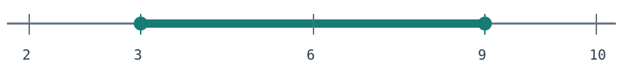
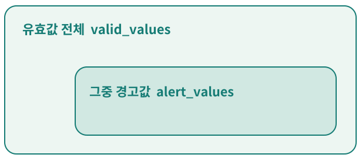

# Physical AI / Day 01: 센서값을 골라 담는 Python

2026.10.17 KST · Python 기초 · 60분 워크북

## 1쪽 · 첫 수업: 시작 안내

Physical AI에 필요한 데이터 처리의 첫 단계를 연습합니다.

### 오늘의 목표 하나

숫자와 빠진 값을 구분하고, **유효값**과 그중 **경고 대상**을 두 리스트로 돌려주는 함수를 만듭니다.

### 전체 흐름에서 오늘 다룰 곳


센서가 주는 값에는 빠진 값이나 정한 범위를 벗어난 값이 섞일 수 있습니다. 판단에 쓰기 전에 어떤 값을 받을지 규칙을 정합니다.

### 60분 진행표

| 시간 | 할 일 |
| --- | --- |
| 5분 | 확인 |
| 15분 | A 또는 B |
| 25분 | 구현 |
| 10분 | 테스트 |
| 5분 | 설명 |

2쪽에서 시작 → A는 3~4쪽, B는 5쪽 중 하나만 → 6~8쪽 공통

**A 기초 다지기**와 **B 확장 설계**는 각각 15분입니다.

- 준비: Python이 있는 PC면 충분합니다. 추가 패키지 설치는 없습니다.
- 휴대폰에서는 읽고 결과를 예상하세요. 구현·실행은 PC에서 이어가면 됩니다.
- 이 자료는 프로그래밍 연습용이며 실제 로봇의 제어·안전 알고리즘이 아닙니다.

## 2쪽 · 공통: 0~5분

### 먼저 5분만 직접 확인

확인 문제는 직접 풀어 보는 짧은 과제입니다. 성적을 매기는 시험이 아니라, 필요한 학습부터 시작하기 위한 짧은 확인입니다.

앞서 본 확인 문제를 이어갑니다. 아직 풀지 않았다면 지금 처음 시도해도 됩니다. 여기서는 함수를 완성하지 말고 생각의 출발점만 적으세요.

#### 앞서 본 입력

```python
[22, None, 0, 31, -99, 30, 85]
```

규칙: -20~80은 유효값(양 끝 포함). 유효값 중 30 이상은 경고 대상.

#### 1. 두 결과를 먼저 예상하세요

- 유효값 리스트: ______________________________
- 경고값 리스트: ______________________________

#### 2. None과 0을 같은 방식으로 처리해도 될까요

이유를 한 문장으로 적거나 말해 보세요. 확신이 없어도 괜찮습니다.

____________________________________________________________

#### 3. 오늘 사용할 경로 하나를 고르세요

| A 기초 다지기 → 3~4쪽 | B 확장 설계 → 5쪽 |
| --- | --- |
| 반복·조건·리스트를 작은 예제로 확인하고 싶다면 선택 | 기본 함수를 혼자 설계할 수 있고 규칙을 바꿔 보고 싶다면 선택 |

정답은 뒤에 싣지 않았습니다. 먼저 예상하고, 구현한 결과와 비교하세요.

## 3쪽 · A 경로: 5~13분

### 값의 의미부터 구분하기

A를 골랐다면 이 쪽과 다음 쪽을 합쳐 15분 읽습니다.

#### 1. 숫자와 값 없음은 다른 정보입니다

| 저울 기록 | 뜻 |
| --- | --- |
| `0` | 측정값으로 기록할 수 있는 숫자 |
| `None` | 값이 없음을 나타내는 표시 |

Python에서 `if x:`만 쓰면 0과 None 모두 조건을 통과하지 않습니다.

값이 없는지 확인할 때는 `x is None`처럼 뜻을 분명히 표현합니다. [1]

#### 2. 크기 비교는 숫자인지 확인한 뒤에 합니다

**None 여부 확인**(빠진 값이면 별도 처리) → **숫자인 경우에만 크기 비교**(None과 숫자를 `<` 또는 `>`로 비교하지 않기)

#### 3. 경계를 포함한다는 말은 끝값도 받는다는 뜻

별도 예시: 3부터 9까지 허용한다면 `3 <= x <= 9`



채운 점 = 끝값도 포함. `<=`는 작거나 같음.

## 4쪽 · A 경로: 13~20분

### 하나씩 보고 끝에 담기

센서 문제와 다른 작은 예제로 `for`, `if`, `append`의 역할을 봅니다.

#### 예시 · 과일 무게 기록 중 양수만 모으기

```python
weights = [120, -5, 90]
positive = []
for weight in weights:
    if weight > 0:
        positive.append(weight)
```

1. 입력 리스트입니다. 적힌 순서대로 값이 들어 있습니다.
2. 결과를 담을 빈 리스트를 먼저 만듭니다.
3. `for`가 값을 하나씩 꺼내 `weight`라는 이름으로 부릅니다.
4. `if`의 조건이 맞는 때에만 안쪽 줄을 실행합니다.
5. `append`는 현재 값을 결과 리스트의 맨 끝에 붙입니다. [2]

#### 손으로 따라가 보기

| 이번 값 | 조건 > 0 | 처리 뒤 positive |
| --- | --- | --- |
| 120 | 참 | `[120]` |
| -5 | 거짓 | `[120]` |
| 90 | 참 | `[120, 90]` |

이 예시는 한 리스트와 양수 조건만 다룹니다. 오늘 센서 문제에서는 음수도 유효할 수 있으니 조건을 그대로 옮기지 마세요. 들여쓰기는 “어느 단계 안에 있는가”를 보여 줍니다.

## 5쪽 · B 경로: 5~20분

### 규칙을 바꿔도 쓰는 함수 설계

B를 골랐다면 3~4쪽 대신 이 쪽을 사용합니다. 아직 NumPy는 필요 없습니다.

기본 규칙을 코드 안에 고정하는 대신 함수의 입력으로 받도록 설계합니다. 15분 동안 조건과 테스트를 먼저 정하고, 코드는 6쪽에서 작성하세요.

```python
def filter_readings(
    readings, min_value=-20,
    max_value=80, alert_threshold=30
):
```

#### 세 설정값의 역할

| 설정값 | 역할 |
| --- | --- |
| `min_value` | 허용하는 가장 작은 값 |
| `max_value` | 허용하는 가장 큰 값 |
| `alert_threshold` | 경고를 시작하는 값 |

#### 1. 규칙을 말로 설계하세요 · 6분

경고 기준이 허용 범위보다 낮거나 높으면 두 결과의 관계는 어떻게 될까요? 음수인 유효값도 처리되도록 판단 순서를 적으세요.

____________________________________________________________

#### 2. 바뀐 설정으로 테스트 두 개를 고르세요 · 9분

예: `min_value=-8, max_value=12, alert_threshold=-2`

경계값, None, 중복값을 섞어 입력과 예상 결과를 직접 적으세요.

범위: None 또는 유한한 정수·실수만 입력됩니다. 설정값도 유한한 수이며 `min_value <= max_value`라고 가정합니다. 잘못된 설정의 오류 처리는 오늘 범위 밖입니다.

## 6쪽 · 공통: 20~45분

### 확인 문제 1: 함수 구현하기

선택한 경로의 함수 하나만 만드세요. 2쪽 입력의 정답 코드는 제공하지 않습니다.

- A: `filter_readings(readings)`에 2쪽의 기본 규칙을 적용합니다.
- B: 5쪽의 설정값을 받는 함수로 확장합니다. 기본 설정은 A와 같습니다.

#### 입출력 약속

- 입력: None 또는 유한한 정수·실수의 리스트
- 반환: `(valid_values, alert_values)` 순서의 묶음. 두 항목은 각각 리스트입니다.

#### 두 결과는 이렇게 연결됩니다



그림은 값의 포함 관계입니다. 결과는 별도 리스트 두 개입니다.

경고값은 두 리스트 모두에 들어갑니다.

#### 완성 조건

- [ ] None과 허용 범위 밖의 값은 두 결과에 넣지 않는다.
- [ ] 각 리스트에서 원래 순서와 중복을 유지하고 입력을 바꾸지 않는다.
- [ ] 입력이 비었거나 모두 유효하지 않으면 두 빈 리스트를 반환한다.
- [ ] 매번 새 결과를 만든다. 화면 출력만 하지 말고 값을 반환한다.

#### 작성 순서

5분: 처리 단계를 글로 쓰기 → 15분: 코드 작성 → 5분: 입력 한 개를 손으로 따라가기

함수는 `def`로 시작하고 본문은 들여씁니다. 반환은 `return`을 씁니다. [3]

## 7쪽 · 공통: 45~55분

### 확인 문제 2: 예상하고 테스트하기

실행 전에 두 리스트를 적고, 실행 결과와 비교하세요. 예상값은 빈칸으로 두었습니다.

아래는 기본 설정용 테스트입니다. A와 B 모두 먼저 기본 설정으로 확인하세요.

B는 아래 여섯 개 중 네 개를 고르고, 5쪽에서 만든 두 개를 더 확인하세요.

| 확인할 것 | 입력 | 내 예상 | 실제 결과 |
| --- | --- | --- | --- |
| 경계 안과 밖 | `[-21, -20, 80, 81]` | | |
| 빠짐·0·경고 경계 | `[None, 0, 29, 30]` | | |
| 순서와 중복 | `[40, -3, 40, 12]` | | |
| 빈 입력 | `[]` | | |
| 모두 빠진 입력 | `[None, None]` | | |
| 모두 범위 밖인 입력 | `[-21, 81]` | | |

종이에 예상한 값과 `print`로 확인한 값이 같아야 합니다. PC가 없다면 “실제”는 비워 두고, 실행은 나중에 확인하세요.

#### 추가 확인 · 1분

2쪽의 원래 입력을 다시 실행해 내 예상과 비교하세요. 이어서 빈 입력으로 한 번 더 호출해, 이전 결과가 다음 호출에 남지 않는지도 확인하세요.

## 8쪽 · 공통: 55~60분

### 확인 문제 3: 내 말로 설명하기

코드와 결과를 연결해 설명하면 오늘의 한 시간이 마무리됩니다.

#### 1. 설명 세 문장

1. None과 0을 구분한 이유

   ____________________________________________________________

2. 왜 유효성을 확인한 뒤에 경고 여부를 판단했는지

   ____________________________________________________________

3. 경계값이나 빈 입력 테스트에서 확인한 점 한 가지

   ____________________________________________________________

#### 2. 보낼 것 세 가지

선택한 경로(A/B)와 함수 코드 / 테스트의 예상·실제 결과 / 위 세 문장

실행하지 않았다면 “아직 실행 전”이라고 표시하세요.

#### 막혔을 때만 보는 선택 힌트

- 값이 없을 때와 숫자일 때의 길을 먼저 나눠 보세요.
- 결과 리스트는 새 호출이 시작될 때 각각 새로 준비하세요.
- `return`은 함수를 끝냅니다. 어느 위치에 둘지 점검하세요.
- 두 리스트를 함께 돌려줄 때는 `return 첫째, 둘째` 형태를 씁니다.

### 다음으로 이어질 기반

오늘의 반복문과 조건 판단은 나중에 NumPy 배열과 “조건에 맞는 값 고르기”를 배울 때 다시 씁니다. 오늘은 Python 리스트만으로 충분합니다.

### 공식 참고 자료

1. [Python · 참/거짓 판단과 비교](https://docs.python.org/3/library/stdtypes.html#truth-value-testing)
2. [Python · 리스트와 append](https://docs.python.org/3/tutorial/datastructures.html)
3. [Python · 반복문과 함수 정의](https://docs.python.org/3/tutorial/controlflow.html)

참고 문서 확인 2026.10.17 KST
