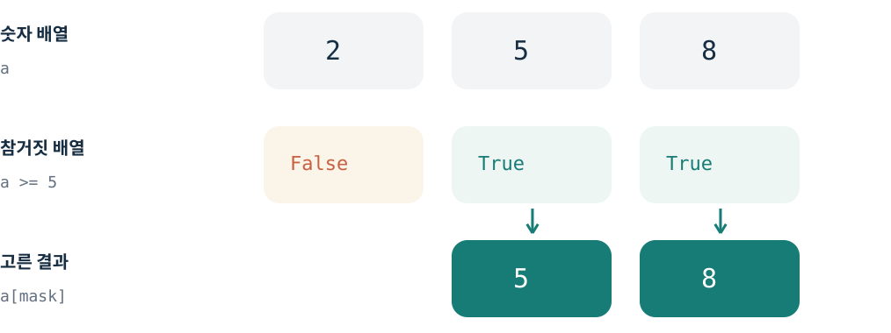
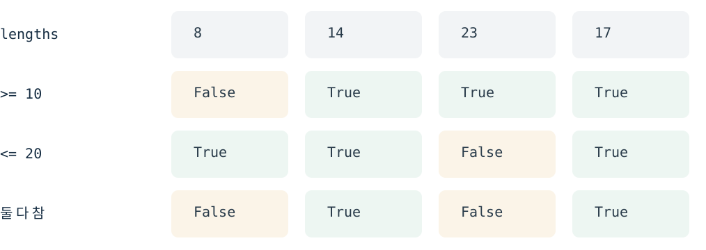
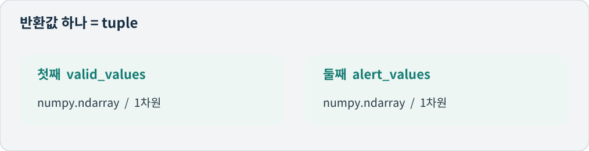
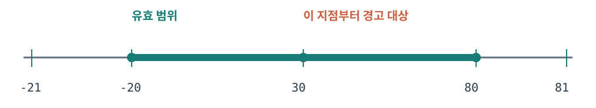

# Physical AI 2일차 NumPy 마스크로 센서값 고르기

2026.10.18 KST · 60분 워크북

## 1쪽 NumPy 마스크로 센서값 고르기

오늘의 목표

Python 리스트 함수에서 한 걸음 더 나아가, 배열 전체에 조건을 적용합니다.

**오늘 완성할 것**

**for문 없이** 조건에 맞는 값을 골라, 유효값과 경고값을
**두 NumPy 배열**로 반환하는 함수를 만듭니다.

### 오늘 새로 익힐 세 가지

1. 배열과 같은 길이의 True / False 표시를 만든다.
2. 두 조건을 괄호와 &로 묶는다.
3. 표시가 True인 자리의 값을 배열로 꺼낸다.

### 60분 진행표


5분 확인 + 15분 선택 경로 + 25분 구현 + 10분 테스트 + 5분 설명 = 60분

1~2쪽으로 시작 → A는 3~4쪽, B는 5쪽 중 하나만 → 6~8쪽 공통
**A 기초 경로**: 마스크가 낯설면 개념과 예제를 읽습니다.
**B 연습 경로**: 마스크를 설명할 수 있으면 예측과 오류 찾기를 합니다.

기존 Python 환경에서 NumPy를 사용합니다. 설치 작업은 하지 않습니다.
휴대폰에서는 읽고 기록하고, 실행은 PC에서 이어가세요.
이 자료는 데이터 처리 연습이며 실제 로봇의 제어·안전 알고리즘이 아닙니다.

---

## 2쪽 먼저 함수의 약속 확인하기

공통 · 0~5분

입력과 기대 출력은 먼저 공개합니다. 직접 작성할 함수의 정답 코드는 싣지 않습니다.

**함수:** filter_readings(values)
**입력:** 정수·소수만 담긴 1차원 numpy.ndarray. None은 넣지 않습니다.
**반환:** tuple 하나 안에 (유효값 배열, 경고값 배열) 순서로 담습니다.

**규칙:** -20 이상 80 이하는 유효값입니다. 양 끝값도 포함합니다.
유효값 중 30 이상은 경고 대상입니다. 순서·중복은 유지하고 입력은 바꾸지 않습니다.
두 결과는 각각 1차원 ndarray이며, 숫자 자료형(dtype)은 입력과 같게 유지합니다.

### 입력과 기대 반환값 예시

```python
values = np.array([0, 29, 30, 80, 81, -20, -21])
# 기대 반환값 (구현 코드가 아닙니다)
(np.array([0, 29, 30, 80, -20]),
 np.array([30, 80]))
```

**빈 입력·전부 범위 밖인 입력:** 빈 ndarray 두 개를 tuple로 반환합니다.
각 배열의 shape은 (0,)입니다. [] 두 개로 바꾸면 반환 자료형이 달라집니다.

### 짧은 확인 후 경로 하나 고르기

np.array([2, 5, 8]) >= 5 를 계산하면
하나의 True / False가 나올까요, 세 자리의 True / False가 나올까요?
아직 실행하지 말고 한 문장으로 설명해 보세요.

기록: **\*\*\*\***\_\_**\*\*\*\***

설명이 아직 어렵다면 A(3~4쪽), 바로 설명할 수 있다면 B(5쪽).
어느 경로를 골라도 20분부터 6쪽 구현으로 합류합니다.

---

## 3쪽 마스크는 자리마다 붙인 표시

A 경로 · 5~13분

마스크(mask)는 어떤 자리를 고를지 적은 True / False 배열입니다.

### 리스트에서 배열로

```python
import numpy as np
numbers = [2, 5, 8]
a = np.array(numbers)
mask = a >= 5
```

numbers는 Python 리스트이고, a는 NumPy의 ndarray입니다.
a >= 5는 배열의 각 숫자를 5와 비교합니다. 결과도 배열입니다. [1]


숫자 3개 → 참거짓 표시 3개 → True 자리의 숫자 2개. 원래 순서는 유지됩니다.

### 자료형과 길이는 서로 다른 정보

**mask.dtype**는 bool입니다. 숫자가 아니라 참·거짓을 담았다는 뜻입니다.
**mask.shape**는 (3,)입니다. 한 줄에 세 자리가 있다는 뜻입니다.
**a[mask]**는 True인 자리의 값만 담은 ndarray입니다. [1][2]

이 수업에서는 값 배열과 마스크의 길이를 같게 맞춥니다.

---

## 4쪽 두 조건은 괄호와 &로 묶기

A 경로 · 13~20분

별도 예시: 상자 길이가 10cm 이상 20cm 이하인 기록만 골라 봅니다.

```python
lengths = np.array([8, 14, 23, 17])
fits = (lengths >= 10) & (lengths <= 20)
picked = lengths[fits]
```


같은 자리에서 두 표시가 모두 True일 때만, 합친 표시도 True가 됩니다.

**fits:** np.array([False, True, False, True])
**picked:** np.array([14, 17])
이 예시는 배열 하나를 고르는 연습입니다. 오늘 함수는 결과 배열 두 개를 반환합니다.

### 기억할 문법 두 가지

**(조건 1) & (조건 2)** 처럼 비교식 각각을 괄호로 감쌉니다.
괄호가 없으면 계산되는 순서가 의도와 달라질 수 있습니다.
**and** 는 여기서 자리별 비교를 합치는 &의 대체 표현이 아닙니다. [3]

읽는 순서: 각 조건의 표시 만들기 → 같은 자리끼리 합치기 → 값 고르기
20분이 되면 6쪽으로 넘어가세요.

---

## 5쪽 예측과 오류 찾기로 준비하기

B 경로 · 5~20분

A 대신 이 쪽을 풉니다. 아래는 출력 예측 문제라 결과를 빈칸으로 두었습니다.

### 확인 문제 1 출력 예측 · 8분

```python
a = np.array([3, 8, 5, 11])
m = (a > 4) & (a < 10)
picked = a[m]
```

실행 전에 m의 값, m.dtype, picked의 값을 각각 적으세요.
가능하면 실행해서 비교하고, 다르면 어느 자리에서 달라졌는지 표시하세요.

기록: **\*\*\*\***\_\_**\*\*\*\*** **\*\*\*\***\_\_**\*\*\*\*** **\*\*\*\***\_\_**\*\*\*\***

### 확인 문제 2 오류 찾기 · 7분

```python
b = np.array([4, 2, 10, 11])
bad_a = (b >= 4) and (b <= 10)
bad_b = b >= 4 & b <= 10
```

목표: 4와 10을 포함한 범위의 마스크 만들기
기대값: np.array([True, False, True, False]), dtype은 bool
두 잘못된 줄의 문제점을 적고 수정하세요. 필요하면 4쪽을 참고하세요.

기록: **\*\*\*\***\_\_**\*\*\*\*** **\*\*\*\***\_\_**\*\*\*\***

이 페이지의 예측 결과와 수정 코드는 시도한 뒤 확인합니다.
20분이 되면 6쪽의 실제 함수 구현으로 넘어가세요.

---

## 6쪽 확인 문제 3 센서 함수 구현

공통 · 20~45분

2쪽의 입력과 출력 약속을 만족하는 함수 하나를 작성하세요.

### 시작 전에 반환 모양 다시 확인


순서는 유효값, 경고값입니다. 둘을 담는 바깥 묶음은 tuple이고, 안쪽 두 항목은 ndarray입니다.

함수 이름은 **filter_readings**, 입력 이름은 **values**입니다.
시작 줄: **def filter_readings(values):**
함수 안에서는 for문·while문·리스트 컴프리헨션 없이 Boolean 마스크를 사용하세요.

### 완성 조건

- [ ] -20과 80은 유효값에 포함하고, 유효값 중 30부터 경고에 포함한다.

- [ ] 경고값은 유효값에도 들어간다. 범위 밖의 큰 수는 경고에 넣지 않는다.

- [ ] 원래 순서·중복·dtype을 유지하고 원본 values를 바꾸지 않는다.

- [ ] 빈 입력이나 모두 범위 밖인 입력에도 (빈 배열, 빈 배열)을 반환한다.

- [ ] 함수 밖에서 결과를 사용할 수 있도록 return으로 돌려준다.

**25분 사용법**

5분: 함수의 입출력 약속을 내 말로 적기
15분: 직접 코드 작성하기
5분: 2쪽의 예시로 실행하고 반환 타입·순서를 확인하기

---

## 7쪽 확인 문제 4 기대값과 비교하기

공통 · 45~55분

구현 검증용 기대값은 공개합니다. 실제 결과와 같으면 체크하세요.


경계값 개념도(간격 비례 아님). -20·30·80을 확인하고, 범위 밖인 81도 테스트합니다.

표의 모든 입력·결과는 np.array(...)입니다. 대괄호는 값만 줄여 쓴 것입니다.
반환값 전체는 항상 (유효값 ndarray, 경고값 ndarray) 순서의 tuple입니다.

| 입력 values       | 기대 유효값     | 기대 경고값 |
| ----------------- | --------------- | ----------- |
| [-20, 30, 80, 81] | [-20, 30, 80]   | [30, 80]    |
| [35, 0, 35, -5]   | [35, 0, 35, -5] | [35, 35]    |
| [-21, 81]         | []              | []          |
| []                | []              | []          |
| [29.5, 30.0]      | [29.5, 30.0]    | [30.0]      |

[]인 결과도 Python 리스트가 아니라 길이 0인 ndarray입니다.
빈 입력 테스트는 np.array([], dtype=int)로 만드세요. 각 출력의 shape은 (0,)입니다.

값 비교에는 np.array_equal(실제배열, 기대배열)을 쓰면 True / False 하나로 확인할 수 있습니다. [4]
추가로 type(결과), type(결과[0]), type(결과[1])과 각 dtype을 확인하세요.

---

## 8쪽 확인 문제 5 설명하고 제출하기

공통 · 55~60분

실행 결과와 코드의 뜻을 연결해 말해 보세요.

### 세 문장으로 설명

1. Boolean 마스크의 True 한 자리가 뜻하는 것
2. 조건마다 괄호를 쓰고 &로 묶은 이유
3. print로 보이는 것과 return으로 돌려주는 것의 차이

기록: **\*\*\*\***\_\_**\*\*\*\*** **\*\*\*\***\_\_**\*\*\*\*** **\*\*\*\***\_\_**\*\*\*\***

### 제출할 것

- [ ] 선택한 경로 A/B와 filter_readings 함수 코드

- [ ] 2쪽 예시와 7쪽 테스트의 실제 반환값, 타입·dtype 확인 결과

- [ ] 위 세 문장. B 경로를 골랐다면 5쪽 답도 함께 보내기

실행 전이라면 “아직 실행 전”이라고 표시하세요. 시도한 내용을 보고 다음 설명과 피드백을 맞춥니다.

**막혔을 때만 보는 힌트**

mask를 출력하면 어떤 자리를 고르는지 볼 수 있습니다.
선택한 값의 자료형은 type(...), 숫자 자료형은 .dtype으로 확인합니다.
먼저 입출력 약속이 맞는지 확인한 뒤 코드를 더 짧게 다듬어도 됩니다.

### 공식 참고 자료

- [[1] NumPy 기초와 배열](https://numpy.org/doc/stable/user/absolute_beginners.html)
- [[2] Boolean 배열로 값 고르기](https://numpy.org/doc/stable/user/basics.indexing.html#boolean-array-indexing)
- [[3] NumPy 연산자와 괄호](https://numpy.org/doc/stable/user/numpy-for-matlab-users.html)
- [[4] 배열이 같은지 확인하기](https://numpy.org/doc/stable/reference/generated/numpy.array_equal.html)

문서 확인 2026.10.18 KST

---
