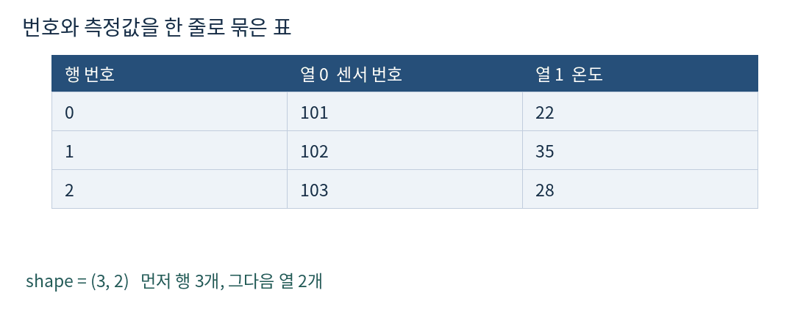
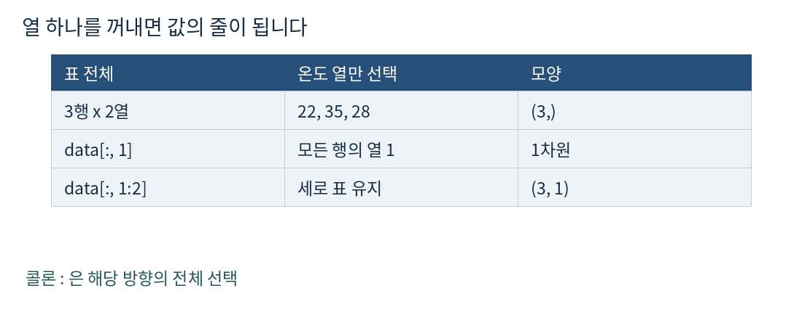
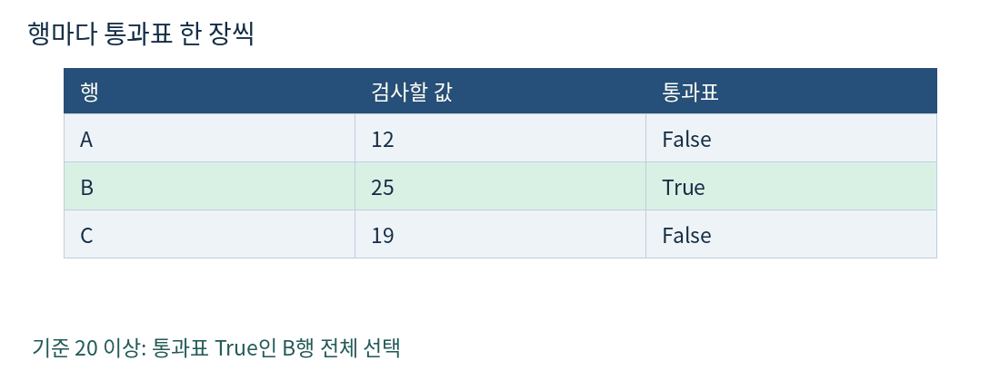
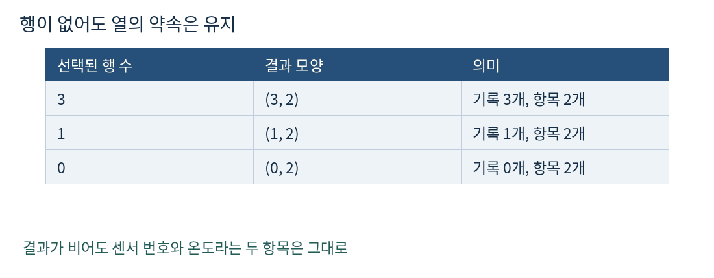
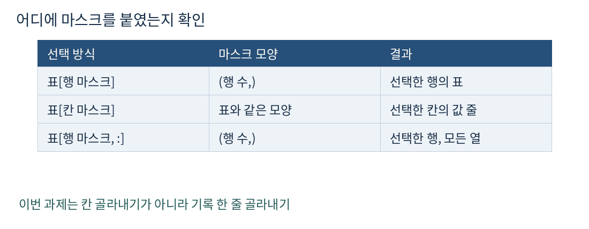

# 피지컬 AI Day 3 NumPy 행 선택

## Day 3 NumPy 표에서 필요한 행 고르기

2026-10-19 · 예상 60분 · 개발 기초

오늘은 센서 번호와 온도를 함께 담은 표에서 조건에 맞는 기록을 골라냅니다. 어제 통과한 1차원 마스크는 짧게 연결하고, 행과 열을 구분하는 방법과 결과의 모양에 집중합니다.



### 오늘 만들 결과

온도가 기준 이상인 센서의 번호와 온도를 함께 돌려주는 select_hot_rows 함수. 결과가 1개이거나 0개여도 두 열을 유지합니다.

### 60분 사용법

5분 짧은 확인 → 15분 기초 보충 또는 실습 설계 → 25분 구현 → 10분 경계 검사 → 5분 설명과 제출. 이미 아는 개념은 건너뛰어 실습 시간을 늘려도 됩니다. 지금 바로 시작하지 않아도 됩니다.

### 완료 기준

구현: 조건에 맞는 행 전체를 순서대로 반환. 설명: shape의 두 숫자와 마스크 길이를 설명. 디버깅: 칸 마스크와 행 마스크의 차이를 찾아 수정.

## 1 확인 문제로 시작하기

3~5분만 사용하세요. 어제 미리보기에서 아직 확인되지 않은 부분만 살펴봅니다. 설치 없이 기존 NumPy 환경에서 진행하세요.

```python
import numpy as np
records = np.array([[101, 22], [102, 35], [103, 28]])
```

확인 문제 1: 온도가 30 이상인 행 전체를 선택하는 코드를 작성하세요. 기대 결과는 [[102, 35]], 반환값은 NumPy ndarray, shape은 (1, 2)입니다. for 반복문을 쓰지 마세요.

확인 문제 2: 기준을 40으로 바꾸어도 두 열이 유지되게 하세요. 기대 결과는 빈 2차원 ndarray, shape은 (0, 2)입니다.

확인 문제 3: 한 행만 남았는데 shape이 (2,)가 되는 선택 방식과 (1, 2)를 유지하는 선택 방식은 무엇이 다른지 한 문장으로 설명하세요.

### 진행 선택

기초 보충: 행·열·shape가 낯설면 2~4절의 그림과 예제를 먼저 읽으세요. 실습 직행: 세 문제를 설명할 수 있으면 2~4절은 빠르게 확인하고 5절로 이동하세요. 답하지 못해도 완료로 처리하지 않으며, 오늘은 이 확인부터 이어가면 됩니다.

### 답안 원칙

원하는 입력·출력과 타입은 먼저 제시합니다. 직접 작성할 함수의 정답 코드와 확인 문제 해설은 시도 후에 제공합니다. 아래 예제는 다른 데이터로 문법을 익히는 연습입니다.

## 2 행과 열은 표의 주소

쉬운 뜻: 가로로 한 줄이 행, 세로로 같은 항목을 모은 줄이 열입니다. 생활 비유: 출석부에서 학생 한 명의 기록은 행, 이름만 모은 칸은 열입니다. 실제 용어: 2차원 배열과 인덱싱입니다.


```python
seats = np.array([[11, 12, 13], [21, 22, 23]])
print(seats.shape)  # (2, 3)
print(seats[1, 2])  # 23
```

1단계: shape의 첫 숫자 2는 행 수, 두 번째 숫자 3은 열 수입니다. 2단계: 대괄호 안의 첫 주소 1은 두 번째 행, 두 번째 주소 2는 세 번째 열입니다. 번호는 0부터 시작합니다.

```python
print(seats[0])       # [11 12 13], shape (3,)
print(seats[0:1, :])  # [[11 12 13]], shape (1, 3)
```

정수 하나로 행을 집으면 그 행 안의 값 줄이 됩니다. 구간 0:1로 선택하면 한 행짜리 표가 유지됩니다. 구간의 끝 1은 포함하지 않습니다.

## 3 검사할 열만 꺼내기

쉬운 뜻: 필요한 항목만 뽑아 검사합니다. 생활 비유: 출석부 전체를 비교하지 않고 나이 칸만 보는 것과 같습니다. 실제 용어: 열 슬라이싱과 불리언 마스크입니다.



```python
boxes = np.array([[201, 12], [202, 25], [203, 19]])
weights = boxes[:, 1]
print(weights)        # [12 25 19]
print(weights.shape)  # (3,)
keep = weights >= 20
print(keep)           # [False  True False]
```

1단계: 콜론은 모든 행입니다. 2단계: 열 1은 무게입니다. 3단계: 각 무게를 20과 비교하면 행마다 True 또는 False 한 개가 생깁니다. 이 True/False 배열이 마스크입니다.

### 모양을 소리 내어 읽기

(3,)는 숫자 3개가 있는 1차원 배열입니다. (3, 1)은 3행 1열 표입니다. 쉼표 뒤에 숫자가 없는 (3,)를 3행 1열이라고 설명하지 마세요.

## 4 마스크로 기록 전체 선택하기



```python
picked = boxes[keep]
print(picked)        # [[202  25]]
print(picked.shape)  # (1, 2)
```

마스크를 원래 표의 행 위치에 붙이면 True인 행의 모든 열이 함께 따라옵니다. 번호와 측정값의 짝을 보존하므로, 선택 후에도 어떤 장치의 기록인지 알 수 있습니다.



행 마스크 길이는 원래 표의 행 수와 같아야 합니다. 모든 값이 False면 결과는 0행인 표입니다. 오늘은 배열에 새 값을 대입하지 않고 골라내기만 하므로 입력 표를 그대로 보존하세요.

## 5 확인 문제 센서 기록 선별기

25분 실습입니다. 아래 요구사항을 만족하는 select_hot_rows(records, threshold=30)를 작성하세요. 이 함수는 경보 후보를 골라내는 데이터 연습이며 실제 장비 제어 명령은 보내지 않습니다.

### 입력과 반환 약속

records: shape (N, 2)의 NumPy 정수 배열. 열 0은 센서 번호, 열 1은 온도. N은 0 이상. threshold는 정수. None, NaN, 문자열, 잘못된 열 수는 오늘 범위에서 제외합니다.

반환: 온도가 threshold 이상인 행 전체를 담은 ndarray. shape은 항상 (K, 2). 원래 행 순서와 dtype을 유지하며 입력을 변경하지 않습니다. 센서 번호를 조건 검사에 사용하지 마세요. 중복 번호가 있어도 각 측정 행을 그대로 유지합니다.

```python
def select_hot_rows(records, threshold=30):
    # 1. 검사할 온도 열을 꺼내세요.
    # 2. 행마다 통과 여부를 만드세요.
    # 3. 해당 행 전체를 반환하세요.
    pass
```

### 먼저 볼 기대 결과

```python
records = np.array([[101, 22], [102, 35], [103, 28],
                    [104, 30], [105, -5]])
# threshold=30
# expected: [[102, 35], [104, 30]]
# shape: (2, 2), dtype: records.dtype
```

제약: for/while 반복문과 리스트 변환 없이 NumPy 선택으로 구현하세요. 아직 막히면 코드 한 줄을 완성하려 하지 말고 온도 열, 마스크, 결과의 shape을 각각 출력해 보세요.

## 6 확인 문제 경계와 오류 검사

10분 동안 아래 기대 결과와 실제 결과를 비교하세요. 빈 입력도 반드시 두 열을 갖도록 생성합니다.

```python
empty = np.empty((0, 2), dtype=int)
# np.array([]) has shape (0,), not (0, 2)
```

### 검사 A · 기본 입력

- 입력: `[[101, 22], [102, 35], [103, 28], [104, 30], [105, -5]]` (5절 기본 입력)
- 기준값: `30`
- 예상 결과 배열: `[[102, 35], [104, 30]]`
- shape: `(2, 2)`

### 검사 B · 기준값 포함 확인

- 입력: `[[1, 29], [2, 30], [3, 31]]`
- 기준값: `30`
- 예상 결과 배열: `[[2, 30], [3, 31]]`
- shape: `(2, 2)`

### 검사 C · 조건에 맞는 행 없음

- 입력: `[[1, 10], [2, 20]]`
- 기준값: `30`
- 예상 결과 배열: `[]` (원소가 없는 2차원 `ndarray`, 열 2개 유지)
- shape: `(0, 2)`

### 검사 D · 빈 입력

- 입력: `empty` — 위에서 `np.empty((0, 2), dtype=int)`로 만든 빈 2차원 배열
- 기준값: `30`
- 예상 결과 배열: `[]` (원소가 없는 2차원 `ndarray`, 열 2개 유지)
- shape: `(0, 2)`

### 검사 E · 중복 센서 번호 유지

- 입력: `[[7, 50], [7, 60]]`
- 기준값: `50`
- 예상 결과 배열: `[[7, 50], [7, 60]]` (두 행 모두 유지)
- shape: `(2, 2)`

### 검사 F · 음수 기준값 포함 확인

- 입력: `[[1, -5], [2, 0]]`
- 기준값: `-5`
- 예상 결과 배열: `[[1, -5], [2, 0]]` (두 행 모두 유지)
- shape: `(2, 2)`

### 확인 문제 오류 고치기

```python
# Intended: select full sensor rows
bad = records[records >= 30]
```

이 코드는 왜 센서 번호까지 검사하며, 결과가 표가 아닌 값의 줄이 될까요? 잘못된 마스크의 shape을 적고, 의도에 맞게 수정하세요. 정답 코드는 제출 후 확인합니다.



## 7 설명하고 제출하기

마지막 5분입니다. 통과 여부뿐 아니라 번호와 온도의 짝을 어떻게 보존했는지 짧게 설명해 주세요.

### 제출할 결과물

1. select_hot_rows 함수가 들어 있는 .py 또는 .ipynb 파일 하나.
2. 검사 A~F의 실제 결과와 각 shape.
3. 입력을 호출 전후 비교한 결과와 dtype 보존 확인.
4. 오류 코드의 문제점과 수정 내용 한 문장.

### 이해 확인

- 선택된 행이 한 개일 때 (1, 2)가 필요한 이유는 무엇인가요?
- 원래 표가 5행일 때 행 마스크에 True/False가 몇 개 있어야 하나요?
- 결과가 비었는데 (0, 2)를 유지하면 다음 처리에서 무엇이 편할까요?

### 통과 후 다음 연결

직접 구현·설명·오류 수정이 확인되면 이 단계는 반복하지 않습니다. 다음에는 여러 센서 열의 계산으로 이어갈 수 있습니다. 오늘 분량을 마치면 추가 문제를 요청하지 않는 한 여기서 끝입니다.

### 학습 자료 위치

폴더: day03-numpy-row-selection
교재: README.md 하나
그림: assets/ 폴더의 PNG 5개
풀이: 같은 폴더에 원하는 .py 또는 .ipynb 파일

### 참고 자료

커리큘럼: https://kant.spartaclub.kr/ai-physical
NumPy 공식 기초: https://numpy.org/doc/stable/user/absolute_beginners.html
NumPy 공식 인덱싱: https://numpy.org/doc/stable/user/basics.indexing.html

이 교재는 하루 60분에 맞춘 개인 학습 단위입니다. 원래 부트캠프 주차를 개인 학습 기간으로 환산하지 않습니다.
