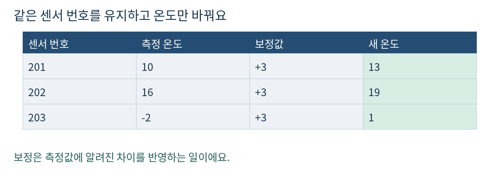
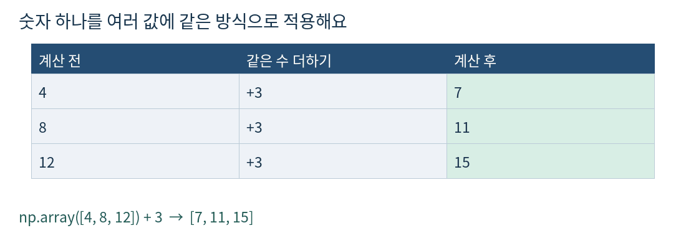
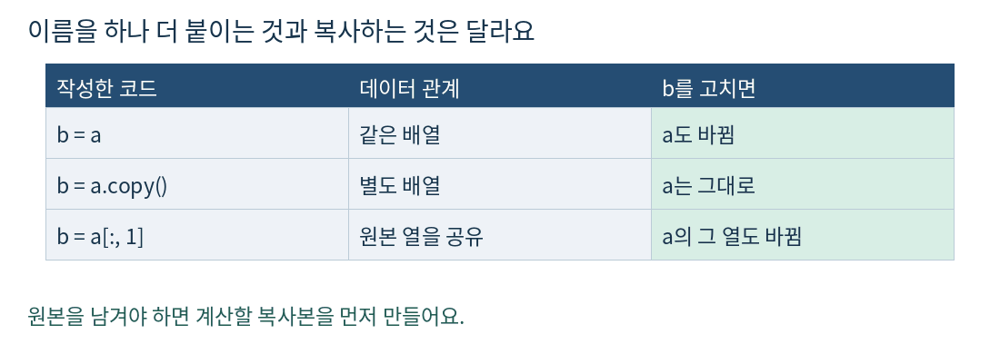
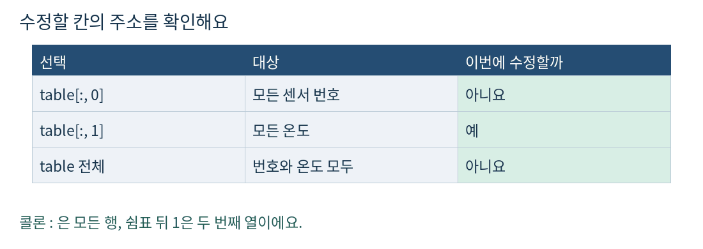
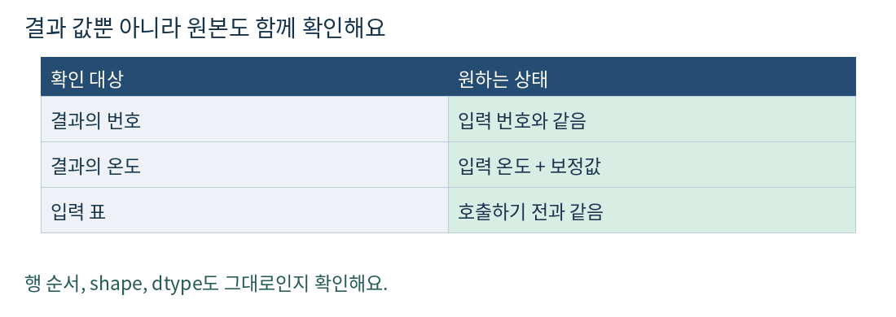

# 피지컬 AI Day 4 NumPy 온도 보정

## Day 4 NumPy 온도 보정하기

2026-10-20 · 예상 60분 · 개발 기초

오늘은 센서 번호는 그대로 두고 온도에 같은 수를 더해 볼 거예요. 원래 측정 기록도 남겨야 해요. 어제 끝낸 행 선택은 다시 시험하지 않고, 필요한 열을 계산하는 데 이어서 쓸게요.



### 실제로 어디에 쓸까요

센서가 기준 온도계보다 항상 2도 낮게 나온다고 확인했다면 측정값에 2를 더해 비교할 수 있어요. 이번에는 그런 상황을 가정한 배열 연습만 해요. 실제 장치의 오차가 늘 같다는 뜻은 아니에요.

### 오늘의 60분

- 5분: 짧은 확인 문제
- 15분: 기초 설명 또는 실습 설계 중 하나
- 25분: 온도 보정 함수 만들기
- 10분: 기대 결과와 원본 보존 검사
- 5분: 한 문장 설명과 제출

편한 시간에 시작하세요. 설치나 실물 센서는 필요 없어요.

## 1 확인 문제 먼저 짧게 해보기

어제 미리보기의 답은 아직 확인되지 않았어요. 아래 문제에 3~5분만 써 보세요. 이미 작성한 코드가 있다면 다시 풀지 말고 그 코드를 보여줘도 돼요.

```python
import numpy as np
records = np.array([[101, 28], [102, 31]])
```

센서 번호 101과 102는 그대로 두고, 온도 28과 31에 각각 2를 더한 새 표를 만들어 주세요. 원래 records는 바뀌면 안 돼요. for 반복문은 쓰지 마세요.

### 원하는 결과

```python
# 새 표: [[101, 30], [102, 33]]
# 새 표의 shape: (2, 2)
# 원래 records: [[101, 28], [102, 31]]
```

### 어느 쪽으로 이어갈까요

- 기초부터: 복사본을 만들거나 온도 열만 계산하는 방법이 막히면 2~4절을 읽어요.
- 실습부터: 직접 구현하고 원본도 그대로임을 보여줄 수 있으면 2~4절을 건너뛰고 5절부터 해요. 절약한 15분은 설계와 디버깅에 써요.

답이 없어도 통과로 처리하지 않아요. 다음에 시작할 때 이 문제부터 이어가면 돼요. 정답 코드와 문제 해설은 먼저 시도한 뒤 확인해요.

## 2 여러 값에 같은 계산하기

쉬운 뜻: 숫자들이 들어 있는 배열에 같은 계산을 한꺼번에 적는 거예요. 생활 비유: 세 사람의 점수에 보너스 3점을 똑같이 주는 일이에요. 이런 식으로 배열 단위 계산을 쓰는 것을 벡터 연산이라고 해요.



```python
scores = np.array([4, 8, 12])
bonus_scores = scores + 3
print(bonus_scores)  # [ 7 11 15]
print(scores)        # [ 4  8 12]
```

- scores에는 점수 세 개가 있어요.
- scores + 3은 각 점수에 3을 더한 새 결과를 만들어요.
- 그 결과를 bonus_scores라는 이름에 담았어요. 이 코드에서는 scores를 고치지 않았어요.

숫자 하나를 배열의 각 값에 맞춰 계산하는 것은 브로드캐스팅의 가장 간단한 경우예요. 오늘은 복잡한 모양 규칙보다 “숫자 하나를 각 값에 적용한다”까지만 익혀요.

### 잠깐 주의

번호와 온도가 함께 들어 있는 표 전체에 수를 더하면 번호까지 바뀌어요. 계산할 열을 먼저 고르는 이유예요.

## 3 원본을 남기고 복사본 고치기

쉬운 뜻: 원본과 별개로 수정할 배열을 만드는 거예요. 생활 비유: 원본 서류에 별명만 붙여도 서류가 두 장이 되지는 않아요. 복사기를 써야 별도의 종이가 생겨요. 실제 코드에서는 copy 메서드를 써요.



```python
a = np.array([10, 20])
b = a
b[0] = 99
print(a)  # [99 20]
```

b = a는 복사가 아니에요. 두 이름이 같은 배열을 가리켜서 b를 고치면 a로 읽은 값도 바뀌어요.

```python
a = np.array([10, 20])
b = a.copy()
b[0] = 99
print(a)  # [10 20]
print(b)  # [99 20]
```

a.copy()는 데이터를 복사한 별도 배열을 만들어요. 오늘은 정수 배열만 다루므로 이 방식으로 원본을 안전하게 남길 수 있어요.

## 4 고칠 열을 정확히 지정하기

표에서 모든 행의 두 번째 열을 고를 때는 table[:, 1]이라고 써요. 어제 배운 열 선택에 “새 값을 넣기”를 이어 붙여 볼게요.



```python
stock = np.array([[501, 4], [502, 7]])
print(stock[:, 1])  # [4 7]
stock[:, 1] = np.array([6, 9])
print(stock)       # [[501   6]
                   #  [502   9]]
```

여기서는 재고 표의 두 번째 열에 새 수량을 넣었어요. 왼쪽 stock[:, 1]이 값을 받을 칸을 지정해요. 오른쪽은 그 칸에 넣을 새 값이에요. 이 예제는 stock 자체를 수정해요. 오늘 함수는 원본을 남겨야 한다는 차이를 기억하세요.

### 열을 꺼내면 항상 복사본일까요

아니에요. col = stock[:, 1]처럼 기본 슬라이싱으로 꺼낸 열은 원본 데이터를 공유하는 뷰예요. col[0]에 값을 넣으면 stock도 바뀔 수 있어요. 변수 이름이 달라도 데이터가 따로 생긴 것은 아니에요.

표를 복사하는 방법과 열에 값을 넣는 방법을 따로 연습했어요. 두 방법을 어떻게 연결할지는 다음 확인 문제에서 직접 정해 보세요.

## 5 확인 문제 온도 보정 함수 만들기

25분 실습이에요. calibrate_temperatures(records, offset=2)를 작성해 주세요. 센서 번호를 보존하고 온도 열에 offset만큼 더한 새 표를 반환해야 해요.

### 입력과 반환 약속

- records는 shape (N, 2)의 부호 있는 NumPy 정수 배열이에요. 열 0은 센서 번호, 열 1은 온도예요. N은 0 이상이에요.
- offset은 Python 정수예요. 이번 검사에서는 온도 -100~100, 보정값 -10~10만 써요. 입력 dtype은 int16, int32, int64 중 하나예요.
- 반환값은 새 ndarray예요. 입력의 행 순서, 센서 번호, shape, dtype을 그대로 유지해요. 입력 배열의 값은 바꾸지 않아요.
- 반복문과 리스트 변환은 쓰지 않아요. 잘못된 입력, 실수, NaN, 정수 범위를 넘는 계산은 오늘 범위에서 제외해요.

### 기본 입력과 기대 결과

```python
records = np.array([[101, 28], [102, 31], [103, -4]],
                   dtype=np.int16)
# offset=2
# 기대 결과: [[101, 30], [102, 33], [103, -2]]
# shape: (3, 2), dtype: int16
# 원본: [[101, 28], [102, 31], [103, -4]]
```

```python
def calibrate_temperatures(records, offset=2):
    # 원본을 남기려면 무엇을 준비해야 할까요?
    # 어느 열을 계산하고 어디에 저장할까요?
    # 완성한 새 표를 반환하세요.
    pass
```

막히면 원본, 계산할 배열, 온도 열을 차례로 출력해 보세요. 위 주석은 구현 순서를 생각하는 힌트예요.

## 6 확인 문제 기대 결과와 비교하기

10분 동안 아래 검사와 7절의 오류 찾기를 진행해요. 각 입력은 np.array(..., dtype=np.int16)으로 만들고 함수를 호출하세요. D만 아래처럼 빈 표로 만들어요.

```python
empty = np.empty((0, 2), dtype=np.int16)
```

- 검사 A: 5절 기본 입력, offset=2 → [[101, 30], [102, 33], [103, -2]], shape (3, 2).
- 검사 B: [[7, 20]], offset=-3 → [[7, 17]], shape (1, 2).
- 검사 C: [[9, 0], [9, -5]], offset=0 → [[9, 0], [9, -5]], shape (2, 2). 값이 같아도 새 배열이어야 해요.
- 검사 D: empty, offset=2 → 빈 표, shape (0, 2).
- 검사 E: [[8, -10], [2, 10]], offset=3 → [[8, -7], [2, 13]], shape (2, 2). 번호 순서를 정렬하지 않아요.



### 원본 확인 방법

```python
before = records.copy()
result = calibrate_temperatures(records, 2)
print(np.array_equal(records, before))  # 기대: True
print(result.dtype == records.dtype)   # 기대: True
print(result is records)               # 기대: False
```

A는 int32와 int64로도 한 번씩 실행하세요. 결과 값과 dtype을 함께 확인하면 돼요.

## 7 확인 문제 오류 찾고 제출하기

아래는 일부러 잘못 작성한 두 코드예요. 각각 별도의 새 입력으로 실행하세요. 두 코드의 문제를 한 문장씩 설명하고, 5절 함수에서 같은 실수를 피했는지 확인해 주세요.

```python
# 오류 A
records = np.array([[5, 10], [6, 20]])
result = records + 2
```

기대 결과는 [[5, 12], [6, 22]]예요. 실제 결과에서 어떤 열이 불필요하게 바뀌었나요?

```python
# 오류 B
records = np.array([[5, 10], [6, 20]])
result = records
result[:, 1] += 2
```

기대하는 원본은 [[5, 10], [6, 20]]예요. 실행 뒤 records를 출력해 보세요. result라는 새 이름을 붙였는데도 왜 원본이 바뀌었을까요?

### 이해 확인

- 온도만 2도 올려야 하는데 센서 번호도 2씩 커졌어요. 계산 대상을 어디로 좁혀야 할까요?
- 원본을 남기려면 b = a와 b = a.copy() 중 무엇을 골라야 할까요? 이유도 한 문장으로 적어 주세요.

### 마지막 5분 제출

- day04-numpy-calibration에 함수가 들어 있는 .py 또는 .ipynb 하나를 저장해 주세요.
- A~E의 실제 결과, shape, dtype과 원본 보존 검사 결과를 남겨 주세요.
- 오류 A와 B의 원인 설명을 함께 보내 주세요. 저장했다고 알려주면 검사할게요.

직접 구현과 설명이 확인되면 이 단계를 반복하지 않아요. 센서마다 다른 보정값 적용은 필요할 때 다음 단계로 연결하고 오늘 필수 과제로 추가하지 않아요.

## 8 참고와 오늘의 마무리

### 완료 기준

- 구현: 온도만 바뀐 새 표를 반환하고 번호와 원본을 보존했어요.
- 설명: 변수 이름만 바꾸는 것과 데이터를 복사하는 것의 차이를 말할 수 있어요.
- 디버깅: 번호가 바뀌거나 원본이 바뀐 원인을 찾아 수정할 수 있어요.

### 다시 볼 자료

NumPy 공식 문서에서 복사와 뷰, 배열에 숫자 하나를 적용하는 계산을 확인할 수 있어요. 지금 문서를 모두 읽을 필요는 없어요.

복사와 뷰
https://numpy.org/doc/stable/user/basics.copies.html

브로드캐스팅
https://numpy.org/doc/stable/user/basics.broadcasting.html

기준 커리큘럼
https://kant.spartaclub.kr/ai-physical

### 파일 구성

- README.md: 이 교재 전체
- assets/: 설명 그림 PNG 5개
- 풀이: 직접 작성한 .py 또는 .ipynb

PDF와 Markdown은 같은 설명과 문제를 담고 있어요. 확인 문제의 정답 코드와 해설은 제출 후에 제공해요. 오늘은 시뮬레이션용 숫자 데이터만 사용하며, 새로운 설치나 유료 장비는 필요 없어요.

이 과정은 하루 60분에 맞춘 개인 학습이에요. 원래 종일 부트캠프의 주차를 개인 학습 기간으로 바꾸어 계산하지 않아요.
