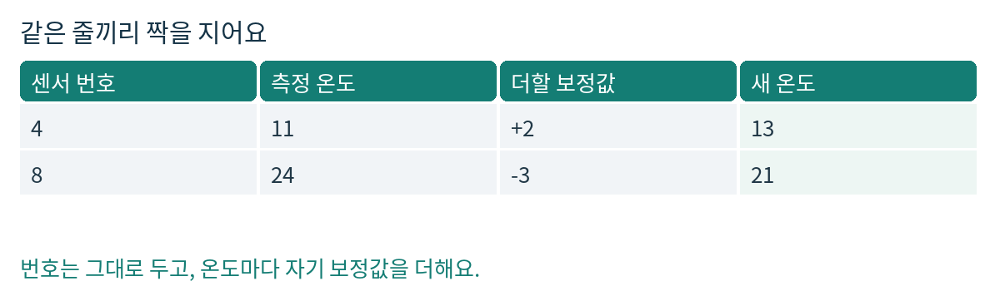
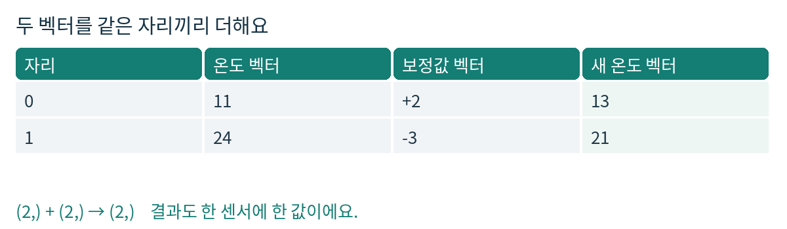
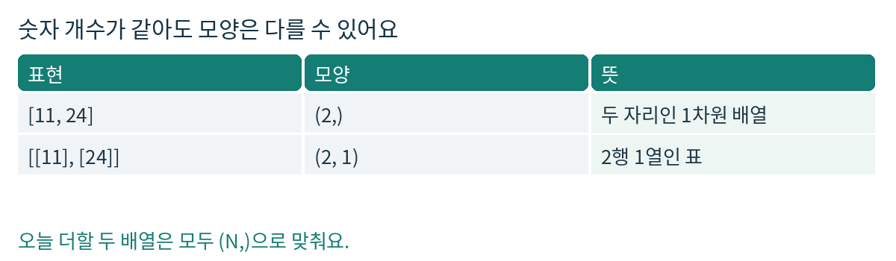
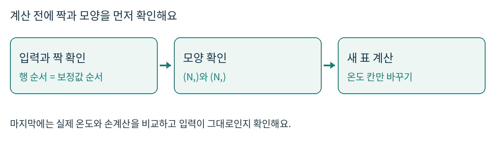

# 피지컬 AI Day05 센서별 NumPy 온도 보정

## Day05 센서마다 다른 온도 보정값 적용하기

2026년 10월 21일 Asia/Seoul · 헴의 피지컬 AI · 정확히 60분

헴, 오늘은 센서마다 다른 수를 더해 볼 거예요. 어제 확인한 온도 열 선택과 원본 보존은 다시 시험하지 않고 그대로 이어 써요. 새로 익힐 것은 “각 온도와 그 센서의 보정값을 같은 자리에 놓기”예요.

### 오늘 할 수 있게 될 일

- 길이가 같은 온도 배열과 보정값 배열을 자리마다 더해요.
- 온도 열의 (N,)과 한 열짜리 표의 (N, 1)을 구별해요.
- 값과 shape가 맞아도 센서와 보정값의 짝이 틀릴 수 있음을 설명해요.

### 확인 문제 0 새 기술 체크 0분부터 4분

> 아직 다음 쪽을 읽거나 실행하지 말고 먼저 예상만 적어 주세요. 이 체크는 Day04 재시험이 아니에요. 모르는 칸은 “아직 모르겠음”이라고 적어도 괜찮아요.

```python
import numpy as np
temps = np.array([28, 33, 19], dtype=np.int64)
offsets = np.array([-2, 1, 4], dtype=np.int64)
```

- 1. 같은 자리끼리 더하면 새 온도 세 개가 어떻게 될까요? 계산식도 적어 볼래요?
- 2. temps의 첫째와 둘째 자리만 바꾸면 offsets도 바꿔야 할까요? 이유는요?
- 3. temps.shape는 (3,)예요. offsets가 [[-2], [1], [4]]처럼 (3, 1)이라면 그대로 더해도 한 센서에 한 값이 나올까요? 예상과 이유를 적어 주세요.

세 답을 도움 없이 설명할 수 있으면 다음 쪽의 실습 경로로 가요. 한 가지라도 막히거나 확신이 없으면 기초 경로로 가요. 이 선택은 숙달 판정이 아니며, 실제 구현과 설명을 보고 확인할 거예요.

---

## 1 오늘의 60분과 입력 약속

| 시간 | 할 일 |
| --- | --- |
| 0-4분 · 4분 | 새 기술 체크 0을 먼저 기록 |
| 4-12분 · 8분 | 아래에서 기초 또는 실습 경로 선택 |
| 12-22분 · 10분 | 작은 예시와 계산 순서 확인 · 3-4절 |
| 22-38분 · 16분 | 확인 문제 A 함수 작성 · 5절 |
| 38-48분 · 10분 | 확인 문제 B 새 입력 세 개 검사 · 6절 |
| 48-55분 · 7분 | 확인 문제 C 오류 관찰과 설명 · 7절 |
| 55-60분 · 5분 | 설명과 파일 저장 및 제출 · 8절 |

### 4분 뒤에는 경로 하나만 골라요

- 기초 경로: 4-9분에는 2절의 뜻과 그림을 읽고, 9-12분에는 보정값이 누구의 것인지 손가락으로 짝지어 봐요.
- 실습 경로: 4-6분에는 2절의 모양 주의만 확인하고, 6-12분에는 5절 입력의 각 행과 보정값을 연결한 메모를 써요. 정답을 맞혔다고 가정하지 않아요.
- 두 경로 모두 12분에 3절로 합류해요. 빨리 끝난 시간은 같은 문제의 예상과 실제를 비교하는 데 써요. 추가 숙제는 없어요.

### 오늘만 쓰는 작은 데이터 약속

- records: shape (N, 2)인 NumPy 배열. N은 1 이상이고 열 0은 센서 번호, 열 1은 정수 온도예요.
- offsets: shape (N,)인 NumPy 배열. records와 같은 행 순서로 놓인 정수 보정값이에요. 센서 번호를 자동으로 찾아 연결하지 않아요.
- 두 입력의 dtype은 모두 np.int64예요. 센서 번호는 1-999, 온도는 -1000~1000, 보정값은 -100~100으로 제한해요. 이 범위의 합은 int64를 넘지 않아요.
- 빈 입력, 실수, NaN, 잘못된 길이, 범위 밖 숫자를 처리하는 함수는 오늘 만들지 않아요. 먼저 입력이 약속에 맞는지 확인하고 실행해요.

---

## 2 보정값은 각 센서에게 붙인 숫자

### 쉬운 뜻에서 시작해요

어떤 센서가 기준보다 늘 2도 낮게 나온다고 확인했다면 +2를 더해 맞춰 볼 수 있어요. 다른 센서가 늘 3도 높다면 -3을 더하겠죠. 이렇게 더할 차이를 보정값, 영어로 offset이라고 불러요.

생활 비유로는 사람마다 다른 쿠폰을 한 장씩 받는 것과 비슷해요. 모두 같은 할인액을 받는 게 아니라, 자기 쿠폰의 숫자를 적용해야 해요.


센서 4에는 +2, 센서 8에는 -3을 적용한 작은 예시

### 기술 이름은 원소별 연산

원소는 배열 안의 값 하나예요. 같은 자리의 값끼리 계산하는 것이 원소별 연산이에요. 첫째 온도는 첫째 보정값, 둘째 온도는 둘째 보정값과 짝을 지어요. NumPy의 같은 shape 배열 덧셈은 이렇게 동작해요. [2]

### 모양은 값의 배치 정보예요

shape는 열 이름이 아니에요. 표의 (N, 2)는 N행 2열이라는 뜻이고, 온도만 꺼낸 (N,)은 N개의 값이 있는 1차원 배열이라는 뜻이에요. dtype은 정수나 실수처럼 값을 담는 자료형을 말해요.

> 여기서는 이미 알려진 차이를 더하는 연습만 해요. 실제 센서의 모든 오차를 고치는 일반적인 보정법은 아니에요. 보정값 추정, 잡음 제거, 장비 제어는 하지 않아요.

---

## 3 작은 예시로 배열의 모양 보기

아래 숫자는 확인 문제와 다른 연습용이에요. 전체 함수를 복사하지 말고 “같은 자리끼리 더한다”는 한 동작을 봐 주세요.

```python
temps = np.array([11, 24], dtype=np.int64)
changes = np.array([2, -3], dtype=np.int64)
new_temps = temps + changes
print(new_temps)        # [13 21]
print(new_temps.shape)  # (2,)
```


11은 +2와, 24는 -3과 짝을 지어 각각 13과 21이 돼요

### 꺼내는 방법이 모양을 바꿔요

```python
demo = np.array([[4, 11], [8, 24]], dtype=np.int64)
print(demo[:, 1].shape)    # (2,)
print(demo[:, 1:2].shape)  # (2, 1)
```


두 온도만 고른 1차원 배열과 2행 1열인 표를 비교해요

[:, 1]은 두 번째 열의 값들을 1차원으로 꺼내요. [:, 1:2]는 한 열짜리 2차원 표를 남겨요. 오늘은 온도와 보정값 모두 (N,)으로 맞춰요. [3]

> (N, 1)과 (N,)을 더하면 NumPy가 크기 1인 방향을 펼쳐 (N, N)으로 계산할 수 있어요. 이것이 여기서 주의할 브로드캐스팅이에요. 오류 없이 계산됐다는 사실만으로 맞는 결과는 아니에요. [2]

---

## 4 구현 전에 작은 계획 세우기


입력의 순서와 모양을 확인하고 새 표의 온도 칸만 계산해요

### 말로 먼저 적어 보세요

- 어느 온도에 어느 보정값이 연결되는지 확인해요. 같은 행 순서라는 약속이 먼저예요.
- 더할 두 배열의 shape를 나란히 출력해요. 둘 다 (N,)이어야 해요.
- 어제 익힌 원본 보존 방식으로 새 표를 준비하고, 그 표의 온도만 바꿔요.
- 손으로 예상한 온도와 실제 결과를 비교해요. 번호와 순서는 건드리지 않아요.

### 비교 도구의 아주 작은 예시

```python
guess = np.array([6, 9], dtype=np.int64)
actual = np.array([6, 9], dtype=np.int64)
print(np.array_equal(guess, actual))  # True
```

np.array_equal은 모양과 값이 모두 같으면 True를 줘요. dtype이 같은지까지 확인하려면 dtype을 따로 비교해요. “내가 먼저 쓴 예상”과 “실행한 결과”를 나란히 남기는 데 쓸 수 있어요. [4]

### 이번에도 유지할 약속

새 표는 입력과 같은 shape와 dtype을 가져야 해요. 입력 records와 offsets는 바꾸지 않고, 센서 번호와 행 순서를 그대로 둬요. 이는 이미 확인한 Day04 기술을 새 계산 안에서 유지하는 조건이지, Day04 전체를 다시 푸는 과제가 아니에요.

> 정답 코드와 확인 문제의 답은 이 교재에 없어요. 예상 기록을 먼저 남기고 시도한 결과를 보내 주세요. 막히면 완성 코드를 받기보다 “지금 두 shape가 무엇인지”부터 함께 볼 거예요.

---

## 5 확인 문제 A 센서별 보정 함수 만들기

22-38분 · 16분. calibrate_per_sensor(records, offsets)를 작성해 주세요. 각 행의 온도에 같은 자리의 보정값을 더한 새 표를 반환해야 해요. for/while 반복문과 리스트 변환은 쓰지 않아요.

```python
records = np.array(
    [[61, 27], [12, 18], [48, 35], [5, -3]],
    dtype=np.int64
)
offsets = np.array([-2, 3, 0, 1], dtype=np.int64)

def calibrate_per_sensor(records, offsets):
    pass
```

### 먼저 예상하기 3분

- 센서 번호 옆에 “기존 온도, 자기 보정값, 예상 새 온도”를 직접 적어 주세요.
- 반환할 표의 shape와 dtype도 먼저 적어 주세요. offsets[0]은 어느 센서에게 붙는 값인가요?

### 직접 구현하기 8분

- 온도만 바뀐 새 ndarray를 반환하세요. 원본 records와 offsets를 수정하지 마세요.
- 센서 번호, 행 순서, 전체 shape, dtype을 유지하세요.
- 모든 센서에 같은 보정값 하나만 쓰거나, 센서 번호로 offsets를 인덱싱하면 안 돼요. offsets는 지금 행 순서에 맞춰 주어졌어요.

### 실제 결과 남기기 5분

- 함수를 호출한 결과와 예상 표를 비교하고, 서로 같았는지 적어 주세요.
- 온도 열과 offsets의 shape를 출력해 저장해 주세요.
- 호출 전후 두 입력이 그대로인지, 결과의 번호·shape·dtype이 유지되는지도 확인해 주세요.

> 빈 day05.ipynb에 예상을 적는 Markdown 셀과 코드를 적는 코드 셀을 직접 추가해 주세요. 처음 제공되는 노트북에는 풀이도 실행 결과도 없어요.

---

## 6 확인 문제 B 다른 입력에서도 짝 유지하기

38-48분 · 10분. 각 검사는 계산 전에 예상 온도를 적고, A에서 작성한 같은 함수를 호출해 비교해 주세요. 아래에는 입력만 있어요. 기대 답을 베끼는 검사가 아니에요.

### B1 한 센서만 있을 때

```python
records_b1 = np.array([[7, -6]], dtype=np.int64)
offsets_b1 = np.array([4], dtype=np.int64)
```

센서가 하나여도 두 입력의 모양 약속을 유지해 주세요. 보정값을 숫자 4 하나가 아니라 배열 [4]로 준 이유를 한 문장 적어 볼래요?

### B2 보정값이 모두 0일 때

```python
records_b2 = np.array([[9, 0], [2, 22]], dtype=np.int64)
offsets_b2 = np.array([0, 0], dtype=np.int64)
```

값이 같게 나오더라도 새 표를 반환한다는 약속은 같아요. 함수 호출 뒤 입력이 그대로인지 함께 기록해 주세요.

### B3 행 순서가 달라졌을 때

```python
records_b3 = np.array(
    [[12, 18], [61, 27], [48, 35], [5, -3]],
    dtype=np.int64
)
# offsets_b3는 헴이 직접 만들어요.
```

A와 같은 센서들이지만 앞의 두 행만 자리를 바꿨어요. 각 센서의 보정값 자체는 A와 같아요. 이 표에 맞는 offsets_b3를 직접 만들고 계산해 주세요. 센서 번호별로 A의 결과와 비교해 보세요.

### 네 가지를 한 줄씩 남겨요

- B1, B2, B3마다: 예상 온도 → 실제 온도 → 일치 여부.
- 각 결과의 shape와 dtype, 두 입력이 바뀌었는지 여부.
- B3에서 보정값의 순서를 바꿨거나 유지한 이유.
- 시간이 끝나면 미완료 항목을 표시하고 넘어가요. 미완료를 통과로 적지는 않아요.

---

## 7 확인 문제 C 오류를 눈으로 잡기

48-55분 · 7분. 아래 코드는 일부러 잘못된 계산을 보여 줘요. 먼저 결과의 shape를 예상하고, 실행 후 실제 shape와 값을 관찰해 주세요. 완성한 A 함수와 별도 셀에서 실험해요.

```python
probe = np.array(
    [[15, 10], [26, 20], [37, 30]], dtype=np.int64
)
steps = np.array([1, -2, 3], dtype=np.int64)
wrong = probe[:, 1:2] + steps
print(probe[:, 1:2].shape, steps.shape, wrong.shape)
print(wrong)
```

- C1. 센서 세 개에게 하나씩 필요한 결과와 비교하면 wrong은 무엇이 이상한가요? 두 입력 모양과 실제 결과 모양을 말해 주세요.
- C2. 온도만 뽑는 부분을 고쳐 한 센서에 한 값만 나오게 해 주세요. 바꾼 코드와 다시 실행한 shape를 남겨요.

### shape가 맞아도 틀릴 수 있어요

C3. B3의 바뀐 행 순서에 A의 offsets를 그대로 넣었다고 해 볼게요. 코드가 실행되고 결과 shape도 맞다면, 그걸로 올바르다고 할 수 있을까요? 센서 한 개를 골라 원래 받아야 할 보정값과 실제 받은 보정값을 비교해 주세요.

### 이해 확인 내 말로 이야기하기

- “보정값 네 개가 있어”라는 말과 “센서 네 개에 맞는 순서로 있어”라는 말은 어떻게 다를까요?
- 온도 배열과 보정값 배열의 shape가 둘 다 (4,)이면, 왜 이번에는 결과도 온도 네 개가 될까요?
- 우리 코드가 센서 번호를 보고 보정값을 자동으로 찾는 건가요, 아니면 어떤 약속을 믿고 계산하는 건가요?

> 모르는 설명을 억지로 채우지 않아도 돼요. “어느 부분까지는 알겠고 어디부터 헷갈린다”라고 남기면 다음 피드백의 출발점이 돼요.

---

## 8 저장하고 오늘 배운 것 확인하기

55-60분 · 5분. 아래 기록을 day05.ipynb에 모으고 저장한 뒤 알려 주세요. 60분이 끝나면 추가 과제를 붙이지 않고 여기서 멈춰요.

### 제출 체크리스트

- [ ] 첫 4분의 체크 0 예상과 고른 경로
- [ ] A의 함수 코드, 손으로 쓴 예상 표, 실제 결과
- [ ] A와 B1-B3의 shape·dtype·입력 보존 기록
- [ ] C의 수정 전후 shape와 코드, 짝이 어긋나는 이유
- [ ] 이해 확인의 내 말 설명과 아직 막힌 부분

### 무엇을 보고 완료라고 할까요

| 기준 | 확인할 증거 |
| --- | --- |
| 구현 | A와 B에서 행별 보정이 맞고, 원본·번호·순서·shape·dtype 약속을 지킴 |
| 설명 | 같은 자리끼리 계산한다는 뜻과 보정값 순서가 중요한 이유를 말함 |
| 디버깅 | (N, 1)과 (N,)의 혼합 문제를 관찰·수정하고, shape만으로 짝을 보장할 수 없다고 설명함 |

실행 기록과 설명이 확인되면 이 단계를 또 반복하지 않아요. 아직 결과가 없으면 “미확인”으로 남기고 그 지점에서 이어가요. Python이나 OpenCV 경험만으로 통과를 가정하지 않아요.

### 파일 구성

```text
day05-numpy-sensor-offsets/
  README.md
  day05.ipynb
  assets/
    01-sensor-pairs.png
    02-shapes.png
    03-before-after.png
    04-workflow.png
```

README.md와 PDF는 같은 설명·문제·그림을 담아요. Markdown의 그림은 assets/ 상대경로를 써요. ZIP에는 위 폴더와 빈 노트북이 있고, PDF는 별도 파일로 제공해요. 기존 NumPy 환경만 쓰며 설치·유료 도구·실물 센서는 필요 없어요.

### 출처와 개인 진도

[1] KANT 피지컬 AI 과정의 Python·NumPy 기초를 참고해 오늘의 배열 연습을 골랐어요. 종일 부트캠프의 주차를 헴의 날짜별 진도에 대응시키지는 않아요. 확인일은 2026-10-21 KST예요.
https://kant.spartaclub.kr/ai-physical

[2] NumPy Broadcasting
https://numpy.org/doc/stable/user/basics.broadcasting.html
[3] NumPy Indexing on ndarrays
https://numpy.org/doc/stable/user/basics.indexing.html
[4] NumPy array_equal
https://numpy.org/doc/stable/reference/generated/numpy.array_equal.html

---
