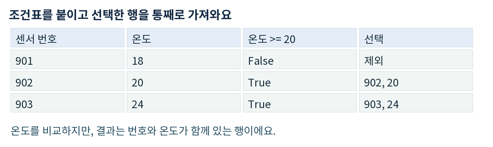
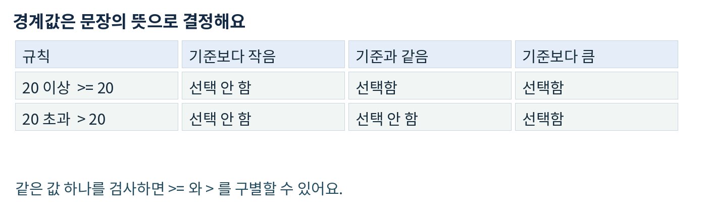
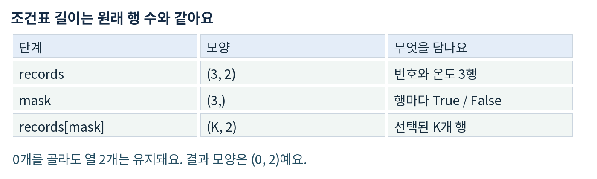

# Day06 조건에 맞는 센서만 고르기

2026년 10월 23일 · 헴의 피지컬 AI · 60분 학습안

Day05에서 센서별 보정과 원본 보존을 확인했어요. 오늘은 보정을 다시 만들지 않아요. 이미 준비된 온도표에서 기준 이상인 행만 골라, 점검할 센서 목록을 만드는 단계예요.

### 목표와 실제 활용

온도 비교 결과를 True/False로 만들고, 그 조건표로 센서 번호와 온도를 함께 꺼낼 수 있어요. 로봇의 여러 측정값 중 확인할 항목을 추리는 연습이에요. 여기의 기준은 학습용이며 실제 장비의 안전 기준이 아니에요.

### 확인 문제 0 시작 확인 3분

day06.ipynb에 코드 셀을 하나 만들어요. 각 행은 [센서 번호, 온도] 순서예요. 아래 데이터를 그대로 넣고, 실행 전에 주석 두 줄로 답해요. 모르면 “모르겠음”이라고 적고 기초 경로로 가면 돼요.

```python
import numpy as np
probe = np.array([[71, 8], [25, 10], [63, 12]])
# 0-1: 온도가 10 이상인 센서 번호 = ...
# 0-2: True/False 조건표로 행을 고르는 코드 = ...
```

답안을 아직 제공하지 않아요. 0-1은 번호 목록, 0-2는 코드 한 줄을 주석에 적어요. 이 문제의 예상 결과를 다른 형식의 배열로 제출할 필요는 없어요.

### 경로 하나만 선택해요

기초 경로: 익숙하지 않으면 1-2절(PDF 2-3쪽)을 읽고 예시를 실행해요. 실습 직행: 조건표를 이미 쓸 수 있으면 1-2절 설명은 건너뛰고 3절의 A(PDF 4쪽)부터 시작해요. 실제 코드로 능력이 확인되면 같은 개념을 다시 시험하지 않아요.

60분 배분: 시작 확인 3분 → 기초와 예시 또는 A 먼저 시도 12분 → A 구현 20분 → B 검사 12분 → C 오류 설명 8분 → 저장과 제출 5분. 먼저 끝나면 기존 결과를 점검하고 마쳐도 돼요. 즉시 공부하거나 시간을 채울 필요는 없어요.

---

## 1 조건표는 남길 행에 붙이는 표시

### 쉬운 뜻과 생활 비유

조건에 맞으면 남기고 아니면 빼는 일이에요. 장보기 목록에서 “지금 필요한 물건”에 체크하고, 체크된 물건만 새 목록에 옮기는 것과 비슷해요.

실제 용어는 불리언 마스크(Boolean mask)예요. True는 조건에 맞음, False는 맞지 않음이에요. 마스크를 사용해 값을 고르는 것을 불리언 인덱싱이라고 해요. [1]


센서 901은 제외하고 902와 903의 전체 행을 선택하는 예시

### 비교와 선택은 서로 다른 단계예요

첫째, 온도를 기준과 비교해 표시를 만들어요. 둘째, 그 표시를 원래 표에 적용해 전체 행을 꺼내요. 온도를 비교했다고 온도만 반환하는 것은 아니에요.

```python
온도 열 → 기준과 비교 → True/False 조건표
원래 표 + 조건표 → 번호와 온도를 함께 선택
```

원래 배열을 바꾸는 대입은 하지 않아요. 오늘 쓰는 records[mask]는 고른 값들을 담은 새 배열을 반환해요. [1]

### 이상과 초과

“이상”은 같은 값도 포함하므로 >=를 써요. “초과”는 같은 값을 포함하지 않으므로 >를 써요. 코드에 넣기 전에 문제 문장을 먼저 확인해요.


20 이상은 20을 포함하고 20 초과는 20을 제외하는 비교

---

## 2 작은 예시를 세 단계로 실행하기

아래는 설명용 예시예요. 확인 문제 A와 숫자가 달라요. 기초 경로에서만 새 코드 셀에 복사해 실행해요. 예시 출력은 학습 설명이며 확인 문제의 정답이 아니에요.

```python
demo = np.array([[901, 18], [902, 20], [903, 24]])
threshold = 20
```

### 1단계 비교할 온도만 꺼내요

```python
temps = demo[:, 1]
print(temps)
# [18 20 24]
```

### 2단계 행마다 조건을 확인해요

```python
mask = temps >= threshold
print(mask)
# [False  True  True]
```

18 >= 20은 False, 20 >= 20과 24 >= 20은 True예요. 배열 비교는 값마다 판단해서 불리언 배열을 만들어요.

### 3단계 표시가 True인 전체 행을 꺼내요

```python
picked = demo[mask]
print(picked)
# [[902  20]
#  [903  24]]
print(picked.shape)  # (2, 2)
```


원래 표와 조건표와 결과의 모양 비교

K는 선택된 행 수예요. 조건에 맞는 센서가 하나도 없으면 K=0이에요. []라는 출력만 보고 열까지 사라졌다고 생각하지 말고 shape도 확인해요.

---

## 3 확인 문제 A 점검 대상 함수 만들기

작성 위치: day06.ipynb의 새 코드 셀. 셀 첫 줄에 # A라고 쓰고 아래 입력과 함수 틀을 넣어요. 함수 이름과 입력 데이터, 기준값은 바꾸지 않아요.

```python
# A
records = np.array([
    [14, 29], [82, 30], [37, 34],
    [6, -2], [51, 30]
], dtype=np.int64)
limit = 30

def select_hot_sensors(records, limit):
    # 여기에 구현
    pass
```

### 반드시 만족해야 하는 조건

1. 온도가 limit 이상인 행만 반환해요.
2. 결과는 NumPy 배열이며 [센서 번호, 온도] 두 열을 유지해요.
3. 남은 행은 입력에서 등장한 순서를 유지해요. 정렬하지 않아요.
4. 입력 records의 값은 바꾸지 않아요.
5. 선택된 행이 없어도 결과 shape는 (0, 2)예요.
6. 이번에는 for문 대신 불리언 마스크를 사용해요.

### 입력 약속과 자유롭게 정해도 되는 부분

records는 shape (N, 2), dtype np.int64인 배열이고 N은 1 이상이에요. 센서 번호는 1-999, 온도와 limit는 -1000부터 1000까지의 정수예요. 잘못된 입력, NaN, 빈 입력의 예외 처리는 이번 범위가 아니에요.

자유 선택: 함수 안 변수 이름, 빈 줄, 주석 표현. 필수 유지: 위 데이터, 함수 이름, >= 의미, 반환 형식과 순서. 임의 숫자로 필수 검사를 대신하지 않아요.

### 제출할 실행 결과

```python
before = records.copy()
result = select_hot_sensors(records, limit)
print(result)
print(result.shape)
print(np.array_equal(records, before))
```

이 셀의 코드와 실행 출력을 저장해요. 손으로 예상 값을 덧붙이는 과제는 없어요. 막히면 온도 열 → 조건표 → 전체 행 선택의 세 단계를 각각 print해 봐요. 함수 정답 코드는 시도 후에 제공해요.

---

## 4 확인 문제 B 경계와 빈 결과 검사

작성 위치: day06.ipynb의 새 코드 셀. # B라고 적고 아래 고정 데이터를 복사해요. A에서 만든 함수를 그대로 호출해요. 새 함수를 만들거나 A를 특정 데이터에만 맞추지 않아요.

```python
# B
cases = {
    "B1": np.array([[41, 9], [42, 10], [43, 11]], dtype=np.int64),
    "B2": np.array([[55, -3], [56, 4]], dtype=np.int64),
    "B3": np.array([[91, 15], [12, 10]], dtype=np.int64)
}
limit = 10  # 세 경우에 공통으로 적용
```

각 경우마다 함수 결과, 결과 shape, 입력이 바뀌었는지 확인하는 출력까지 남겨요. 반복문으로 한 번에 검사하거나 호출 코드를 세 번 적어도 돼요. 여기서는 검사 방법만 자유이고 입력 숫자와 limit는 고정이에요.

### 반드시 확인할 관찰 지점

B1: 기준 바로 아래, 기준과 같음, 기준 바로 위를 비교해요.
B2: 조건에 맞는 행이 없을 때 값과 shape를 함께 봐요.
B3: 센서 번호가 크기순이 아니어도 입력 순서를 유지하는지 봐요.

### 기록 형식 예시

아래는 별도 장난감 데이터의 기록 방식만 보여 줘요. B의 답이 아니에요. 결과는 print 출력으로 남기고, 짧은 관찰은 같은 셀의 주석 한 줄로 적어요.

```python
# 예시: 입력 [[7, 2]], 기준 1로 검사한 기록
# 예시 관찰: 번호 7이 남고 shape는 (1, 2), 원본은 같음
```

실제 제출에는 # B1 관찰: ..., # B2 관찰: ..., # B3 관찰: ...를 적어요. “원본은 같음”이라고 쓰기 전에 np.array_equal로 확인해요. 앞에서 증명한 복사 개념을 다시 설명할 필요는 없어요.

### 결과가 다르면

함수 안에서 limit 대신 고정 숫자를 쓰지 않았는지, >= 대신 >를 쓰지 않았는지, 조건표를 온도 배열에만 적용하지 않았는지 차례로 살펴봐요. 모든 검사가 실제로 맞았는지는 풀이를 받은 뒤 확인해 줄게요.

---

## 5 확인 문제 C 번호가 사라진 코드 고치기

작성 위치: day06.ipynb의 새 코드 셀. 아래 코드를 그대로 실행한 뒤 고친 코드는 같은 셀 아래에 추가해요. 원래 코드를 지우지 않으면 전후 비교가 쉬워요.

```python
# C
sample = np.array([[44, 16], [19, 21], [73, 25]])
values = sample[:, 1]
flag = values >= 21
wrong = values[flag]
print("before:", wrong, wrong.shape)
```

요구사항: 온도가 21 이상인 센서의 번호와 온도를 두 열짜리 배열로 반환해야 해요. 위 코드는 실행 오류가 없어도 이 요구사항을 만족하는지 확인해요.

### 고칠 부분과 제출 형식

1. wrong을 만드는 줄을 대신할 코드 한 줄을 작성해 fixed에 저장해요.
2. print("after:", fixed, fixed.shape)를 실행해요.
3. 같은 셀에 아래 주석 두 줄을 자기 말로 완성해요.

```python
# C-설명: 기존 코드에서 빠진 정보는 ...
# C-이유: 조건표를 ...에 적용해야 하기 때문
```

### 이해 확인

day06.ipynb의 마지막 코드 셀에 주석 두 줄만 적어요.

```python
# 이해 1: >=를 >로 바꾸면 ...인 온도의 선택이 달라진다.
# 이해 2: mask의 True 하나는 원래 표의 ...를 선택한다.
```

### 완료 기준

구현: A 함수가 계약을 지키고 B1-B3을 통과해요.
설명: “이상”의 경계와 True의 뜻을 자기 말로 말해요.
디버깅: C의 전후 결과에서 빠진 센서 번호를 복구해요.
확인은 실제 코드와 출력을 보고 해요. 저장만 하거나 답이 없다고 숙달로 처리하지 않아요.

### 제출과 다음 단계

day06.ipynb 하나에 A, B, C와 마지막 설명을 저장해 보내 주세요. 이론은 이미 알면 예시 셀은 없어도 돼요. 끝까지 못 했으면 마지막으로 실행한 셀과 막힌 점 한 줄만 보내도 그곳부터 이어가요. 추가 과제는 없고, 정답과 해설은 시도 뒤에 제공해요.

### 출처와 범위

[1] NumPy 공식 문서 · Boolean array indexing
https://numpy.org/doc/stable/user/basics.indexing.html#boolean-array-indexing

[2] KANT Physical AI 기준 커리큘럼
https://kant.spartaclub.kr/ai-physical
개발 기초 중 NumPy 적용 단계예요. 부트캠프 주차를 개인 학습 기간으로 환산하지 않아요. 문서 확인일 2026-10-23 KST.

---
