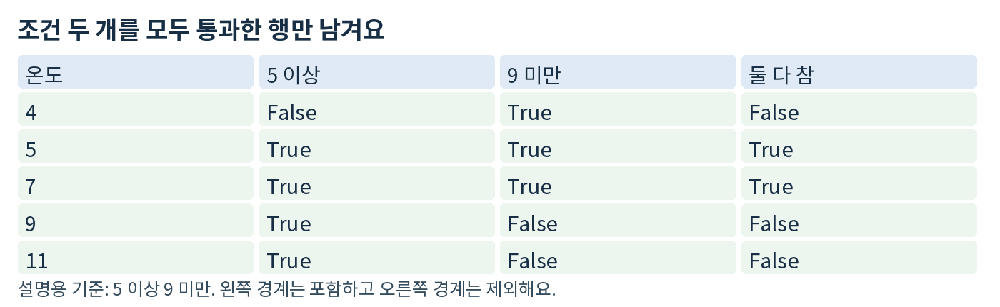
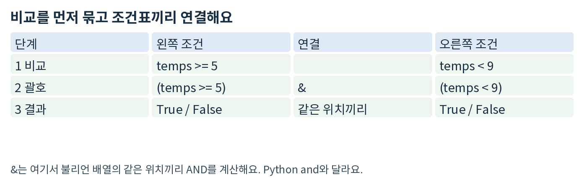
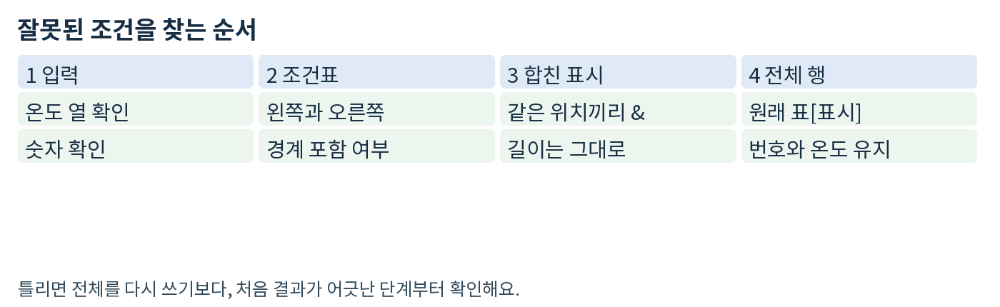

# Day07 두 조건으로 온도 범위 고르기

2026년 10월 25일 · 헴의 피지컬 AI · 최대 60분

Day06의 전체 행 선택과 원본 보존은 실제 풀이로 확인했어요. 오늘은 그 내용을 다시 시험하지 않고, 아래·위 경계를 함께 적용하는 부분만 이어가요. 어젯밤 preview와 같은 확인 문제예요. 이미 풀었다면 다시 풀지 말고 기존 코드를 보내 주세요.

### 목표와 실제 활용

두 조건을 모두 만족하는 측정값만 골라요. 예를 들어 로봇 센서 기록에서 분석할 온도 구간만 추릴 수 있어요. 숫자는 학습용이며 실제 장비의 안전 기준이 아니에요.

### 확인 문제 A preview 이어서 3분에서 5분

빈 day07.ipynb를 열고 코드 셀 하나를 추가해요. 아래 고정 입력을 복사하고 함수의 pass 부분만 구현해요. 각 행은 [센서 번호, 온도]예요.

코드

```python
import numpy as np

records = np.array([
    [104, 18], [102, 20], [107, 26],
    [101, 30], [109, 33]
])

def pick_range(records, low, high):
    pass

result = pick_range(records, 20, 30)
print(result)
print(result.shape)
```

조건: low 이상 high 미만인 전체 행을 반환해요. 센서 번호·온도 두 열과 입력 순서를 유지하고 원본은 바꾸지 않아요. for문 대신 NumPy 조건표를 사용해요. 결과가 없으면 shape는 (0, 2)예요.

같은 코드 셀 맨 아래에 주석 한 줄을 적어요: # A-설명: 선택된 행은 두 조건을 ...
답은 코드 / 실제 실행 출력 / 설명 한 줄이에요. 예상 답이나 정답 코드는 지금 제공하지 않아요.

### 필요한 경로만 골라요

기초 설명부터: 막히면 2-3쪽 예시를 읽고 A로 돌아와요. 실습 바로: A를 바로 구현할 수 있으면 2-3쪽은 건너뛰고 B와 C로 확인해요. 답이 없으면 다음에는 A에서 이어가며 새 과제를 더하지 않아요.

## 1 두 개의 체크 표시를 합치기

### 쉬운 뜻

조건 하나가 아니라 두 조건에 모두 맞아야 남기는 방법이에요. 첫 조건에 맞더라도 두 번째에 맞지 않으면 제외해요.

### 생활 비유

장보기에서 “5천 원 이상이면서 9천 원 미만”인 물건만 고르는 것과 같아요. 5천 원은 포함하고 9천 원은 제외해요. 가격 대신 센서 온도를 비교하면 오늘의 코드가 돼요.

### 실제 용어

각 비교 결과는 불리언 마스크예요. 두 마스크를 같은 위치끼리 &로 묶으면 논리 AND가 돼요. 둘 다 True인 자리만 True예요. 이 문서에서는 이렇게 합친 표시를 복합 불리언 마스크라고 부를게요. [1]


설명용 온도 다섯 개를 두 조건으로 비교한 표

### 짧은 문장을 작은 조건으로 바꾸기

“5 이상”은 temps >= 5, “9 미만”은 temps < 9예요. 두 판단을 따로 만들고 마지막에 합치면 실수를 찾기 쉬워요.

코드

```python
left = temps >= 5
right = temps < 9
mask = left & right
```

위 코드는 설명용 조각이에요. 바로 실행하려면 다음 쪽에서 temps를 먼저 만들어요. mask가 True인 위치의 전체 행을 꺼내는 일은 Day06에서 익힌 방식 그대로예요.

## 2 설명용 예시를 작은 단계로 실행하기

기초 경로에서만 새 코드 셀에 실행해요. A와 다른 숫자이며, 아래 출력은 설명용 예시의 결과예요. 예시 셀은 제출 필수가 아니에요.

### 1단계 온도 열을 꺼내요

코드

```python
demo = np.array([
    [901, 4], [902, 5], [903, 7],
    [904, 9], [905, 11]
])
temps = demo[:, 1]
print(temps)
```

실행 출력

```text
[ 4  5  7  9 11]
```

### 2단계 두 조건을 합쳐요

코드

```python
left = temps >= 5
right = temps < 9
mask = left & right
print(left)
print(right)
print(mask)
```

실행 출력

```text
[False  True  True  True  True]
[ True  True  True False False]
[False  True  True False False]
```

### 3단계 True인 전체 행을 꺼내요

코드

```python
picked = demo[mask]
print(picked)
print(picked.shape)
```

실행 출력

```text
[[902   5]
 [903   7]]
(2, 2)
```

두 조건을 한 줄로 쓸 때는 각각 괄호로 감싸요. mask = (temps >= 5) & (temps < 9)처럼 써요. 괄호로 비교 범위를 분명하게 만드는 것이 중요해요. [1]

## 3 확인 문제 B 경계만 짧게 검사하기

A가 막혔다면 먼저 A를 완성해요. 작성 위치는 day07.ipynb의 새 코드 셀이고 첫 줄은 # B예요. 아래 고정 데이터와 경계를 그대로 써요. 함수는 A의 pick_range를 재사용해요.

코드

```python
# B
cases = {
    "B1": np.array([[61, 9], [42, 10],
                    [73, 14], [24, 15]]),
    "B2": np.array([[85, 2], [16, 18]]),
    "B3": np.array([[97, 14], [38, 10]])
}
low, high = 10, 15
```

### 각 사례에서 남길 결과

각 B1-B3에 대해 결과 배열과 shape를 출력해요. np.array_equal로 실행 전후 입력이 같은지도 한 번씩 확인해요. 검사 코드를 반복문으로 묶거나 세 번 호출하는 방식은 자유예요. 입력 숫자와 low, high는 바꾸지 않아요.

### 기록할 주석은 세 줄만

코드

```python
# B1-관찰: 아래 경계와 같은 값은 ... / 위 경계와 같은 값은 ...
# B2-관찰: 선택된 행 수는 ... / shape는 ...
# B3-관찰: 결과의 센서 번호 순서는 ...
```

주석 작성 예: # 관찰: 출력에서 번호 8 다음에 번호 3이 나왔다.
이것은 적는 형식만 보여 주는 별도 예시예요. B3의 답이 아니에요. 실행한 결과를 보고 위 세 줄을 완성하면 돼요.

### 입력 약속과 자유 선택

records는 shape (N, 2)의 정수 NumPy 배열이며 N은 1 이상이에요. low와 high는 정수이고 low < high예요. NaN, 잘못된 입력, 빈 입력의 예외 처리는 이번 범위가 아니에요. 함수 안 변수 이름과 주석 표현은 자유예요.

이미 증명한 복사 개념을 길게 설명할 필요는 없어요. 이번 확인의 중심은 아래 경계 포함, 위 경계 제외, 두 조건을 동시에 적용했는지예요. B의 정답 출력은 제출 후 비교해요.

## 4 확인 문제 C and 오류 고치기


불리언 배열에서 각 비교를 괄호로 묶고 &로 연결하는 구조

작성 위치: 새 코드 셀에 # C라고 쓰고 아래를 그대로 실행해요. 이 코드는 오류 관찰용이에요. 오류가 나도 노트북 전체가 망가진 것은 아니에요.

코드

```python
# C
probe = np.array([[54, 3], [17, 6], [88, 8]])
temps = probe[:, 1]
bad = (temps >= 4) and (temps < 8)
```

### 고칠 부분과 제출 형식

1. 오류 메시지의 마지막 줄을 같은 셀 아래 주석으로 옮겨 적어요.
2. 별도 새 코드 셀에서 bad 줄을 고친 코드를 fixed_mask에 저장해요.
3. print(probe[fixed_mask])와 print(fixed_mask)를 실행해요.
4. 같은 셀 아래 주석 두 줄을 완성해요. 오류를 지우려고 입력 숫자를 바꾸지 마세요.

코드

```python
# C-원인: Python and는 이 배열을 ...로 판단하려 해서 오류가 난다.
# C-수정: 각 원소끼리 두 조건을 합치기 위해 ...를 사용했다.
```

막히면 2쪽의 두 조건표와 이번 코드의 연결 기호를 비교해요. 오류 메시지에서 배열의 참·거짓을 언급하는 부분을 찾아보세요. 구체적인 수정 코드와 오류 원인 해설은 시도 후에 확인해 줄게요.

### 괄호도 함께 확인해요

비교 두 개를 한 줄로 썼다면 각각 괄호로 묶었는지 확인해요. 먼저 비교하고 나중에 조건표를 합친다는 의도를 코드에 드러내요. 연산 기호만 바꾸고 괄호를 빼면 다른 계산 순서가 적용될 수 있어요.

## 5 이해 확인과 제출 안내


온도 열부터 각 조건표와 합친 조건표 그리고 선택 행까지 보는 오류 점검 순서

### 이해 확인

마지막 코드 셀에 주석 한 줄만 적어요. A에서 이 뜻을 이미 정확히 설명했다면 다시 쓰지 않아도 돼요.

코드

```python
# 이해: low <= 온도 < high에서 아래 경계는 ...이고 위 경계는 ...이다.
```

### 완료 기준

구현: A 함수가 low 이상 high 미만의 전체 행을 순서대로 반환해요.
검사: B의 세 입력에 결과·shape·원본 비교 출력이 남아 있어요.
설명: 두 조건이 모두 참이어야 한다는 뜻과 두 경계의 차이를 말해요.
디버깅: C의 오류를 고치고 왜 바꿨는지 한 줄로 설명해요.

### 시간은 최대 60분이에요

A 시작 확인 5분 → 기초 설명·예시 또는 A 직접 구현 15분 → A 마무리 10분 → B 검사 12분 → C 오류 수정 10분 → 이해 확인·저장 8분. 이미 능력이 확인된 부분은 생략해요. 빨리 끝나면 시간을 채우거나 새 과제를 추가할 필요가 없어요.

### 제출할 것은 day07.ipynb 하나

A, B, C의 코드와 실행 출력, 지정 주석을 저장해 보내 주세요. 미완성이면 마지막으로 실행한 셀과 막힌 점 한 줄만 보내도 돼요. 정답·해설은 시도 후 제공하고, 수정할 부분만 보충해요. 지금 일어나거나 바로 공부할 필요는 없어요.

### 출처와 학습 범위

[1] NumPy 공식 문서 Boolean array indexing
https://numpy.org/doc/stable/user/basics.indexing.html#boolean-array-indexing

[2] KANT Physical AI 기준 커리큘럼
https://kant.spartaclub.kr/ai-physical
공식 자료 확인일: 2026-10-25 KST. 개발 기초의 NumPy 적용 단계예요. 부트캠프 주차를 개인 학습 기간으로 환산하지 않아요. 실물 장비·GPU·새 설치 없이 기존 NumPy 환경에서 연습해요.
