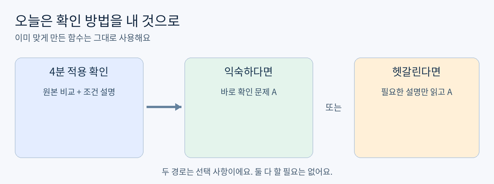
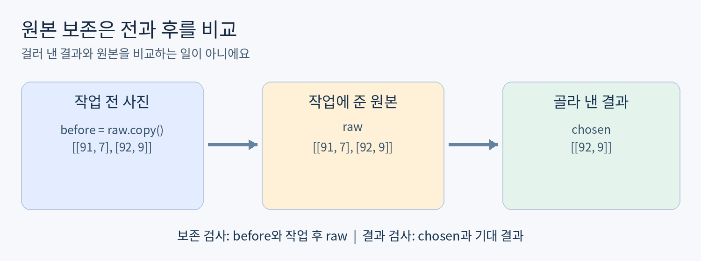
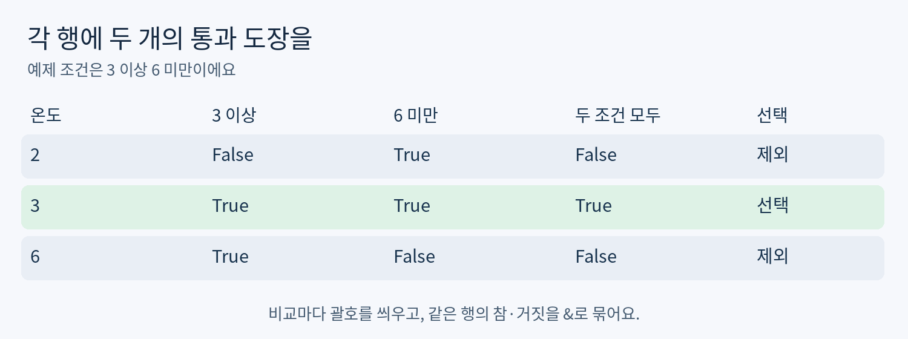

# Day08 원본을 지키며 조건 선택 확인하기

2026년 10월 26일 / 피지컬 AI 개인 학습 / 최대 60분

오늘 목표는 새 문법을 많이 배우는 것이 아니라, 내가 만든 함수의 결과와 원본 보존을 따로 확인하는 거예요. Day07의 조건 선택 함수는 이미 테스트를 통과했으므로 다시 처음부터 만들지 않아요.

지난 보완에서는 비교 코드와 일부 설명을 우사기가 채웠어요. 오늘은 짧은 적용 확인만 해보고, 익숙하면 바로 실습으로 가요. 파일이 완성됐다는 사실과 혼자 설명할 수 있다는 것은 구분해요.



그림 1. 짧게 확인한 뒤 필요한 경로 하나만 고르기

### 60분 사용법

- 0~4분: 확인 문제 0으로 오늘의 시작 위치 찾기.

- 4~15분: 헷갈리는 부분만 3~4쪽에서 읽기. 이미 익숙하면 예제를 건너뛰고 A를 먼저 시작하기.

- 15~40분: 확인 문제 A에서 결과와 원본을 따로 검증하기.

- 40~50분: A가 끝났으면 선택 연습 B. 아직이면 A만 이어가기.

- 50~60분: 설명 한두 문장과 저장 결과 정리하기. 일찍 끝났으면 남은 시간을 채울 필요는 없어요.

이 자료는 기상 알림이 아니에요. 충분히 쉬고 편할 때 시작하세요. 60분에 다 못 끝내면 마지막 작업 위치만 적고 멈춰도 돼요. 오늘 못 한 문제를 새 숙제로 쌓지 않아요.

## 확인 문제 0 시작 위치 찾기

먼저 4분만 해봐요. 다음 쪽의 예제는 이 확인을 시도한 뒤 읽으세요. 정답 코드와 채점 해설은 제출 후에 제공해요.

### 작성 위치와 셀

day08-numpy-check-and-select/day08.ipynb를 열어요. 제공된 노트북은 빈 파일이에요. 이미 작성한 셀이 있다면 지우지 말고 뒤에 이어 쓰세요. 아래 번호는 오늘 새로 만들 셀의 순서예요.

- 셀 1 / 코드: import numpy as np를 실행하고 아래 두 줄의 입력을 적어요.

```python
probe = np.array([[61, 2], [72, 5], [83, 8]])
selected = probe[probe[:, 1] >= 5]
```

- 셀 2 / Markdown: 실행 전 원본을 보관하려면 언제 무엇을 복사해야 할지, 작업 뒤에는 어떤 두 배열을 비교해야 할지 두 문장으로 적어요. 코드를 실행하는 셀이 아니에요.

- 셀 2의 다음 줄: (probe[:, 1] >= 3) & (probe[:, 1] < 7)에서 & 대신 and를 쓰기 어려운 이유를 내 말로 한 문장 적어요. 오류를 일부러 실행할 필요는 없어요.

이 문제는 결과 배열을 맞히는 시험이 아니에요. 원본 보존을 확인하는 대상과 배열 조건을 묶는 뜻을 확인해요. 답이 바로 생각나면 아래 예제를 읽지 않고 5쪽 A로 가도 돼요.

### 기초 보충 또는 실습 직행

- 원본을 무엇과 비교하는지 헷갈리면 3쪽만 읽고 A로 가요.

- and와 &가 헷갈리면 4쪽만 읽고 A로 가요.

- 둘 다 설명할 수 있다면 A로 바로 가요. 같은 개념의 긴 시험은 다시 하지 않아요.

### 형식 예시

셀 2에는 0-1과 0-2 번호를 붙여 한국어로 적어요. 0-1은 복사 시점과 비교 대상, 0-2는 &와 and의 차이를 담으면 돼요. 아래는 답안 형식을 보여주는 별개의 예시예요.

형식 예시: 입력 [[901, 1], [902, 2]]를 관찰했다면, “예시 1. 센서 번호는 901과 902이고 온도는 1과 2이다.”처럼 배열을 보고 내 말로 설명해요.

실제 답에는 예시 숫자가 아니라 위 probe와 내 비교 대상을 사용하세요. 이 예시에는 확인 문제 0의 정답을 넣지 않았어요.

## 필요할 때만 보는 원본 보존

쉬운 뜻: 작업하기 전과 후의 원본이 같은지 살펴봐요. 생활 비유: 책을 정리하기 전에 찍은 사진과 정리 뒤의 책장을 비교하는 거예요. 실제 용어: copy는 별도 복사, array_equal은 배열의 모양과 값이 같은지 확인하는 함수예요.



그림 2. 원본 보존 검사와 결과 검사는 비교 대상이 달라요

### 작은 예제부터

```python
raw = np.array([[91, 7], [92, 9]])
before = raw.copy()
chosen = raw[raw[:, 1] >= 8]
print(chosen)
print(np.array_equal(before, raw))
```

```text
[[92  9]]
True
```

1. before는 고르기 작업 전의 사진이에요. 2. chosen은 골라 낸 결과라 행 수가 줄어도 괜찮아요. 3. before와 작업 후 raw를 비교해야 원본이 변했는지 알 수 있어요.

```python
print(np.array_equal(raw, chosen))
```

```text
False
```

위 False는 원본이 변했다는 증거가 아니에요. 원본 전체와 일부만 고른 결과가 다르다는 뜻이에요. 질문이 다르면 비교 대상도 달라져요.

참고: before = raw라고만 쓰면 두 이름이 같은 배열을 가리켜요. 작업 전 상태를 따로 남길 때는 .copy()를 사용해요. 오늘은 정수 배열만 다뤄 NaN과 실수 오차 비교는 범위에서 제외해요. [2]

## 필요할 때만 보는 두 조건 묶기

쉬운 뜻: 같은 행이 두 검사에 모두 통과해야 해요. 생활 비유: 입장권도 있고 나이 조건도 맞아야 들어가는 두 개의 문이에요. 실제 용어: 각 행의 True 또는 False를 모은 것을 불리언 마스크라고 해요.



그림 3. 같은 행의 두 결과를 &로 묶는 예제

```python
demo = np.array([[11, 2], [22, 3], [33, 6]])
temp = demo[:, 1]
left = temp >= 3
right = temp < 6
mask = left & right
print(mask)
print(demo[mask])
```

```text
[False  True False]
[[22  3]]
```

조건을 한 줄로 쓰면 (temp >= 3) & (temp < 6)이에요. 각 비교의 괄호를 유지해요. 이 예제의 &는 두 불리언 배열을 원소별로 묶어요. [3]

Python and는 배열의 각 행을 따로 처리하지 않아요. 여러 원소가 있는 배열 전체를 하나의 참 / 거짓으로 판단하려 하면 의미가 모호해 오류가 나요. np.logical_and도 원소별 결합을 지원하지만 오늘은 이미 익힌 &만 사용해요. [3]

demo[mask]는 True인 행의 모든 열을 선택해요. 센서 번호가 들어 있는 첫째 열도 같이 남아요. 불리언 인덱싱으로 얻은 결과는 원본과 별도 배열이에요. [4]

이미 이 부분을 설명할 수 있으면 예제를 다시 입력할 필요는 없어요. 바로 확인 문제 A로 이동하세요.

## 확인 문제 A 결과와 원본을 따로 검사하기

목표는 검증 코드 작성이에요. Day07에서 완성한 pick_range(records, low, high)를 그대로 가져와 사용해요. 함수를 새로 만들거나 고칠 필요는 없어요.

### 고정 입력과 실행 조건

```python
sample = np.array([
    [104, 4], [215, 5], [326, 9], [437, 10]
])
low, high = 5, 10
```

첫째 열은 센서 번호, 둘째 열은 온도예요. low 이상 high 미만인 전체 행을 원래 순서대로 고르는 계약은 Day07과 같아요. A에서는 위 숫자 / 행 순서 / low / high를 바꾸지 마세요.

### 작성할 셀

- 셀 3 / 코드: Day07의 pick_range 함수만 그대로 복사해요. import는 셀 1에 있으므로 중복해도 상관없어요.

- 셀 4 / 코드: 고정 입력을 만들고, 작업 전 원본을 별도 보관해요. 함수를 호출한 뒤 결과 배열 / shape / 원본 보존 여부 / 기대 결과 일치 여부를 순서대로 출력하세요. 검사 코드에서 for문을 써도 되지만 필요하지는 않아요.

- 셀 5 / Markdown: 원본 보존 비교와 결과 정답 비교에서 각각 어떤 배열을 비교했는지 두 문장으로 써요.

### A에서 요구하는 실행 결과

```text
[[215   5]
 [326   9]]
(2, 2)
True
True
```

위 출력은 구현 과제의 계약이에요. 숨겨진 예측 문제의 정답이 아니에요. 공백 간격은 달라도 되지만 배열 값 / 순서 / shape와 두 참 / 거짓 값은 같아야 해요. 두 True는 각각 원본 보존과 기대 결과 일치를 뜻해요. 정답 코드는 아직 제공하지 않아요.

### 선택한 경계를 바꾸지 않고 확인하기

기대 결과는 직접 np.array로 만들 수 있어요. 5는 포함하고 10은 제외하는 조건을 유지하세요. 함수가 돌려준 결과와 기대 결과를 비교하는 것이며, 입력 전체와 결과를 비교하는 것이 아니에요.

## 확인 문제 B 선택 연습과 오늘의 제출

A를 스스로 확인했다면 B로 이어가요. A가 아직 헷갈리면 B는 건너뛰어도 오늘 실패가 아니에요. B는 다음 단계로 강제 진도를 나가기 위한 필수 시험이 아니에요.

### 확인 문제 B 고른 행의 개수도 알려주기

작은 새 도구 하나만 더해요. 배열 shape의 첫째 값은 행 개수예요. 예를 들어 모양이 (3, 2)라면 행은 3개예요. arr.shape[0]은 그 첫째 값만 가져와요. [5]

```python
extra = np.array([[58, 12], [69, 15], [70, 18]])
low_b, high_b = 12, 18
```

셀 6 / 코드에 위 입력을 쓰고, 같은 pick_range로 고른 행과 행 개수를 출력하세요. 함수의 반환 형식은 바꾸지 말고, 반환된 배열의 shape에서 개수를 구해요. 번호와 온도 모두를 세는 .size와 혼동하지 마세요. B의 입력값과 경계도 고정이에요.

```text
[[58 12]
 [69 15]]
2
```

B의 함수 호출 / 개수 계산 코드는 제출 후 설명해요. 원하면 나만의 숫자로 추가 실험해도 되지만 위 고정 사례의 기록은 남겨주세요.

### 이해 확인과 제출할 결과물

- 셀 5 마지막에 “비교 결과가 False이면 무엇이 다르다는 뜻인지 먼저 확인해야 한다”를 내 사례로 한 문장 설명해요. A 설명과 겹치면 한 문장으로 합쳐도 돼요.

- day08.ipynb에 확인 문제 0의 짧은 답, A 코드 / 실행 출력 / 설명을 저장하세요. B는 했을 때만 포함해요.

- 이 대화에 “Day08 A 완료” 또는 “A의 원본 비교에서 멈춤”처럼 실제 상태를 알려주세요. 코드를 다시 붙이거나 같은 테스트를 여러 번 적을 필요는 없어요.

제출 형식 예: “Day08 A 완료 / 원본 보존 True / 기대 결과 True / B는 건너뜀”. 이것은 상태 보고의 형식 예시이며, 실행하지 않았다면 True라고 적지 마세요.

### 다음 자료에 반영할 것

검사 대상과 조건 묶기를 혼자 설명하면 이 부분은 생략하고 다음 실습으로 가요. 답이 없으면 완료로 가정하지 않고, 오늘의 A 시작 위치를 유지해요. 추가 공부나 설치는 먼저 요청받고 진행해요.

## 전체 과정에서 오늘의 위치

오늘은 Python과 NumPy 기본기를 실제 센서 표로 확인하는 단계예요. 로봇이 움직이기 전, 잘못된 데이터나 검사 실수를 줄이는 연습과 연결돼요. 실제 로봇 / 유료 GPU / 새 프로그램 설치 없이 현재 Python과 NumPy 환경에서 진행해요.

### 개인 학습의 진행 방향

- 기본기: Python / NumPy / OOP, Ubuntu / Git, 선형대수와 3D 좌표, ROS2, OpenCV와 AI 입문.

- 응용: 로봇 제어와 3D 비전.

- 자율주행과 로봇 AI: SLAM / Nav2, 추적, LLM / VLM / VLA, 모방학습.

- 확장: 다중 로봇과 공정 자동화.

- 운영과 연결: Digital Twin / RobotOps / Sim-to-Real.

KANT 페이지의 1~5주 / 6~9주 / 10~15주 / 16~19주 / 20~29주는 종일 부트캠프의 단계 표시예요. 이 숫자를 하루 60분 개인 학습 기간으로 바꾸어 약속하지 않아요. 현재 웹페이지는 기업 프로젝트와 취업 준비 단계도 별도로 소개하고 있어요. 여기서는 요청한 기술 순서를 참고하되 실제 풀이에 따라 속도를 조정해요. [1]

### 자료와 파일 사용

이 README.md와 PDF는 같은 본문 / 예제 / 문제 / 출력 계약을 담고 있어요. 예제 출력은 공개하지만 확인 문제의 정답 코드와 채점 해설은 시도 후에 제공해요. README의 그림은 assets 폴더와 함께 이동하세요. day08.ipynb는 답안 없이 시작하는 노트북이에요.

### 근거 자료

확인일: 2026년 10월 26일. 커리큘럼은 방향 참고이며 이 교재는 KANT 공식 교재가 아니에요.

[1] KANT 피지컬 AI 과정: https://kant.spartaclub.kr/ai-physical

[2] NumPy array_equal: https://numpy.org/doc/stable/reference/generated/numpy.array_equal.html

[3] NumPy logical_and: https://numpy.org/doc/stable/reference/generated/numpy.logical_and.html

[4] NumPy 배열 인덱싱: https://numpy.org/doc/stable/user/basics.indexing.html

[5] NumPy ndarray.shape: https://numpy.org/doc/stable/reference/generated/numpy.ndarray.shape.html
