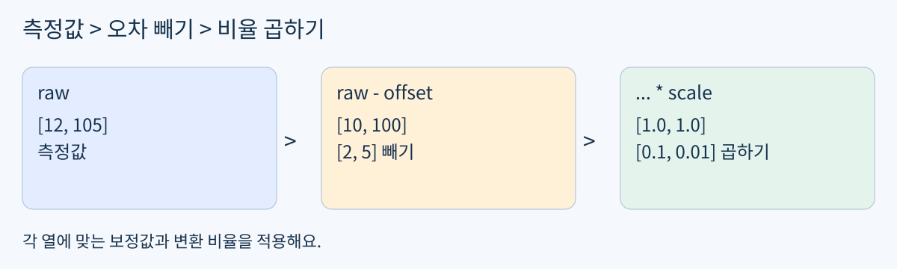
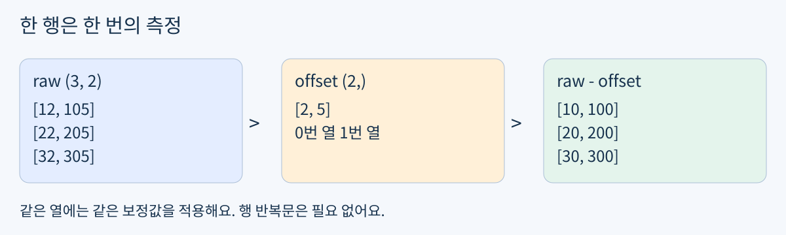
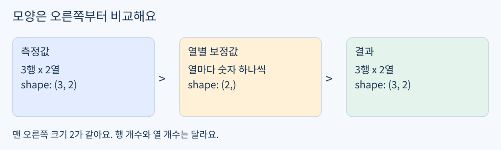

# Day09 열마다 센서 값 보정하기

2026년 10월 27일 / 개발 기초 / NumPy / 최대 60분

Day08은 학습 완료예요. 조건으로 행을 고르는 함수와 원본 보존은 실제 검증을 통과했어요. 오늘은 그 함수를 다시 만들지 않고, 여러 센서 열에 서로 다른 보정값을 적용해요.

목표: 센서 표의 행과 열을 구분하고, 열별로 빼기와 곱하기를 적용하는 함수를 만들어요. 실제 로봇에서는 센서마다 기준점과 단위가 달라요. 오늘은 가상 숫자로만 연습하며 장비나 새 설치는 필요 없어요.



그림 1. 측정값에서 기준 오차를 빼고, 열별 변환 비율을 곱해요.

### 60분 사용법

- 0~3분: 확인 문제 0으로 익숙한지 짧게 확인해요.

- 3~15분: 낯설면 최소 개념과 예제를 읽어요. 익숙하면 바로 A로 가요.

- 15~40분: 확인 문제 A의 함수와 실행 결과를 작성해요.

- 40~50분: A가 끝났다면 선택 문제 B로 오류 원인을 살펴봐요.

- 50~60분: 설명 한 문장과 노트북 저장. 일찍 끝나면 시간을 채우지 않아도 돼요.

전날 선택 preview의 답이 없다고 미완료로 돌리지 않아요. 오늘은 아래 짧은 확인으로 시작 위치만 정해요. 지금 일어나거나 바로 공부할 필요는 없어요. 편할 때 시작하고 60분이면 멈춰도 괜찮아요.

## 확인 문제 0 시작 위치 고르기

3분 이내의 짧은 적용 확인이에요. 정답과 해설은 시도한 뒤 제공해요. 아래 문제를 시도한 다음 뒤의 예제를 읽으세요.

### 어디에 작성하나요

day09-numpy-column-calibration/day09.ipynb를 열어요. 새 파일은 빈 노트북이에요. 기존 풀이가 있으면 지우지 말고 이어 쓰세요.

```python
import numpy as np
probe = np.array([[7, 40], [9, 60]])
shift = np.array([1, 10])
```

- 코드 셀: probe - shift를 실행하기 전에 결과의 모양과 첫 행을 예상해요.

- Markdown 셀: shift의 1과 10이 각각 어느 열에 적용되는지 한 문장 적어요. 그다음 실행해서 예상과 비교해요.

### 나에게 맞는 경로 하나

- 바로 설명할 수 있어요: 최소 개념과 단계 예제는 건너뛰고 확인 문제 A로 가요.

- 모양만 헷갈려요: 그림 2와 3의 행 / 열 설명만 보고 A로 가요.

- 처음이에요: 단계 예제를 순서대로 실행한 뒤 A로 가요.

이미 작성한 코드로 같은 능력을 보여주면 이 확인도 생략할 수 있어요. 답을 보내지 않았다는 이유로 알고 있거나 모른다고 단정하지 않아요.

### 표 읽기 약속

이번 자료에서는 한 행이 한 번의 측정이고, 0번 열과 1번 열은 서로 다른 센서예요. 이 배열에는 센서 번호 열을 넣지 않았어요. 모든 열이 계산 대상이에요.

## 최소 개념 열마다 같은 규칙

쉬운 뜻: 긴 표의 각 열에 정해진 숫자를 반복해서 적용해요. 생활 비유: 첫 번째 줄자에서는 늘 2를 빼고, 두 번째 줄자에서는 늘 5를 빼서 눈금을 맞추는 거예요. 실제 용어는 열별 연산과 브로드캐스팅이에요.



그림 2. 각 행의 0번 열에서 2, 1번 열에서 5를 빼는 예제예요.

offset은 기준 오차예요. 측정값이 실제보다 늘 2만큼 크게 나오는 센서라면 2를 빼요. scale은 단위를 바꾸는 곱셈 비율이에요. 이번 예제에서는 0번 열에 0.1, 1번 열에 0.01을 곱해요.



그림 3. (3, 2)와 (2,)의 맨 오른쪽 크기 2가 같아 열별 계산이 가능해요.

NumPy는 모양을 오른쪽부터 비교해요. 각 자리의 크기가 같거나 한쪽이 1이면 함께 계산할 수 있어요. 빠진 앞쪽 자리는 1처럼 생각해요. 여기서는 (2,)가 모든 행에 적용되지만, 실제로 같은 배열을 여러 번 복사해 만드는 뜻은 아니에요. [2]

주의: 열이 2개인 표에 길이 3짜리 보정값을 바로 빼면 맞지 않아요. 측정 횟수인 행 개수와 센서 종류인 열 개수를 섞지 마세요. 오늘은 행별 보정이나 복잡한 차원 확장은 다루지 않아요.

## 단계 예제 숫자를 두 번 변환하기

### 1 입력을 준비해요

```python
raw = np.array([[12, 105], [22, 205], [32, 305]])
offset = np.array([2, 5])
scale = np.array([0.1, 0.01])
```

raw는 3번 측정한 두 센서의 값이에요. offset과 scale의 첫 숫자는 0번 열, 다음 숫자는 1번 열에 대응해요.

### 2 기준 오차를 빼요

```python
corrected = raw - offset
print(corrected)
```

```text
[[ 10 100]
 [ 20 200]
 [ 30 300]]
```

첫 행만 손으로 계산하면 12 - 2 = 10, 105 - 5 = 100이에요. 나머지 행도 같은 열 규칙을 따라요.

### 3 열별 비율을 곱해요

```python
converted = corrected * scale
print(converted)
print(converted.shape)
```

```text
[[1. 1.]
 [2. 2.]
 [3. 3.]]
(3, 2)
```

첫 행은 10 × 0.1 = 1, 100 × 0.01 = 1이에요. 소수점이 붙은 출력은 실수 자료형으로 계산했다는 표시예요. 행과 열의 수는 그대로예요.

### 4 원본은 그대로 둬요

위처럼 계산 결과에 새 이름을 붙이면 raw는 바뀌지 않아요. raw -= offset처럼 원본에 직접 대입하는 연산은 오늘 사용하지 않아요. copy의 독립성은 이미 이해했으므로 다시 시험하지 않아요.

## 확인 문제 A 센서 보정 함수

필수 실습은 A 하나예요. 아래 요구사항을 기준으로만 확인해요. 예제와는 다른 입력이므로 결과를 직접 계산하거나 실행해 보세요. 정답 코드 / 결과 배열은 제출 후 제공해요.

### 입력과 함수 약속

```python
readings = np.array([[15, 230], [25, 430], [35, 630]])
offset = np.array([5, 30])
scale = np.array([0.2, 0.01])
```

함수 이름은 calibrate(readings, offset, scale)이에요. 각 열에서 offset을 뺀 뒤 같은 열의 scale을 곱한 새 배열을 반환하세요. 입력은 숫자 배열 shape (N, 2), offset과 scale은 shape (2,)라고 가정해요. N은 1 이상이에요. 예외 처리, 설치, 파일 읽기, 실제 센서 연결은 요구하지 않아요.

### 작성 순서

- 코드 셀 1: 위 입력을 작성하고 실행 전 readings.copy()를 before에 보관해요.

- 코드 셀 2: calibrate 함수를 작성해요. for문 없이 배열 연산을 사용해요. 반환값을 result로 받아요.

- 코드 셀 3: result, result.shape, np.array_equal(before, readings)를 각각 출력해요. 마지막 값은 원본 보존 검사 하나예요. True를 두 번 출력할 필요는 없어요.

- Markdown 셀: “offset의 첫 값은 ___에 적용된다. 먼저 빼고 나중에 곱하는 이유는 ___이다.”를 자기 말로 채워요.

### 완료 기준

- 구현: 모든 행에 열별 보정이 적용되고, 결과 shape가 입력과 같으며 입력을 바꾸지 않아요.

- 설명: 한 행과 한 열의 의미, 각 보정값의 적용 위치를 설명해요.

- 검사: 출력과 첫 행의 손계산을 비교해요. 별도의 정답 배열 / assert / 추가 테스트는 필수가 아니에요.

제출할 결과물: 저장한 day09.ipynb 한 개. 코드 / 실행 출력 / 설명 문장을 포함하세요. PDF나 README를 답안으로 고칠 필요는 없어요. 풀이를 보내거나 저장 위치를 알려주면 기존 코드로 검사할 수 있어요.

## 확인 문제 B 선택 디버깅과 마무리

A를 마쳤고 여유가 있을 때만 해요. B를 하지 않아도 A 완료에는 영향이 없어요. 문제를 새 숙제로 쌓지 않아요.

```python
extra = np.array([[8, 80], [12, 120], [16, 160]])
wrong_offset = np.array([1, 2, 3])
# extra - wrong_offset
```

- 선택 B: 주석의 계산이 왜 맞지 않는지 두 배열의 shape를 이용해 설명해요. “첫 센서에서 1, 둘째 센서에서 2를 뺀다”는 목적에 맞게 offset만 고쳐 실행해요. 오류를 일부러 실행할 필요는 없어요.

### 이해 확인

A의 내 코드에서 offset의 두 숫자와 센서 두 열을 손가락으로 짝지어 보세요. 말로 설명이 된다면 같은 문제를 다시 풀 필요는 없어요. 헷갈리는 칸 하나만 표시해도 다음 피드백의 시작점이 돼요.

### 파일과 학습 기록

README.md는 이 교재 본문, assets 폴더는 그림 3개, day09.ipynb는 풀이 공간이에요. PDF와 Markdown에는 같은 본문과 같은 시점의 공개 내용만 있어요. 확인 문제의 정답 / 해설은 아직 넣지 않았어요.

진도는 NumPy 배열 응용이에요. 개발 기초 다음에는 로봇 제어 / 3D 비전, 자율주행 / 로봇 AI, 다중 로봇 / 공정 자동화, Digital Twin / RobotOps / Sim-to-Real 순으로 이어가요. KANT의 종일 부트캠프 주차를 개인 학습 주수로 바꾸지 않아요. [1]

### 참고 자료

이 교재는 개인 맞춤 학습 자료이며 KANT 공식 교재가 아니에요. 공식 자료 확인일은 2026년 10월 27일이에요.

[1] KANT Physical AI 과정: https://kant.spartaclub.kr/ai-physical

[2] NumPy Broadcasting: https://numpy.org/doc/stable/user/basics.broadcasting.html
