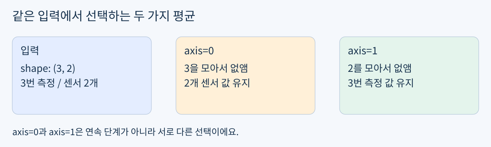
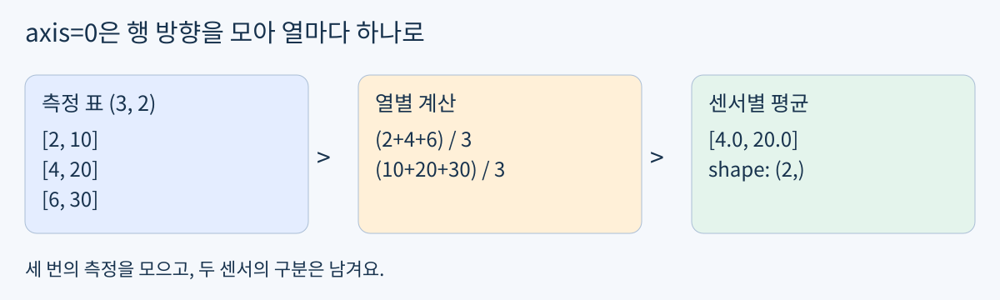
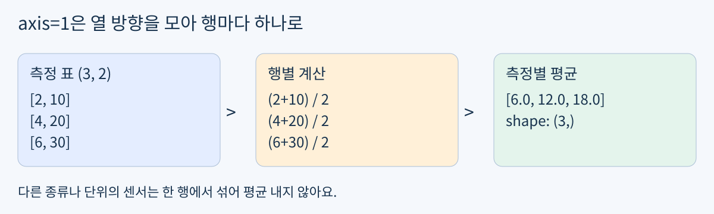

# Day10 센서별 평균과 axis 이해하기

2026년 10월 28일 / 개발 기초 / NumPy / 최대 60분

Day09는 완료했어요. 열마다 보정값을 적용하고 중간 계산을 다음 연산으로 연결하는 수정도 실제 검증을 통과했어요. 오늘은 보정 함수를 다시 만들지 않고 여러 번 측정한 값을 센서별 평균으로 줄여요.

목표: 무엇끼리 평균 낼지 정하고 axis를 선택해요. 실제 활용은 여러 번 읽은 센서 값을 센서마다 한 숫자로 요약하는 일이에요. 모든 예제는 가상 숫자이며 실물 장비, 유료 GPU, 새 설치는 필요 없어요.



그림 1. 입력의 두 축 중 하나를 모아 요약해요.

### 60분 사용법

- 0~3분: 확인 문제 0으로 시작 위치만 정해요.

- 3~15분: 낯선 부분만 개념과 그림으로 확인해요. 이미 설명할 수 있으면 A로 바로 가요.

- 15~40분: 필수 A의 함수, 출력, 설명 한 문장을 작성해요.

- 40~50분: 여유가 있을 때만 선택 B를 해요.

- 50~60분: 첫 센서의 손계산과 출력 비교 후 저장해요. 일찍 끝나면 시간을 채우지 않아도 돼요.

지금 바로 공부할 필요는 없어요. 전날 preview 답변 여부와 관계없이 완료한 Day09를 다시 과제로 만들지 않아요. 오늘 시작 위치는 짧은 적용 확인 또는 기존 코드로 정해요.

## 확인 문제 0 무엇을 남길까요

3분 이내 확인이에요. 답과 해설은 시도 후 제공해요. 아래 질문을 먼저 생각한 뒤 다음 페이지 예제를 보세요.

```python
import numpy as np
probe = np.array([[3, 30], [5, 50], [7, 70]])
```

한 행은 한 번의 측정, 한 열은 한 센서예요. 두 센서 각각의 평균을 원해요.

- Markdown 셀: 결과에 숫자가 몇 개 남아야 하는지, 첫 센서 평균은 어떤 세 숫자로 계산하는지 적어요.

- 이미 axis를 안다면 사용할 axis 값도 적어요. 모르면 추측을 강요하지 말고 다음 그림을 읽어요.

### 나에게 맞는 경로 하나

- 숫자 묶음과 axis를 바로 설명할 수 있어요: A로 직행해요.

- 평균은 알지만 axis가 헷갈려요: 그림 2와 4단계 예제만 확인해요.

- 평균부터 낯설어요: 최소 개념부터 순서대로 읽어요.

같은 능력이 드러나는 기존 코드가 있으면 확인 문제 0도 생략할 수 있어요. 답변이 없다는 사실은 숙달이나 미학습의 증거가 아니에요.

### 풀이를 적을 곳

day10-numpy-axis-mean/day10.ipynb에 코드 셀과 Markdown 셀을 추가해요. 처음 제공한 노트북은 비어 있어요. 이미 작성한 내용이 있다면 보존하세요.

## 최소 개념 평균과 모으는 방향

쉬운 뜻: 여러 값을 더한 뒤 값의 개수로 나누면 평균이에요. 생활 비유: 세 번 잰 왼쪽 줄자의 길이끼리 모으고, 오른쪽 줄자의 길이끼리 따로 모으는 거예요. 실제 용어는 산술평균(mean)과 축(axis)이에요.

예를 들어 2, 4, 6의 평균은 (2 + 4 + 6) / 3 = 4예요. 세 숫자를 더했으니 3으로 나눠요.



그림 2. axis=0으로 측정 횟수 축을 모으면 센서별 평균이 남아요.

2차원 shape (행 수, 열 수)에서 axis=0은 첫 번째 축인 행 축을 줄여요. 그래서 각 열의 값들이 모이고 결과에는 센서별 숫자가 남아요. “axis=0은 행 평균”이라고 외우면 헷갈리기 쉬워요. 무엇이 없어지고 무엇이 남는지 보세요. [2]



그림 3. axis=1은 각 행 안의 열들을 모아요.

axis=1은 두 번째 축인 열 축을 줄여요. 위 그림은 숫자 묶음의 차이를 보여 주는 예제예요. 실제로 온도와 거리처럼 단위가 다른 센서를 섞어 평균 내면 의미가 없어요. 오늘의 목적은 센서별 요약이므로 서로 다른 센서 열은 분리해요.

## 단계 예제 센서별 평균 구하기

### 1 보정이 끝난 값 준비하기

```python
samples = np.array([[2, 10], [4, 20], [6, 30]])
print(samples.shape)
```

```text
(3, 2)
```

여기서는 보정된 값을 직접 제공해요. Day09의 calibrate 함수를 다시 작성할 필요는 없어요.

### 2 첫 센서만 손으로 확인하기

0번 열은 2, 4, 6이에요. 합 12를 측정 횟수 3으로 나누면 4예요. 두 번째 센서도 자기 열의 값만 모아요.

### 3 NumPy에 모을 방향 알려 주기

```python
sensor_means = np.mean(samples, axis=0)
print(sensor_means)
print(sensor_means.shape)
```

```text
[ 4. 20.]
(2,)
```

평균을 계산하는 np.mean과 줄일 축을 고르는 axis=0이 함께 쓰였어요. 센서 두 개가 남았으므로 shape는 (2,)예요. 이 계산은 samples의 값을 바꾸지 않아요. [2]

### 4 전체 평균과 구분하기

```python
overall_mean = np.mean(samples)
print(overall_mean)
```

```text
12.0
```

axis를 생략하면 모든 숫자를 하나로 모아요. 센서별 평균 두 개가 필요할 때는 이 결과를 대신 쓸 수 없어요. 12.0이 오류 메시지 없이 나와도 목적에 맞는 결과인지 확인해야 해요. [2]

오늘은 빈 배열, NaN, 가중평균, keepdims 옵션은 다루지 않아요. 기존 함수가 만든 중간 결과를 사용할 때는 원래 입력으로 되돌아가지 않도록 변수 이름을 한 번 확인해요.

## 확인 문제 A 센서 평균 함수

필수 실습은 A 하나예요. 정답 코드와 결과 배열은 제출 후 제공해요. 아래에 적힌 요구사항만 완료 기준으로 사용해요.

### 입력과 함수 약속

```python
readings = np.array([[4, 20], [8, 40], [12, 60], [16, 80]])
```

함수 이름은 sensor_average(readings)예요. 입력은 보정이 끝난 숫자 배열 shape (N, 2)이며 N은 1 이상이에요. 각 센서의 측정값 평균을 순서대로 담은 shape (2,) 배열을 반환하세요. 입력을 바꾸지 말고 np.mean을 사용해요. 예외 처리나 외부 파일 읽기는 요구하지 않아요.

### 작성 순서

- 코드 셀 1: import와 위 입력을 작성해요. readings.copy()를 before에 보관해요.

- 코드 셀 2: sensor_average 함수를 작성하고 반환값을 result로 받아요.

- 코드 셀 3: result, result.shape, np.array_equal(before, readings)를 출력해요. 원본 보존 검사는 한 번이면 돼요.

- Markdown 셀: 첫 센서의 손계산을 적고 “나는 *** 축을 모아 ***별 평균을 남겼다”를 자기 말로 설명해요.

### 완료 기준

- 구현: 센서 두 개의 평균이 올바른 순서로 나오며 shape는 (2,)예요. 입력은 그대로예요.

- 설명: 어떤 값들을 한 묶음으로 평균 냈는지 말할 수 있어요.

- 검사: 첫 센서 손계산과 출력이 맞는지 비교해요. 별도 assert나 정답 배열, 추가 시험은 필수가 아니에요.

제출할 결과물은 저장한 day10.ipynb 한 개예요. 코드, 실행 출력, 설명 문장을 포함해요. 완료했다고 알려주면 연결된 INA-PC의 저장본을 확인할 수 있어요. 파일을 다시 업로드하는 것은 필수가 아니에요.

## 확인 문제 B 선택 디버깅과 마무리

A가 끝났고 여유가 있을 때만 해요. B를 하지 않아도 A 완료에 영향이 없어요.

```python
data = np.array([[5, 15], [10, 30], [15, 45]])
wrong = np.mean(data, axis=1)
print(wrong.shape)
```

목표는 센서별 평균 두 개예요. 선택 B: 현재 결과의 숫자 개수가 목표와 왜 다른지 설명하고, axis 값만 수정해 실행해요. 정답과 해설은 시도한 뒤 확인해요.

### 이해 확인

A의 배열에서 첫 센서 평균에 들어가는 숫자들을 손가락으로 짚어 보세요. 결과의 한 칸이 무엇을 뜻하는지 설명할 수 있으면 같은 문제를 또 풀 필요는 없어요. 헷갈리는 부분 하나만 알려줘도 돼요.

### 현장에서 주의할 점

평균은 여러 측정값을 간단히 요약하지만 튀는 값이나 지속적인 오차를 자동으로 없애 주지는 않아요. 종류나 단위가 다른 센서를 한 숫자로 섞기 전에 의미가 있는지 먼저 확인해요. 오늘은 같은 센서의 반복 측정만 모아요.

### 파일과 다음 학습

README.md와 PDF는 같은 본문이에요. assets에는 그림 3개, day10.ipynb에는 내 풀이를 저장해요. 확인 문제의 정답은 두 형식 모두 아직 공개하지 않았어요. 다음 진도는 실제 풀이를 확인한 뒤 정하고, 미응답이면 이번 자료의 필요한 부분에서 이어가요.

현재 위치는 개발 기초의 NumPy 응용이에요. 이후 로봇 제어와 3D 비전, 자율주행과 로봇 AI, 다중 로봇과 공정 자동화, Digital Twin과 RobotOps 및 Sim-to-Real 순서를 따라가요. KANT의 종일 부트캠프 주차를 개인 학습 기간으로 바꾸지 않아요. [1]

### 참고 자료

개인 맞춤 교재이며 KANT 공식 교재는 아니에요. 공식 자료 확인일은 2026년 10월 28일이에요.

[1] KANT Physical AI: https://kant.spartaclub.kr/ai-physical

[2] NumPy mean: https://numpy.org/doc/stable/reference/generated/numpy.mean.html
