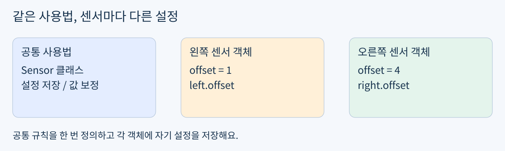
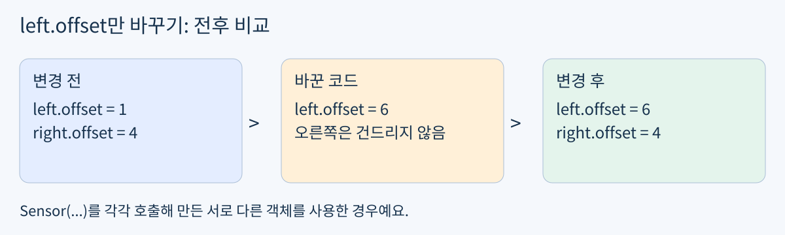
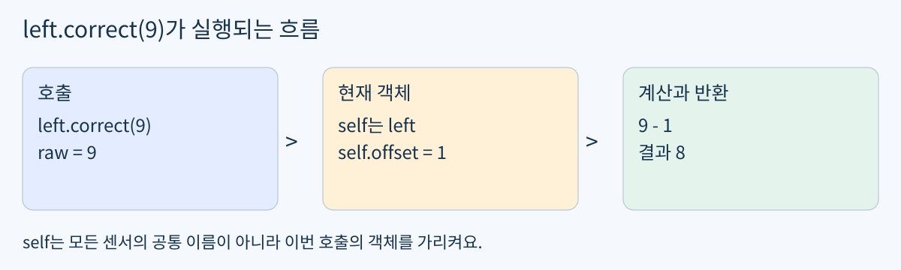

# Day11 센서 설정과 계산 묶기

2026년 10월 29일 / 개발 기초 / Python OOP / 최대 60분

Day10의 센서별 평균 함수는 실제 풀이 검사까지 완료했어요. 어제 preview의 “5?”도 맞았어요. 같은 숫자 문제나 NumPy 평균을 다시 풀지 않고, 오늘은 그 생각을 짧은 클래스로 구현해요.

목표: 센서 두 개가 각자의 설정을 갖도록 만들고, 자기 설정으로 값을 보정해요. 실제 활용: 로봇의 왼쪽 센서와 오른쪽 센서에 서로 다른 오차 보정값을 저장하는 일이에요.



그림 1. 공통 규칙과 개별 설정을 나눠요.

### 60분 사용법

- 0~5분: A의 요구사항을 읽어요. **init**과 self를 구현할 수 있으면 A로 바로 가요.

- 5~20분: 낯선 부분만 최소 개념과 단계 예제로 보충해요.

- 20~45분: A를 구현하고 두 객체의 결과를 확인해요.

- 45~55분: 저장된 출력과 설명을 한 번 점검해요. 막힌 부분만 고쳐요.

- 55~60분: 노트북을 저장해요. 일찍 끝나면 시간을 채울 필요는 없어요.

지금 바로 공부할 필요는 없어요. 예제는 가상 숫자뿐이며 실물 장비, 유료 GPU, 새 설치가 필요 없어요. preview 정답은 확인했지만 클래스 구현까지 숙달했다고 가정하지 않아요.

## 최소 개념 설정을 담는 작은 도구

쉬운 뜻: 관련된 설정과 일을 한 묶음으로 관리해요. 생활 비유: 같은 모양의 리모컨 두 개라도 각각 연결된 기기와 음량 설정은 다를 수 있어요. 실제 용어는 객체 지향 프로그래밍, 줄여서 OOP예요.

### 오늘 필요한 말 네 가지

- 클래스(class): 객체가 가질 설정과 동작을 정의하는 공통 규칙이에요.

- 객체 / 인스턴스(instance): 그 클래스로 만든 개별 도구예요. left와 right가 각각 가리키는 센서예요.

- 속성(attribute): 객체에 붙여 둔 값이에요. left.offset처럼 점 뒤에 이름을 붙여 읽어요.

- 메서드(method): 객체를 통해 호출하는 함수예요. left.correct(9)처럼 사용해요.

### 설정과 입력을 구분하기

offset은 센서에 저장해 둘 설정이에요. raw는 이번에 읽은 측정값이에요. 새 측정값이 들어올 때마다 설정을 다시 정하지 않고 저장된 설정으로 계산해요.

```python
def correct(raw, offset):
    return raw - offset
```

이 함수는 매번 raw와 offset을 함께 전달해요. 클래스에서는 offset을 객체에 저장하고, 호출할 때 raw만 전달하도록 구성할 수 있어요. 클래스가 항상 더 좋은 것은 아니지만 여러 센서의 설정을 관리할 때 유용해요.

### **init**과 self

**init**은 새 인스턴스의 초기 설정을 채우는 메서드예요. self는 그 메서드를 사용하는 현재 인스턴스를 받는 관례적인 매개변수 이름이에요. 밑줄은 init 앞뒤에 두 개씩 있어요. [2]

중요한 한계: 객체를 따로 만들었다고 모든 내부 데이터가 자동 복사되는 것은 아니에요. 오늘은 각 객체에 숫자 설정을 저장하고 다시 대입하는 범위만 다뤄요. 공유 리스트와 상속은 오늘 과제가 아니에요.

## 단계 예제 1 설정 저장하기

### 1 공통 규칙 작성하기

```python
class Sensor:
    def __init__(self, offset):
        self.offset = offset
```

class Sensor:는 새 규칙의 이름이에요. **init**의 offset은 처음 받은 값이고, self.offset은 현재 객체에 저장하는 자리예요. 왼쪽과 오른쪽의 offset이라는 글자는 같아도 역할이 달라요.

### 2 서로 다른 객체 만들기

```python
left = Sensor(1)
right = Sensor(4)
print(left.offset, right.offset)
```

```text
1 4
```

Sensor(...)를 두 번 호출해 두 인스턴스를 만들었어요. 첫 호출은 left 쪽에 1, 두 번째 호출은 right 쪽에 4를 저장해요. 호출할 때 self를 직접 적지 않아요.

### 3 하나의 설정만 바꾸기

```python
left.offset = 6
print(left.offset, right.offset)
```

```text
6 4
```



그림 2. 왼쪽 설정을 바꾸어도 오른쪽 설정은 유지돼요.

이 예제는 이미 맞힌 preview를 설명하는 자료이며 재시험이 아니에요. 두 객체가 별개라는 생각을 코드와 연결하는 용도로만 봐요. [2]

## 단계 예제 2 자기 설정으로 계산하기

### 1 메서드를 추가한 전체 예제

```python
class Sensor:
    def __init__(self, offset):
        self.offset = offset

    def correct(self, raw):
        return raw - self.offset
```

correct의 첫 매개변수 self는 현재 센서예요. raw에서 현재 센서의 offset을 빼고 결과를 돌려줘요. 앞 페이지와 이어 실행한다면 아래처럼 객체를 다시 만든 뒤 확인해요.

### 2 같은 입력을 두 센서에 전달하기

```python
left = Sensor(1)
right = Sensor(4)
print(left.correct(9))
print(right.correct(9))
```

```text
8
5
```



그림 3. 현재 객체의 설정을 찾아 계산해요.

left.correct(9)에서는 self가 left를, right.correct(9)에서는 self가 right를 가리켜요. 그래서 같은 9를 넣어도 저장된 설정에 따라 결과가 달라져요. [2]

### 3 계산과 저장은 다르기

return raw - self.offset은 계산한 값을 반환해요. self.offset에 다시 대입하지 않았으므로 저장된 offset은 바뀌지 않아요. 값을 보정할 때 설정까지 실수로 바꾸지 않는지 살펴보세요.

노트북에서는 클래스를 고친 뒤 클래스 셀을 다시 실행하고, 객체를 만드는 셀도 다시 실행해요. 예전에 만든 인스턴스는 새 클래스 정의를 자동으로 따라 바뀌지 않아요.

## 확인 문제 A 두 센서 보정 도구

필수 실습은 A 하나예요. 정답 코드와 결과값은 시도 후 제공해요. 보정 계산은 Day09에서 했던 순서를 재사용하고 새로 배우는 부분은 설정을 객체에 저장하는 방법이에요.

### 구현 약속

SensorCalibrator 클래스를 만들어요. **init**(self, offset, scale)은 숫자 offset과 scale을 각 인스턴스에 저장해요. apply(self, raw)는 (raw - offset) \* scale을 계산해 반환해요. raw, offset, scale은 오늘 모두 숫자 한 개예요. NumPy 배열, 예외 처리, 상속은 필요 없어요.

```python
a = SensorCalibrator(2, 3)
b = SensorCalibrator(4, 2)
```

### 작성 순서

- 1. 클래스 코드를 작성하고 위와 같이 a, b를 각각 만들어요.

- 2. a.apply(10), b.apply(10)을 출력해요. 각 결과를 손계산과 비교해요.

- 3. a.offset을 1로 바꿔요. a.apply(10), b.apply(10), b.offset을 출력해 전후를 비교해요.

- 4. Markdown 셀에 “a.apply(10)의 self는 무엇인지”와 “b의 설정이 유지되는 이유”를 자기 말로 짧게 적어요.

### 완료 기준

- 구현: offset과 scale이 객체마다 저장되고 두 센서의 보정 결과가 맞아요.

- 설명: 공통 클래스와 개별 객체를 구분하고 self가 누구인지 설명할 수 있어요.

- 검사: a의 설정만 바꾼 뒤 a와 b의 결과를 비교해요. 추가 assert, True 출력 개수, 별도 시험은 필수가 아니에요.

### 제출할 결과물

day11-oop-sensor-settings/day11.ipynb 한 개에 코드, 실행 출력, 짧은 설명을 저장하면 돼요. 저장본에 한 번만 있어도 충분해요. 완료했다고 알려주면 연결된 INA-PC에서 확인하며 재업로드를 요구하지 않아요. 이미 있는 풀이를 지우거나 덮어쓰지 마세요.

## 확인 문제 B 선택 디버깅

A가 끝난 뒤 여유가 있을 때만 해요. B를 하지 않아도 A 완료에 영향이 없어요. 정답과 해설은 시도 후 제공해요.

```python
a = SensorCalibrator(2, 3)
b = a
b.offset = 7
print(a.offset)
```

의도는 a와 b가 각각 자기 설정을 갖는 것이었어요. 실제 출력과 의도가 다른 이유를 설명하고, b를 만드는 줄만 고쳐 보세요. 메모리 주소를 출력하거나 외울 필요는 없어요.

### 막혔을 때 점검 순서

- 속성이 없다는 오류: **init** 철자와 self.속성 형태를 먼저 봐요.

- 인수 개수 오류: 메서드 정의의 첫 매개변수와 호출할 때 넣은 값을 비교해요.

- 계산값이 이상함: 괄호와 연산 순서를 확인해요. 설정 저장 문제인지 계산 문제인지 나눠 봐요.

- 고친 코드가 반영되지 않음: 클래스 정의 셀, 객체 생성 셀, 실행 셀 순서로 다시 실행해요.

### 이해 확인과 이어가기

A의 실행 한 번을 가리키며 “이 객체의 어떤 설정을 써서 계산했는지” 말해 보세요. 구현으로 증명한 부분은 다음 학습에서 생략하고, 헷갈린 부분만 보충해요. 답변이 없으면 완료나 숙달로 간주하지 않고 이 자료에서 이어가요.

현재 위치는 개발 기초의 OOP예요. 이후 Ubuntu/Git, 선형대수와 3D 좌표, ROS2, OpenCV와 AI 기초를 실제 능력에 맞춰 이어가요. 이후 큰 흐름은 로봇 제어/3D 비전 → 자율주행/로봇 AI → 다중 로봇/공정 자동화 → Digital Twin/RobotOps/Sim-to-Real이에요. KANT의 종일 부트캠프 주차를 개인 학습 기간으로 환산하지 않아요. [1]

### 파일과 참고 자료

README.md와 PDF 본문은 같아요. assets에 실제 그림 3개가 들어 있어요. 두 형식 모두 A와 B의 정답은 아직 공개하지 않았어요. 이 자료는 개인 맞춤 교재이며 KANT 공식 교재는 아니에요. 자료 확인일: 2026-10-29 KST.

[1] KANT Physical AI: https://kant.spartaclub.kr/ai-physical

[2] Python 공식 클래스 안내: https://docs.python.org/3/tutorial/classes.html
