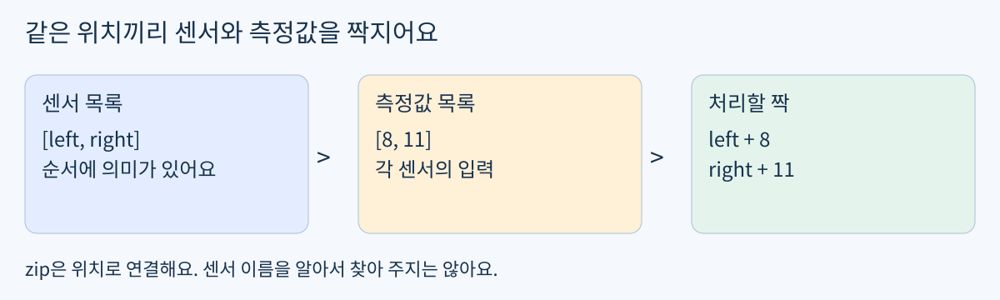
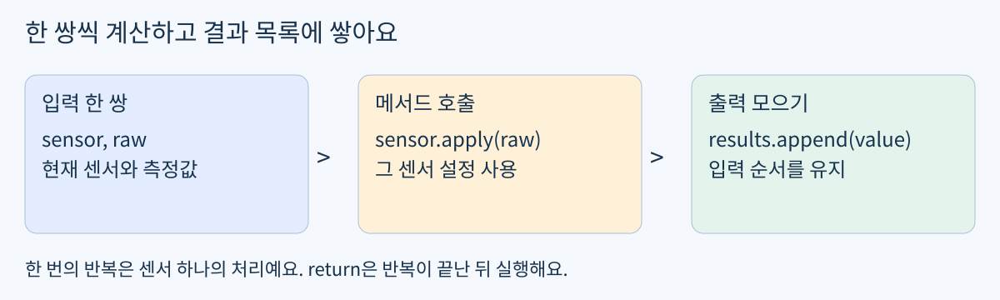
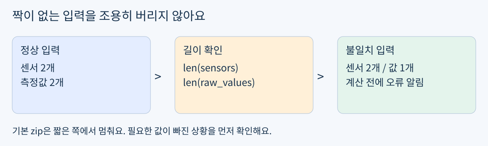

# Day12 여러 센서를 순서대로 처리하기

2026년 10월 30일 / 개발 기초 / Python OOP 활용 / 최대 60분

Day11은 실제 풀이와 수정 설명까지 검사 완료했어요. 객체별 설정, apply 계산, 독립 객체와 같은 객체 참조는 다시 시험하지 않아요. 오늘은 이미 만든 도구 여러 개에 측정값을 하나씩 연결해요.

목표: 센서 목록과 측정값 목록을 같은 순서로 짝짓고 결과를 목록으로 반환해요. 실제 활용: 로봇의 여러 거리 센서에서 받은 값을 각 센서의 설정으로 보정하는 처리 단계예요.



그림 1. 센서 순서와 입력 순서를 맞춰요.

### 60분 사용법

- 0~5분: A의 요구사항을 읽고 목록 묶기와 반복을 할 수 있으면 실습으로 바로 가요.

- 5~20분: 필요한 개념과 예제만 확인해요. class와 self 기초는 재시험하지 않아요.

- 20~45분: A를 구현하고 두 입력 묶음으로 실행해요.

- 45~55분: 입력 순서, 결과 개수, 반환 위치를 점검해요.

- 55~60분: 노트북을 저장해요. 일찍 끝나면 시간을 채울 필요 없어요.

자료 발송은 지금 공부하라는 뜻이 아니에요. 가상 숫자로 실습하며 장비, 유료 GPU, 설치가 필요 없어요. 새 개념이 익숙하면 예제를 생략해도 돼요.

## 최소 개념 짝짓기와 결과 모으기

쉬운 뜻: 여러 도구에 알맞은 재료를 하나씩 건네고 결과를 모아요. 생활 비유: 이름표 순서대로 도시락을 나눠 주는 일이에요. 실제 용어로는 배치 처리(batch processing)와 입력 매핑이라고 해요.

### 오늘 필요한 도구

- 리스트(list): 순서를 가진 묶음이에요. 센서 객체도 목록에 담을 수 있어요.

- zip: 두 목록의 첫 번째끼리, 두 번째끼리 짝을 꺼내요. 이름이나 의미를 비교하지 않아요. [2]

- for: 각 짝에 같은 처리 순서를 반복해요.

- append: 결과 한 개를 목록 끝에 추가해요. append 자체의 반환값은 None이에요.

```python
names = ["left", "right"]
values = [8, 11]
for name, value in zip(names, values):
    print(name, value)
```

```text
left 8
right 11
```

name, value 두 변수는 이번 짝의 두 항목을 받아요. zip은 한 번 순회하며 짝을 꺼내는 도구예요. 재사용하려면 zip(...)을 다시 만들면 돼요.

### 순서가 약속이에요

첫 측정값이 왼쪽 센서에서 왔다면 센서 목록도 왼쪽부터 있어야 해요. 길이가 같아도 순서가 바뀌면 엉뚱한 센서 설정으로 계산할 수 있어요. 오늘은 두 목록이 올바른 순서로 주어진다고 약속해요.

## 단계 예제 한 센서 처리를 반복하기

아래 클래스는 Day11과 같은 계산이에요. 새로 외우거나 다시 구현 시험을 보는 부분이 아니라 예제 실행에 필요한 도구예요.

```python
class SensorCalibrator:
    def __init__(self, offset, scale):
        self.offset = offset
        self.scale = scale

    def apply(self, raw):
        return (raw - self.offset) * self.scale
```

### 1 도구와 입력 준비

```python
sensors = [SensorCalibrator(1, 2),
           SensorCalibrator(3, 1)]
raw_values = [8, 11]
results = []
```

빈 results는 보정한 숫자를 담을 그릇이에요. 센서 목록에는 보정 결과가 아니라 객체가 들어 있어요.

### 2 한 쌍씩 계산

```python
for sensor, raw in zip(sensors, raw_values):
    value = sensor.apply(raw)
    results.append(value)
print(results)
```

```text
[14, 8]
```



그림 2. 객체를 꺼내 메서드를 호출하고 결과를 모아요.

첫 짝은 (8-1)×2=14, 두 번째는 (11-3)×1=8이에요. sensor는 이번 반복에서 꺼낸 객체예요. 실제 메서드 이름은 apply예요. results = results.append(value)로 쓰면 results가 None으로 바뀌므로 주의해요.

## 단계 예제 함수와 입력 길이 점검

### 1 호출할 때마다 새 결과 목록 만들기

```python
def add_pairs(left, right):
    if len(left) != len(right):
        raise ValueError("length mismatch")
    result = []
    for a, b in zip(left, right):
        result.append(a + b)
    return result

print(add_pairs([1, 2], [10, 20]))
print(add_pairs([3, 4], [10, 20]))
```

```text
[11, 22]
[13, 24]
```

이 예제는 센서 보정 함수의 정답이 아니라 두 숫자 목록을 더하는 별도 예제예요. result=[]가 함수 안에 있어 호출마다 새로운 결과를 모아요. return은 for와 같은 들여쓰기 수준이며 반복이 끝난 뒤 목록 전체를 돌려줘요.



그림 3. 필요한 입력이 빠지면 계산을 시작하지 않아요.

### 2 조용한 누락 막기

기본 zip은 짧은 목록 끝에서 멈춰요. 센서가 둘인데 값이 하나라면 오류 없이 결과 하나만 생길 수 있어요. len 비교는 개수 불일치를 발견하고, raise ValueError는 “입력 약속이 틀렸어요”라고 알리는 방법이에요. [2]

위 함수에 [1, 2]와 [10]을 전달하면 length mismatch 오류가 나요. 이는 의도한 입력 검사예요. 오늘 필수 A는 길이가 같은 입력만 받고, 길이 검사 구현은 선택 B에서 다뤄요.

## 확인 문제 A 센서 묶음 보정 함수

필수 실습은 A 하나예요. 정답 코드와 결과값은 시도 후 제공해요. 기존 SensorCalibrator 클래스는 Day11에서 복사하거나 이 자료의 예제를 그대로 사용해도 돼요.

### 구현 약속

apply_all(sensors, raw_values) 함수를 만들어요. 같은 위치의 센서와 측정값을 짝지어 각 센서의 apply를 호출하고, 보정한 숫자들을 입력 순서대로 담은 새 리스트를 반환해요. 두 입력은 길이가 같고 비어 있지 않은 리스트이며 값은 숫자라고 가정해요. 입력 목록이나 센서 설정을 바꾸지 않아요.

```python
sensors = [SensorCalibrator(2, 2),
           SensorCalibrator(1, 3),
           SensorCalibrator(4, 1)]
raw_values = [9, 7, 12]
```

### 작성 순서

- 1. apply_all을 작성하고 위 입력으로 결과를 출력해요.

- 2. 센서 목록은 그대로 두고 새 입력 [10, 8, 13]으로 다시 호출해요.

- 3. 각 호출의 결과가 숫자 3개인지, 첫 호출 결과에 두 번째 결과가 붙지 않았는지 확인해요.

- 4. 첫 입력의 가운데 센서 한 개만 손계산해 출력과 비교해요. 짧은 주석이나 Markdown 설명이면 돼요.

### 완료 기준

- 구현: 입력 순서대로 모든 센서가 처리되고 새 결과 리스트가 반환돼요.

- 설명: 현재 sensor와 raw가 어느 위치의 한 쌍인지 실행 예로 설명할 수 있어요.

- 디버깅: 결과가 하나뿐이면 return의 들여쓰기, 호출마다 결과가 늘면 결과 목록의 생성 위치를 확인해요.

추가 assert, True 개수, 선택 B는 완료 조건이 아니에요. 기존 풀이와 출력으로 이미 증명했다면 별도 설명 시험을 반복하지 않아요.

### 제출할 결과물

day12-oop-sensor-batch/day12.ipynb 한 개에 코드, 두 실행 결과, 짧은 손계산을 저장해요. 저장된 풀이가 한 번만 있어도 충분해요. 완료했다고 알려주면 INA-PC의 저장본으로 검사하며 재업로드를 요구하지 않아요.

## 확인 문제 B 선택 입력 누락 찾기

A 이후 여유가 있을 때만 해요. B 미완료는 A 완료에 영향을 주지 않아요. 정답과 해설은 시도 후 공개해요.

센서는 3개인데 raw_values가 [9, 7]뿐인 입력을 생각해 보세요. 기본 zip이 무엇을 처리하고 무엇을 빠뜨릴지 먼저 적고, 길이가 다르면 ValueError를 발생시키도록 apply_all을 보완해 보세요. 길이가 맞을 때는 기존 A 동작을 유지해요.

### 막혔을 때 최소 점검

- 결과가 None: return results가 있는지, append의 반환값을 저장했는지 확인해요.

- 결과가 하나: return이 for 안에서 너무 일찍 실행되는지 확인해요.

- 센서 순서가 틀림: 두 리스트의 같은 인덱스가 같은 센서를 뜻하는지 확인해요.

- 메서드를 찾을 수 없음: sensor가 숫자가 아니라 센서 객체인지, 메서드 이름이 apply인지 확인해요.

### 이해 확인과 다음 선택

현재 반복의 sensor와 raw를 하나씩 짚어 보세요. 이미 설명 가능한 부분은 건너뛰고, 헷갈리면 그림 1과 예제 한 번만 확인해요. 답변이 없으면 다음 자료에서 이 실습 재개 지점부터 안내하고 새 과제를 쌓지 않아요.

현재는 개발 기초의 Python/OOP 활용 단계예요. 이후 Ubuntu/Git, 선형대수/3D 좌표, ROS2, OpenCV/AI 기초를 실제 구현 증거에 맞춰 이어가요. 큰 순서는 로봇 제어/3D 비전, 자율주행/로봇 AI, 다중 로봇/공정 자동화, Digital Twin/RobotOps/Sim-to-Real이에요. 종일 부트캠프의 주차를 개인 학습 기간으로 환산하지 않아요. [1]

### 파일과 참고 자료

PDF와 README.md의 본문은 같고 assets에 그림 3개가 있어요. 두 형식 모두 확인 문제 정답은 미공개예요. 개인 맞춤 교재이며 KANT 공식 교재는 아니에요.

[1] 기준 커리큘럼과 사용자 지정 순서: https://kant.spartaclub.kr/ai-physical

[2] Python 공식 zip 안내: https://docs.python.org/3/library/functions.html#zip

자료 확인일: 2026-10-30 KST. KANT 페이지는 이번 조회에서 리디렉션 접근 제한으로 최신 상세 내용을 재확인하지 못해 사용자가 지정한 순서를 기준으로 구성했어요.
