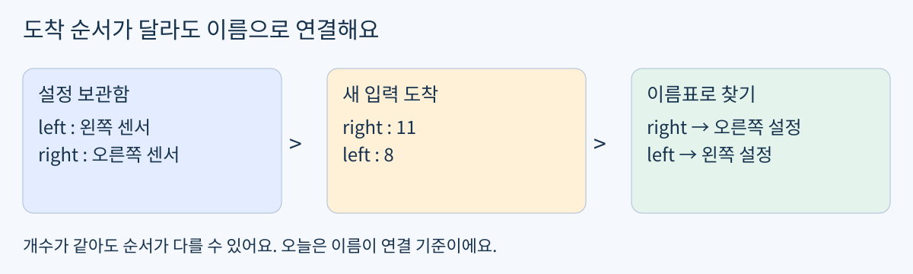
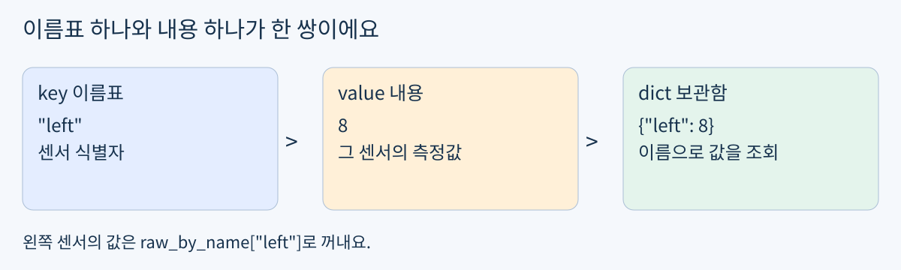
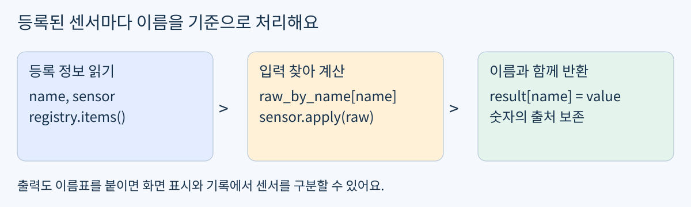

# Day13 이름으로 센서 입력 연결하기

2026년 11월 1일 / 개발 기초 / Python 데이터 연결 / 최대 60분

Day12의 여러 센서 처리와 길이 검사는 실제 풀이로 확인했어요. 같은 문제를 다시 풀지 않아요. 오늘은 입력의 도착 순서가 바뀌어도 이름으로 올바른 센서를 찾아요.

목표: 센서 이름으로 설정과 측정값을 연결하고, 결과에도 이름을 남겨요. 활용: 로봇의 왼쪽 / 오른쪽 센서 데이터가 다른 순서로 도착할 때 잘못된 보정 설정을 적용하지 않도록 해요.



그림 1. 위치 대신 이름으로 입력과 센서를 연결해요.

### 60분 사용법

- 0~5분: 아래 짧은 확인으로 기초 보충 또는 실습 직행을 골라요.

- 5~20분: 필요한 dict 조회 / items 예제만 살펴봐요.

- 20~45분: 확인 문제 A를 구현하고 순서를 바꾼 입력도 실행해요.

- 45~55분: 이름과 결과의 연결, 입력 보존을 점검해요.

- 55~60분: 코드와 출력, 짧은 설명을 저장해요. 일찍 끝나면 종료해도 돼요.

가상 숫자로만 실습해요. 설치, 장비, 유료 GPU는 필요 없어요. 자료 도착은 기상이나 즉시 공부하라는 뜻이 아니에요.

## 최소 개념 이름표로 꺼내는 보관함

쉬운 뜻: 숫자에 이름표를 붙여 보관해요. 생활 비유: 사물함의 위치를 외우는 대신 학생 이름으로 물건을 찾는 일이에요. Python의 실제 용어는 딕셔너리(dict), 이름표는 키(key), 내용은 값(value)이에요. [2]



그림 2. 키와 값이 모여 딕셔너리가 돼요.

### 확인 문제 0 시작 경로 선택

```python
packet = {"rear": 6, "front": 15}
```

3분만 사용해 packet에서 front 값을 꺼내는 한 줄을 써 보세요. 작성 / 실행이 편하면 다음 개념 설명은 건너뛰고 예제 또는 A로 가요. 헷갈리면 아래 이름표 조회 예제부터 시작해요. 이 문제는 별도 제출 의무가 아니며 정답은 시도 후 확인해요.

### 이름표 조회 예제

```python
locker = {"mina": "book", "jisu": "cup"}
print(locker["jisu"])
```

```text
cup
```

locker["jisu"]는 두 번째 것을 무조건 꺼내는 표현이 아니에요. "jisu"라는 키의 값을 찾아요. 실제 값이 숫자여도, 센서 객체여도 조회 방식은 같아요.

키는 같은 딕셔너리 안에서 유일해요. 같은 키에 다시 대입하면 이전 값을 바꿔요. 리스트처럼 중복 이름을 별도 항목으로 계속 쌓지는 않아요.

## 단계 예제 이름과 값을 함께 다루기

### 1 순서와 조회를 구분하기

```python
packet = {"right": 11, "left": 8}
print(packet["left"])
```

```text
8
```

left는 나중에 적었지만 이름으로 정확히 찾았어요. Python dict는 삽입 순서를 보존하지만, 오늘의 연결은 그 순서가 아니라 key가 기준이에요. [2]

### 2 이름과 내용을 함께 반복하기

```python
for name, value in packet.items():
    print(name, value)
```

```text
right 11
left 8
```

items()는 키와 값의 쌍을 꺼내요. for name in packet은 키만 꺼내요. 오늘 이미 익숙한 for를 쓰되 반복에서 꺼내는 대상만 달라져요.

### 3 결과에 이름표 붙이기

```python
adjustment = {"left": 2, "right": 5}
result = {}
for name, amount in adjustment.items():
    result[name] = packet[name] + amount
print(result)
```

```text
{'left': 10, 'right': 16}
```

이 예제는 별도 숫자 더하기예요. result={}는 빈 딕셔너리이고 result[name]=...은 해당 이름의 값을 기록해요. packet의 삽입 순서가 right부터여도 left에는 left의 값만 사용해요.

길이만 맞는지 확인하는 것으로 이름 일치까지 보장되지는 않아요. {"left":8,"rear":11}은 항목이 둘이어도 right 값이 없어요. 오늘 필수 A에서는 정확히 같은 이름 집합이 들어온다고 약속해요.

## 단계 예제 센서 이름과 객체 연결하기

클래스와 보정식은 이미 구현한 도구예요. 다시 시험하지 않으며 아래 코드를 그대로 재사용해도 돼요.

```python
class SensorCalibrator:
    def __init__(self, offset, scale):
        self.offset = offset
        self.scale = scale

    def apply(self, raw):
        return (raw - self.offset) * self.scale
```

### 1 이름으로 센서 객체 등록

```python
registry = {"left": SensorCalibrator(1, 2),
            "right": SensorCalibrator(3, 1)}
raw_by_name = {"right": 11, "left": 8}
```

registry["left"]는 센서 객체, raw_by_name["left"]는 숫자예요. 같은 key를 써서 서로 맞는 두 항목을 찾을 수 있어요.

### 2 센서 한 개 연결

```python
name = "left"
sensor = registry[name]
raw = raw_by_name[name]
value = sensor.apply(raw)
print(value)
```

```text
14
```

raw는 8이고 센서 설정은 offset=1, scale=2이므로 (8-1)×2=14예요. 숫자의 위치가 아니라 "left"라는 이름이 연결 고리예요.



그림 3. 여러 이름에 같은 처리 순서를 적용할 준비예요.

## 확인 문제 A 이름 기반 보정 함수

필수 과제는 A 하나예요. 정답 코드 / 완성 결과는 시도 후 제공해요. class와 길이 검사를 다시 구현하는 문제가 아니에요.

### 입력과 반환 약속

apply_named(registry, raw_by_name) 함수를 만들어요. registry의 각 이름에 해당하는 측정값을 찾아 그 센서의 apply로 계산해요. 같은 이름을 키로 사용하는 새 딕셔너리를 반환해요. 입력 딕셔너리와 센서 설정은 변경하지 않아요.

두 입력은 비어 있지 않고, 키는 고유한 문자열이며 정확히 같은 이름 집합이라고 가정해요. 측정값은 숫자예요. 이름 누락 / 중복 검사는 필수 범위가 아니에요.

```python
registry = {"left": SensorCalibrator(2, 2),
            "center": SensorCalibrator(1, 3),
            "right": SensorCalibrator(4, 1)}
packet_a = {"right": 12, "left": 9, "center": 7}
packet_b = {"center": 7, "right": 12, "left": 9}
```

### 작성과 실행

- 1. 함수를 작성하고 packet_a로 호출한 반환값을 출력해요.

- 2. 같은 registry를 그대로 사용해 packet_b로 다시 호출해요.

- 3. 두 결과가 이름별로 같은 값을 담는지 비교해요. 출력에 보이는 항목 순서 자체는 평가 기준이 아니에요.

- 4. 두 호출 뒤 입력과 센서 설정이 원래대로인지 확인해요. 별도 assert나 True 개수는 요구하지 않아요.

### 완료 기준

- 구현: 모든 등록 이름에 올바른 센서와 입력을 연결하고 새 dict로 반환해요.

- 설명: 순서가 달라도 같은 이름끼리 연결되는 이유를 한 문장 또는 코드 주석으로 설명해요.

- 디버깅: 결과가 어긋나면 두 values() 목록을 위치로 묶지 않았는지 확인해요.

### 제출할 결과물

day13-sensor-name-mapping/day13.ipynb에 함수 코드, 두 호출 결과, 이름 연결 설명을 저장해요. 이미 있는 코드 / 출력이 근거가 되면 같은 내용을 다시 작성할 필요 없어요. 저장했다고 알려주면 기존 파일로 검사해요.

## 점검과 다음 학습 선택

### 흔한 문제를 작은 순서로 찾기

- KeyError: 사용한 이름이 실제 입력 키와 같은지 확인해요. 대소문자 / 철자 / 공백도 비교해요.

- 값이 다른 센서에 붙음: registry[name]과 raw_by_name[name]에 같은 name을 쓰는지 확인해요.

- 숫자에 apply가 없다는 오류: sensor 변수에 측정값 대신 센서 객체가 들어 있는지 확인해요.

- 이전 결과가 바뀜: 호출마다 새 결과 dict를 만드는지, 입력을 결과로 그대로 사용했는지 살펴봐요.

### 이해 확인

어느 dict가 센서 객체를 담고 어느 dict가 측정값을 담는지 실제 코드에서 짚어 보세요. 충분히 설명했다면 별도 시험은 없어요. 핵심은 두 목록의 순서가 아니라 하나의 이름으로 두 곳을 찾는 것이에요.

### 다음 자료로 이어가는 기준

A가 익숙하면 이 구현을 다시 반복하지 않고 다음 기초 실습으로 넘어가요. 헷갈리면 이름 조회 예제만 보충해요. 답이 없으면 완료로 간주하지 않으며 이 A부터 재개하고 새 필수 과제를 쌓지 않아요. 추가 실습은 원할 때만 제공해요.

### 파일과 참고 자료

PDF와 README.md는 같은 본문이며 assets의 그림 3개를 함께 사용해요. 두 형식 모두 확인 문제의 정답 / 해설은 아직 공개하지 않아요. 이 자료는 개인 맞춤 교재이며 KANT 공식 교재가 아니에요.

개발 기초 이후 로봇 제어 / 3D 비전, 자율주행 / 로봇 AI, 다중 로봇 / 공정 자동화, Digital Twin / RobotOps / Sim-to-Real로 이어가요. 종일 부트캠프 주차를 개인 학습 기간으로 환산하지 않아요. [1]

[1] 기준 커리큘럼: https://kant.spartaclub.kr/ai-physical

[2] Python 공식 딕셔너리 / 반복 안내: https://docs.python.org/3/tutorial/datastructures.html#dictionaries

자료 확인일: 2026-11-01 KST. KANT 페이지는 리디렉션 접근 제한으로 최신 상세 내용을 재확인하지 못해 사용자가 지정한 순서를 기준으로 구성했어요.
