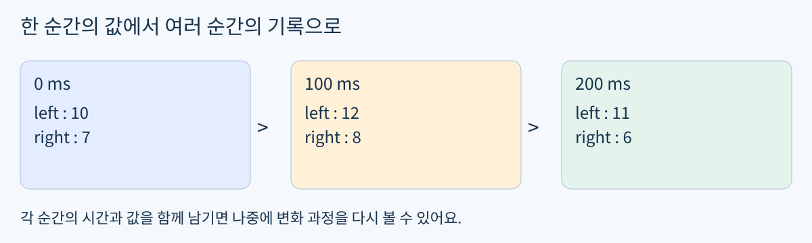
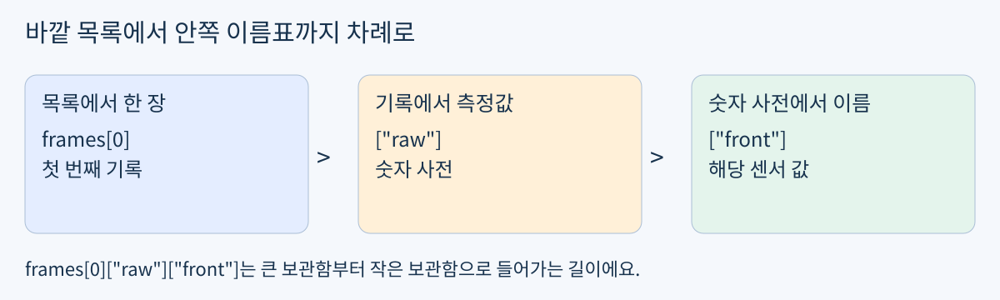
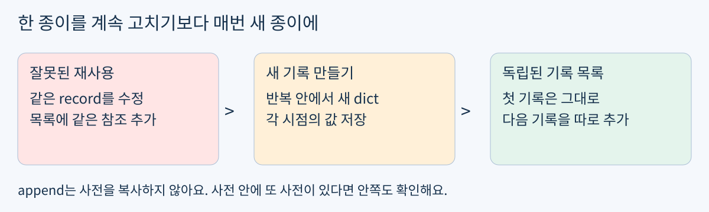

# Day14 시간별 센서 기록 만들기

2026년 11월 2일 / 개발 기초 / Python 데이터 기록 / 최대 60분

Day13에서 이름으로 센서를 연결하는 함수와 원본 보존을 실제 실행으로 확인했어요. 그 함수는 그대로 재사용하고, 오늘은 여러 순간의 결과를 서로 섞이지 않게 기록해요.

목표: 시간과 보정값을 한 묶음으로 만들고, 여러 묶음을 새 리스트에 쌓아요. 활용: 로봇이 움직이는 동안 센서 값이 언제 바뀌었는지 재현하고 오류를 찾는 기초예요.



그림 1. 시간과 측정값을 한 묶음으로 남겨요.

### 60분 사용법

- 0~5분: 시작 확인으로 중첩 조회가 필요한지 판단해요.

- 5~15분: 필요한 최소 개념과 기록 만들기 예제만 읽어요.

- 15~25분: 같은 사전을 재사용하는 예제를 실행하고 차이를 살펴봐요.

- 25~50분: 확인 문제 A를 구현하고 세 시점을 실행해요.

- 50~60분: 첫 기록 보존을 확인하고 코드와 짧은 설명을 저장해요.

익숙한 부분은 건너뛰고 일찍 마쳐도 돼요. 실습은 가상 숫자만 사용하며 설치 / 유료 GPU / 장비가 필요 없어요. 자료 도착은 기상이나 즉시 공부 요청이 아니에요.

## 최소 개념 시간표가 붙은 기록 카드

쉬운 뜻: 숫자 옆에 언제 잰 값인지 적어요. 생활 비유: 하루의 온도를 사진처럼 한 장씩 찍고 앨범에 순서대로 넣는 일이에요. 실제 용어는 한 순간의 데이터 묶음인 프레임(frame), 기록 목록인 로그(log), 데이터 안쪽의 데이터를 찾는 중첩 조회예요.

오늘 t_ms는 시작 이후 지난 밀리초예요. 1000 ms는 1초예요. 실제 시계나 인터넷 시간이 아니라 우리가 정한 가상 시각이며, 시간 측정 장치나 동기화 문제는 다루지 않아요.



그림 2. 리스트의 위치와 딕셔너리의 이름표를 차례로 찾아요.

### 확인 문제 0 시작 경로 선택

```python
samples = [{"t_ms": 50, "raw": {"rear": 9}}]
```

3분 동안 samples의 첫 기록에서 rear 값을 꺼내는 한 줄을 작성해 보세요. 편하면 아래 조회 설명은 생략하고 다음 예제로 가요. 낯설면 각 단계의 값을 하나씩 출력해 봐요. 별도 제출 의무는 없고, 정답은 시도 후 확인해요.

### 다른 자료로 보는 조회 예제

```python
albums = [{"day": "Mon", "photo": {"place": "park"}}]
card = albums[0]
photo = card["photo"]
print(photo["place"])
```

```text
park
```

albums[0]은 첫 사전, card["photo"]는 안쪽 사전, photo["place"]는 문자열이에요. 한 번에 길게 쓰기 어렵다면 변수 세 개로 나눠도 좋아요.

## 단계 예제 새 기록을 목록에 추가하기

### 1 한 순간의 기록 만들기

```python
temperatures = {"room": 21, "hall": 19}
record = {"t_ms": 0, "values": temperatures}
print(record["values"]["hall"])
```

```text
19
```

record의 t_ms는 숫자이고 values는 또 다른 사전이에요. 이 예제는 보정 없이 온도를 담아요. 서로 다른 종류의 값을 이름표로 나누어 한 기록에 넣을 수 있어요.

### 2 목록에 서로 다른 기록 추가하기

```python
log = []
log.append({"t_ms": 0, "values": {"room": 21}})
log.append({"t_ms": 500, "values": {"room": 23}})
print(log[0]["values"]["room"])
print(log[1]["t_ms"])
```

```text
21
500
```

append는 리스트 끝에 항목 하나를 붙여요. 두 번의 {...} 표현은 서로 다른 사전을 만들어요. 첫 기록과 다음 기록을 구분할 수 있어요. [2]

### 3 완성한 도구 재사용하기

Day13의 SensorCalibrator와 apply_named 정의를 day14.ipynb에 그대로 가져와도 돼요. 다시 구현하거나 재시험하는 과제가 아니에요. apply_named가 한 프레임의 raw를 받아 새 보정값 사전을 반환하는 점을 활용해요.

오늘 만들 함수는 프레임 목록을 차례로 읽고, 각 프레임마다 기존 도구를 호출해요. 시간은 바꾸지 않고 결과에 함께 남겨요. 파일 저장 / 그래프 / 경고 판단 기능까지 만들 필요는 없어요.

## 단계 예제 같은 사전을 넣을 때의 함정

리스트에 사전을 append하면 그 사전의 내용을 사진처럼 자동 복사하지 않아요. 같은 종이를 두 번 가리키는 주소표를 넣는 것과 비슷해요. 실제 용어는 객체 참조예요.

```python
log = []
card = {"step": 0}
log.append(card)
card["step"] = 1
log.append(card)
print(log)
```

```text
[{'step': 1}, {'step': 1}]
```

첫 번째 항목도 1로 보이는 이유는 두 항목이 같은 card를 가리키기 때문이에요. 첫 순간의 0을 독립 기록으로 보존하지 못했어요.



그림 3. 매번 새 기록과 새 계산 결과를 사용해요.

### 새 기록으로 바꾼 예제

```python
log = []
for step in [0, 1]:
    card = {"step": step}
    log.append(card)
print(log)
```

```text
[{'step': 0}, {'step': 1}]
```

반복할 때마다 새 사전을 만들면 각 기록이 분리돼요. 단, 안쪽에 같은 사전을 넣으면 안쪽 데이터는 여전히 공유될 수 있어요. dict.copy()도 안쪽 객체까지 복제하지 않는 얕은 복사예요. 오늘은 apply_named가 매번 만드는 새 숫자 사전을 사용하므로 deepcopy를 배울 필요는 없어요. [3]

## 재사용할 완성 도구

아래 코드는 이미 통과한 도구예요. 새 과제의 답안이 아니며 그대로 복사해도 돼요. apply_named의 확인용 print를 생략하고 반복 변수 이름을 name으로 적었어요. 이 코드를 다시 구현하거나 설명할 필요는 없어요.

```python
class SensorCalibrator:
    def __init__(self, offset, scale):
        self.offset = offset
        self.scale = scale

    def apply(self, raw):
        return (raw - self.offset) * self.scale

def apply_named(registry, raw_by_name):
    new_value = registry.copy()
    for name, value in raw_by_name.items():
        new_value[name] = new_value[name].apply(value)
    return new_value
```

한 번 호출하면 이름별 숫자를 담은 새 사전이 나와요. 다음 페이지에서는 이 함수를 여러 프레임에 재사용해요. 센서 객체 자체의 설정을 바꾸는 동작은 없어요.

### 실습 시작 순서

- 1. 새 day14.ipynb에서 위 도구 정의 셀을 먼저 실행해요.

- 2. 확인 문제 A의 registry와 frames를 별도 셀에 넣어요.

- 3. 자신의 record_frames 함수와 호출 / 출력 셀을 작성해요.

## 확인 문제 A 시간별 보정 기록

필수 과제는 A 하나예요. 정답 함수 / 완성 출력은 시도 후 제공해요. Day13의 센서 클래스와 apply_named를 그대로 사용해요.

### 입력과 반환 약속

record_frames(registry, frames)를 만들어요. 각 프레임의 raw를 기존 apply_named로 계산하고, {"t_ms": 해당 시간, "values": 보정값 사전} 형태의 새 기록을 새 리스트에 넣어 반환해요. 입력 순서와 시간을 유지하고 입력 / 센서 설정을 변경하지 않아요.

frames는 비어 있지 않고 t_ms는 오름차순 정수예요. 각 raw는 registry와 정확히 같은 센서 이름을 가지며 측정값은 숫자예요. 정렬 / 누락 검사 / 시간 검증은 필수 범위가 아니에요.

```python
registry = {"left": SensorCalibrator(2, 2),
            "right": SensorCalibrator(1, 3)}
frames = [
    {"t_ms": 0, "raw": {"right": 7, "left": 10}},
    {"t_ms": 100, "raw": {"left": 12, "right": 8}},
    {"t_ms": 200, "raw": {"right": 6, "left": 11}},
]
```

### 작성과 실행

- 1. record_frames 함수를 작성하고 세 프레임을 한 번에 처리해요.

- 2. 반환된 세 기록을 출력하고, 시간과 센서 이름이 남았는지 확인해요.

- 3. 첫 기록의 left 값 하나를 손계산해 출력과 비교해요.

- 4. 마지막 기록을 만든 뒤에도 첫 기록이 첫 시점의 값을 담는지 확인해요. 입력과 센서 설정도 살펴봐요.

힌트: 바깥 반복의 대상은 센서 이름이 아니라 frames예요. 한 기록에서 시간과 raw를 각각 꺼내고, 기존 함수를 어디에 호출할지 생각해 보세요.

## 완료 기준과 제출

### 세 가지 완료 기준

- 구현: 세 시점을 각각 새 기록으로 만들고 시간 / 이름별 보정값을 반환해요.

- 설명: 같은 사전 하나를 계속 고쳐 append하면 어떤 문제가 생기는지 한 문장으로 적어요.

- 디버깅: 첫 기록이 마지막 값으로 덮이지 않는지, 원본 입력과 설정이 보존되는지 확인해요. 별도 assert 개수는 요구하지 않아요.

### 확인 문제 이해 확인

본인의 코드에서 새 리스트, 매번 새로 만드는 바깥 기록, 새 보정값 사전이 각각 어디서 생기는지 짚어 보세요. 설명이나 코드로 이미 드러나면 같은 내용을 다시 제출할 필요 없어요.

### 막힐 때 확인할 곳

- KeyError: "raw"와 "values"를 혼동했는지 확인해요. raw는 입력, values는 출력의 이름표예요.

- 모든 시점 값이 같음: 반복 밖에서 만든 사전 하나를 계속 재사용했는지 확인해요.

- 기록이 하나뿐임: return이 반복 안에 들어갔는지 확인해요.

### 제출할 결과물

day14-sensor-frame-log/day14.ipynb에 기존 도구 정의, 작성 함수, 세 기록 출력, 첫 left 손계산, 참조 재사용 문제 설명을 남겨요. 이미 저장한 코드와 출력은 그대로 검사 근거로 사용해요. 저장했다고 알려주면 검사할게요.

A가 확인되면 같은 기록 만들기를 반복하지 않고 다음 단계로 조정해요. 답이 없으면 완료로 간주하지 않고 여기서 이어가요. 추가 실습은 요청할 때만 제공해요.

### 파일과 참고 자료

PDF와 README.md는 같은 본문이고 assets의 그림 3개를 사용해요. 두 형식 모두 확인 문제의 정답은 시도 후 공개해요. 개인 맞춤 자료이며 KANT 공식 교재는 아니에요.

개발 기초 다음은 로봇 제어 / 3D 비전, 자율주행 / 로봇 AI, 다중 로봇 / 공정 자동화, Digital Twin / RobotOps / Sim-to-Real 순서예요. 종일 부트캠프 주차를 개인 학습 기간으로 환산하지 않아요.

[1] 기준 커리큘럼: https://kant.spartaclub.kr/ai-physical

[2] Python 리스트: https://docs.python.org/3/tutorial/datastructures.html#more-on-lists

[3] Python 얕은 복사: https://docs.python.org/3/library/copy.html

2026-11-02 KST 확인: KANT 페이지는 리디렉션 접근 제한으로 최신 상세 내용을 재확인하지 못했어요. 사용자가 지정한 순서를 기준으로 구성했어요.
