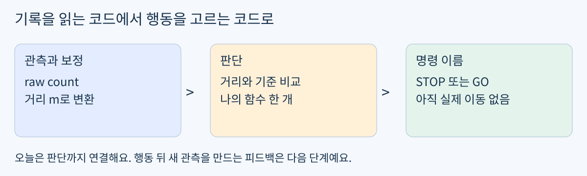
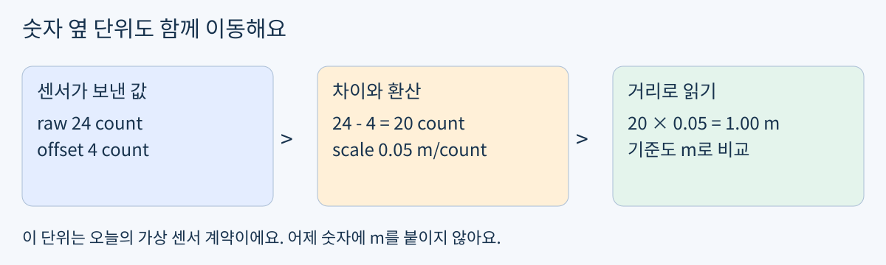
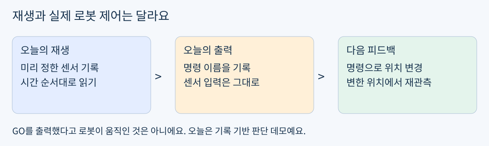

# Day15 센서 기록으로 정지 판단하기

2026년 11월 3일 / 개인 로드맵 1블록 1회 / 최대 60분

헴은 Day14에서 시간별 기록, 원본 보존, 서로 독립적인 사전 만들기를 코드와 설명으로 통과했어요. 오늘은 그 문법을 다시 시험하지 않아요. 완성한 도구를 사용해 가상 로봇이 멈출지 진행할지 고르는 함수를 연결해요.



그림 1. 센서 숫자가 행동 선택으로 이어지는 오늘의 범위

### 오늘의 목표와 결과물

choose_action(front_m, stop_m) 한 함수로 정지 여부를 결정해요. 같은 기록을 서로 다른 정지 기준으로 재생해 어떤 시점의 판단이 바뀌는지 설명해요. 실제 로봇 구동과 학습된 AI는 아직 없어요.

### 60분의 사용법

- 0~10분: 입력 단위와 오늘의 정지 규칙을 그림으로 확인

- 10~20분: 제공 도구와 가상 기록을 그대로 실행

- 20~35분: 확인 문제 A의 판단 함수 하나 작성

- 35~50분: 경계 세 입력과 기록 재생, 기준만 바꿔 비교

- 50~60분: 결과와 한계 두 문장을 저장하고 이해 확인

익숙한 부분은 바로 실습으로 가도 돼요. 막힌 부분만 보충하고, 60분을 넘으면 새 과제 없이 이어가요. Python 표준 기능만 사용하며 설치, GPU, 실물 장비가 필요 없어요. 자료 도착은 기상이나 즉시 공부 요청이 아니에요.

## 최소 개념 거리와 정지 기준

쉬운 뜻: 앞에 남은 여유를 보고 멈출지 골라요. 생활 비유: 앞사람과 너무 가까워지면 한 걸음 멈추는 것과 비슷해요. 실제 용어는 관측(observation), 판단 규칙(policy), 명령(action)이에요.

front_m은 로봇 앞면부터 고정 장애물까지의 가상 거리이고, stop_m은 정지 판단에 사용할 기준 거리예요. 둘 다 미터(m)로 비교해요. 오늘 기준은 학습용 값이며 실물의 안전 정지 거리나 인증 기준이 아니에요.



그림 2. 센서 눈금 count를 미터 m로 바꾸는 별도 예제

### 단계 예제 단위를 확인하며 계산하기

```python
raw = 24             # count
offset = 4           # count
scale = 0.05         # m/count
distance_m = (raw - offset) * scale
print(distance_m)
```

```text
1.0
```

24에서 4를 빼면 20 count, 여기에 0.05 m/count를 곱하면 1 m예요. 이 예제는 보정식을 연결하는 설명이며 확인 문제의 행동 정답은 아니에요.

### 오늘 입력의 약속

- raw와 offset은 count, scale은 m/count, 보정 결과는 m

- front_m은 유한한 0 이상의 수, stop_m은 유한한 양수

- 오늘은 누락, NaN, 음수 입력, 센서 잡음 검증을 추가 과제로 요구하지 않음

Day14의 숫자에는 거리 단위가 정해져 있지 않았어요. 그 숫자를 그대로 m로 해석하지 않고, 오늘 새로 정의한 가상 센서를 사용해요. 실제 센서의 단위와 보정 계수는 제품 / 실측으로 별도 확인해야 해요.

## 제공 도구 보정과 이름 연결

아래 두 정의는 이미 배운 도구예요. 빈 day15.ipynb의 첫 코드 셀에 그대로 복사해 실행하세요. 외우거나 다시 작성하는 과제가 아니에요. 기존 파일에서 가져와도 되지만 수식과 인자 순서는 같아야 해요.

```python
class SensorCalibrator:
    def __init__(self, offset, scale):
        self.offset = offset
        self.scale = scale

    def apply(self, raw):
        return (raw - self.offset) * self.scale


def apply_named(registry, raw_by_name):
    return {
        name: registry[name].apply(raw)
        for name, raw in raw_by_name.items()
    }
```

apply_named는 Day13과 같은 이름 대응 역할을 하는 간결한 제공 버전이에요. 새 사전을 반환하며 센서 객체와 입력을 수정하지 않아요. 사전 컴프리헨션 문법을 오늘 따로 공부하거나 이 형태로 다시 쓸 필요는 없어요.

### 사용 지점 한 곳만 읽기

```python
demo_registry = {"front": SensorCalibrator(4, 0.05)}
demo_result = apply_named(demo_registry, {"front": 24})
print(demo_result["front"])
```

```text
1.0
```

센서 객체는 계산 도구이고, demo_result의 front는 보정된 거리예요. 오늘 나의 함수에는 raw 숫자나 객체가 아니라 이 거리 숫자 하나가 들어가요.

## 제공 도구 시간별 기록과 새 센서 자료

이 셀도 그대로 사용하세요. Day14의 결과 형식 t_ms와 values를 유지해 뒤의 재생 코드가 바로 읽을 수 있어요.

```python
def record_frames(registry, frames):
    return [
        {"t_ms": frame["t_ms"],
         "values": apply_named(registry, frame["raw"])}
        for frame in frames
    ]

registry = {"front": SensorCalibrator(4, 0.05)}
frames = [
    {"t_ms": 0, "raw": {"front": 28}},
    {"t_ms": 100, "raw": {"front": 14}},
    {"t_ms": 200, "raw": {"front": 10}},
]
records = record_frames(registry, frames)
for item in records:
    print(item["t_ms"], round(item["values"]["front"], 2))
```

표시한 거리의 단위는 m, 시간은 시작 이후 ms예요. round는 화면을 읽기 쉽게 만드는 용도예요. 판단에는 반올림 전 원래 값을 전달해요.

### 내가 작성할 곳과 제공되는 곳

- 제공: 보정, 이름 대응, 시간 기록, 결과 출력과 비교용 코드

- 직접 작성: choose_action 함수 한 개

- 직접 관찰: 기준 아래 / 같음 / 위, 기준을 바꿨을 때 달라지는 판단

이전 기록을 새로 만드는 코드는 다시 검사하지 않아요. 위 제공 코드는 미래 코드 완성 예시가 아니라 이미 통과한 도구의 재사용이에요. 오늘 판단 함수의 정답은 포함하지 않았어요.

## 확인 문제 A 멈춤과 진행 고르기

### 규칙을 먼저 고정하기

이번 실습에서는 front_m이 stop_m보다 작거나 같으면 문자열 "STOP", 더 크면 문자열 "GO"를 반환하도록 정해요. 기준과 같은 값도 정지로 취급하는 학습용 정책이에요. 물리적인 안전 보장이라는 뜻은 아니에요.

```python
def choose_action(front_m, stop_m):
    # Write your decision here.
    raise NotImplementedError("Write choose_action first")
```

위 뼈대의 raise 줄을 본인 판단 코드로 바꿔요. print만 하는 함수가 아니라 문자열을 return하는 함수여야 해요. 입력 자료나 센서 객체를 수정할 필요는 없어요.

### 경계 확인 세 입력

```python
stop_m = 0.50
for distance_m in [0.25, 0.50, 0.75]:
    print(distance_m, choose_action(distance_m, stop_m))
```

먼저 세 입력의 예상 명령을 적고 실행 결과와 비교해요. 틀렸다면 전체를 다시 만들지 말고 비교 기호와 return 위치를 확인해요. 정답 목록과 완성 코드는 시도 후 검사 때 제공해요.

### 짧은 힌트

- 숫자와 기준의 관계를 비교하고, 두 갈래에서 서로 다른 문자열을 반환해요.

- 같은 값도 어느 갈래에 넣을지 조건에 포함해야 해요.

- 함수 이름이나 대소문자를 바꾸면 제공 재생 코드와 맞지 않을 수 있어요.

이미 함수가 동작하면 새로운 조건문 문제를 더 풀지 않고 다음 페이지의 기록 재생으로 바로 가요.

## 같은 기록을 두 기준으로 재생하기

아래 셀은 그대로 사용해요. 판단 함수를 완성한 뒤 실행하면 시간, 거리, 본인의 명령이 함께 나타나요. 코드가 제공되어도 STOP과 GO 출력은 본인 함수가 만들어야 해요.

```python
from copy import deepcopy

def replay(records, stop_m):
    return [
        {"t_ms": row["t_ms"],
         "front_m": row["values"]["front"],
         "action": choose_action(
             row["values"]["front"], stop_m)}
        for row in records
    ]

before = deepcopy(records)
for threshold in [0.50, 0.25]:
    print("stop_m =", threshold)
    result = replay(records, threshold)
    for row in result:
        print(row["t_ms"], round(row["front_m"], 2),
              row["action"])
assert records == before
```

### 관찰할 세 가지

- 한 기준 안에서 먼 거리와 가까운 거리의 판단이 어떻게 다른가?

- 입력은 고정하고 기준만 바꾸면 어떤 시점의 판단이 달라지는가?

- 마지막 assert가 통과하는가? 기준 실험 때문에 원본 기록이 바뀌면 안 돼요.

비교는 학습용 두 조건의 차이를 보는 실험이에요. 작은 기준이 무조건 좋다는 뜻은 아니에요. 실제 정지 여유는 속도, 제동, 지연, 센서 오차 등을 함께 고려해야 해요.

출력이 None이면 return 대신 print만 썼는지 확인해요. 모든 값이 한 명령이면 비교에 front_m을 사용했는지, 기준을 함수 밖에서 고정하지 않았는지 확인해요.

## 판단 데모의 범위와 제출



그림 3. 오늘의 기록 재생과 이후의 위치 피드백 비교

### 확인 문제 이해 확인

두 문장으로 설명해요. 첫째, front_m과 stop_m은 어떤 단위이고 기준과 같은 거리에서는 어떤 규칙을 쓰나요? 둘째, 지금 GO가 출력되면 가상 로봇 위치도 변한 건가요? 코드나 앞선 설명으로 이미 확인되면 같은 내용을 반복 제출하지 않아도 돼요.

### 제출할 결과물

- day15.ipynb에 제공 도구, 본인의 choose_action, 경계 세 입력 출력 저장

- 두 기준의 시간 / 거리 / 명령 출력과 바뀐 시점 한 줄

- 경계 규칙과 실제 이동 여부에 대한 짧은 설명

저장했다고 알려주면 실제 코드를 실행해 확인해요. 통과하면 같은 문법을 반복하지 않고 거리와 속도 명령을 눈으로 연결하는 다음 단계로 가요. 추가 과제는 요청할 때만 제공해요.

### 한계와 다음 연결

오늘은 규칙 기반 판단이며 데이터로 학습한 AI가 아니에요. 미리 정해진 기록을 재생하므로 행동이 다음 센서값에 영향을 주지 않아요. 다음 단계에서 명령을 속도로 표현하고, 이후 위치 갱신과 재관측을 붙여 모의 피드백을 만들어요.

### 자료와 출처

PDF와 README.md는 같은 본문이며 assets의 그림 3개를 사용해요. 개인 맞춤 자료이고 KANT 공식 교재가 아니에요. 전일제 부트캠프 주차를 개인 기간으로 환산하지 않아요.

KANT 기준 과정: https://kant-ai-campus.com/ai-physical

개인 로드맵: 2026-11-02 개정본의 Day15 계획과 Day14 실제 통과 기록 반영. Python 표준 기능만 사용하며 새 라이브러리 설치 없음.
