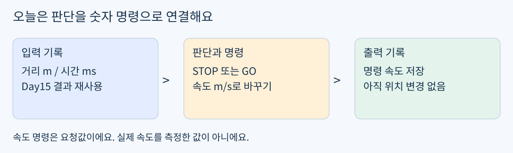
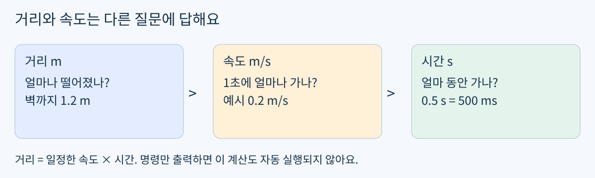
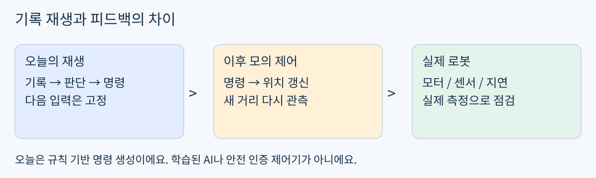

# Day16 판단을 속도 명령으로 바꾸기

2026년 11월 4일 / 개인 로드맵 1블록 2회 / 최대 60분

헴은 Day15의 판단 함수, 경계값, 두 정지 기준 비교, 원본 보존을 통과했어요. 거리 단위와 GO가 표시일 뿐이라는 설명도 맞았어요. 같은 문법을 다시 시험하지 않고 완성한 판단 뒤에 속도 명령을 붙여요.



그림 1. 오늘 새로 구현하는 부분은 판단 뒤의 속도 변환

### 목표와 실제 활용

STOP과 GO를 로봇이 사용할 수 있는 숫자 속도로 바꾸고 시간별로 기록해요. 이동 로봇의 주행 명령 생성에 쓰이는 연결 방식이에요. 실제 모터 연결이나 설치는 없어요.

### 60분 계획

- 0~5분: 아래 짧은 확인으로 보충 또는 실습 직행 선택

- 5~15분: 거리 / 속도 / 시간 그림과 계산 예제

- 15~30분: 속도 변환 함수 작성과 직접 호출

- 30~45분: 제공 재생 코드 실행과 두 속도 비교

- 45~55분: 단위 오류 찾기와 해석

- 55~60분: 결과 저장과 제출

### 확인 문제 시작 선택  /  3~5분

0.4 m/s로 0.5초 동안 일정하게 움직이면 이동 거리는 얼마일까요? 숫자와 단위를 한 줄 적어봐요. 설명할 수 있으면 예제는 가볍게 읽고 3쪽 실습으로 가요. 헷갈리면 2쪽부터 읽어요. 답이 없어도 완료로 처리하지 않아요. 정답과 해설은 시도 후 제공해요.

## 숫자 옆 단위를 연결하기

쉬운 뜻: 거리는 떨어진 길이, 속도는 1초 동안 가는 길이예요. 생활 비유: 복도 끝까지 남은 길이는 거리이고, 걷는 빠르기는 속도예요. 실제 용어는 거리 m, 속도 m/s, 시간 s예요.



그림 2. 같은 숫자라도 단위가 다르면 뜻이 달라요

### 작은 단계로 계산하기

예제: 장난감이 일정한 속도 0.3 m/s로 2초 움직인다고 가정해요. 1초에 0.3m, 2초에는 0.6m예요. 이동 거리 = 속도 × 시간 = 0.3 × 2 = 0.6m예요.

```python
speed_mps = 0.3
duration_s = 2.0
travel_m = speed_mps * duration_s
print(travel_m)
```

```text
0.6
```

m/s에서 mps는 meters per second를 줄여 쓴 변수 이름이에요. 이 계산은 속도가 일정하게 유지된다는 가정이며, 가속이나 미끄러짐을 반영하지 않아요.

### 명령과 측정 구분

0.2 m/s 명령은 “이 빠르기로 가라”는 요청이에요. 실제 로봇이 정말 그 속도로 움직였는지는 센서로 측정해야 해요. 오늘은 명령 숫자를 만들 뿐, 위치를 갱신하거나 실제 속도를 측정하지 않아요.

아래 실습의 속도는 비교를 위한 가상 값이에요. 실제 로봇의 안전 속도로 권장하는 값이 아니에요. 설치, 유료 GPU, 실물 장비는 필요 없어요.

## 확인 문제 A 속도 변환 함수

### 오늘 새로 작성할 함수 하나

action_to_speed(action, cruise_mps)를 작성해요. action은 "STOP" 또는 "GO"만 들어오고 cruise_mps는 0 이상의 유한한 숫자라고 가정해요. STOP이면 숫자 0.0, GO이면 전달받은 cruise_mps를 반환해요. 다른 입력의 예외 처리는 오늘 범위에 없어요.

```python
def action_to_speed(action, cruise_mps):
    # Replace the next line with your code.
    raise NotImplementedError("Write action_to_speed")
```

위 raise 줄을 본인 코드로 바꾸세요. 함수 안에서 출력만 하지 말고 숫자를 return해야 해요. 아래 호출 코드는 그대로 사용해요.

```python
for action in ["STOP", "GO"]:
    print(action, action_to_speed(action, 0.2))

print("GO at zero:", action_to_speed("GO", 0.0))
```

먼저 세 호출의 예상 숫자를 적고 실행해서 비교해요. GO라도 전달한 속도가 0이면 무엇을 뜻하는지 한 문장으로 설명해요. 정답 출력 목록은 아직 제공하지 않아요.

### 이미 작성한 판단 함수 재사용

```python
def choose_action(front_m, stop_m):
    if front_m <= stop_m:
        return "STOP"
    return "GO"
```

choose_action은 어제 통과한 도구예요. 새로 풀 문제가 아니므로 그대로 사용해도 돼요. 오늘은 반환된 문자열을 숫자 명령으로 이어주는 부분에 집중해요.

### 막혔을 때만 보는 힌트

- 비교 대상은 거리 숫자가 아니라 action 문자열이에요.

- 이동 속도를 0.2로 함수 안에 고정하면 다른 속도를 요청했을 때 반영되지 않아요.

## 기록을 속도 명령으로 재생하기

아래는 Day15에서 이미 확인한 보정 후 거리 기록이에요. 센서 클래스와 보정 계산을 다시 구현하지 않아요. records와 stop_m은 두 실험 모두 동일하게 유지해요.

```python
records = [
    {"t_ms": 0,   "front_m": 1.20},
    {"t_ms": 100, "front_m": 0.50},
    {"t_ms": 200, "front_m": 0.30},
]

def replay_speeds(records, stop_m, cruise_mps):
    result = []
    for row in records:
        action = choose_action(row["front_m"], stop_m)
        result.append({
            "t_ms": row["t_ms"],
            "front_m": row["front_m"],
            "action": action,
            "speed_mps": action_to_speed(
                action, cruise_mps),
        })
    return result
```

이 재생 함수는 제공 도구예요. 그대로 실행하세요. speed_mps는 명령 속도이고 실제 측정 속도가 아니에요. 각 행의 t_ms도 기록의 시간이며, 컴퓨터가 코드를 실행한 현재 시간이 아니에요.

### 두 실험을 이미 수행하는 코드

```python
from copy import deepcopy
before = deepcopy(records)

for cruise_mps in [0.2, 0.4]:
    print("cruise_mps =", cruise_mps)
    for row in replay_speeds(records, 0.50, cruise_mps):
        print(row)

assert records == before
```

위 for문은 이미 이동 명령 속도를 0.2와 0.4로 바꿔 두 번 실행해요. 추가로 기준이나 입력을 수정하지 마세요. 원본 보존 assert는 제공된 확인 도구예요.

## 확인 문제 B 비교와 디버깅

### 무엇을 비교할지 정확히 정하기

- 고정: 세 행의 입력 기록, 정지 기준 stop_m=0.50m, 판단 함수

- 변경: 이동 명령 속도 cruise_mps만 0.2 → 0.4m/s

- 비교: 두 출력에서 같은 t_ms끼리 action과 speed_mps를 각각 대조

질문 1. 어느 t_ms에서 speed_mps가 달라졌나요? 시간 목록과 전후 숫자를 적어요. 질문 2. action도 달라졌나요? 달라졌는지와 이유를 한 문장으로 설명해요. 코드가 이미 두 실험을 수행하므로 결과만 비교하면 돼요.

### 확인 문제 C 시간 단위 오류

아래는 의도적으로 틀린 코드예요. 속도는 m/s인데 시간은 ms예요. 500ms 동안 일정한 0.2m/s로 간다고 가정할 때, 이동 거리가 m로 계산되도록 고치세요. 이 코드는 기록 재생과 별개인 단위 연습이며, 실행해도 로봇 위치는 바뀌지 않아요.

```python
speed_mps = 0.2
duration_ms = 500
travel_m = speed_mps * duration_ms
print(travel_m)
```

고친 코드, 결과와 단위를 적어요. 힌트: 1000ms가 1초예요. 어느 값을 환산해야 하는지 먼저 생각해요. 정답과 완성 코드는 제출 후 확인해요.

### 출력이 이상하면

- None이 나오면 action_to_speed에 return이 있는지 확인

- 두 이동 속도가 항상 같으면 함수 안에 속도를 상수로 고정했는지 확인

- 코드와 출력의 시간이 다르면 해당 셀 재실행 후 저장

- 처음부터 다시 실행할 때 오류가 나면 함수 정의 셀을 먼저 실행

## 오늘의 범위와 제출



그림 3. 다음 입력이 행동에 따라 바뀌어야 피드백이 돼요

### 한 문장 이해 확인

속도 명령이 0.2에서 0.4로 바뀌어도 이 재생 코드의 다음 front_m이 그대로인 이유를 설명해요. Day15의 “표시만 한다”는 이해를 속도 숫자에 연결하는 확인이에요. 긴 시험은 없어요.

### 제출할 결과물

- day16.ipynb: action_to_speed, 제공 재생 코드, 두 속도의 저장 출력

- 같은 t_ms의 속도 전후 비교와 action 변화 여부 한 줄

- 시간 단위 오류를 고친 코드와 결과

- 다음 입력이 고정인 이유 한 문장

마지막에 셀을 실행하고 저장해요. 이미 검증한 기능은 반복 제출하지 않아도 돼요. 빠르게 끝나면 60분을 채우려고 추가 문제를 풀 필요 없어요. 막힌 부분만 보내면 그 부분부터 이어가요.

### 다음 연결

오늘은 규칙 기반 명령 생성이며 학습된 AI가 아니에요. 다음에는 속도와 시간을 이용해 가상 위치를 갱신하고, 달라진 위치에서 거리를 다시 계산하는 모의 제어로 연결해요. 실제 모터에는 제동, 오차, 지연과 별도 안전 설계가 필요해요.

### 자료 안내

PDF와 README.md는 같은 내용이며 그림은 assets의 SVG 3개예요. 정답 공개 시점도 동일하게 사용자 시도 후예요. KANT 개발 기초에서 로봇 제어로 이어지는 개인 맞춤 연결 자료이며 공식 교재가 아니에요. 전일제 부트캠프 주차를 개인 학습 기간으로 환산하지 않아요.

기준 과정: https://kant-ai-campus.com/ai-physical

2026-11-02 개정 개인 로드맵과 Day15 실제 통과 기록 반영. Python 표준 기능만 사용하며 신규 설치 없음.
