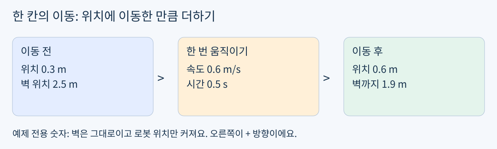
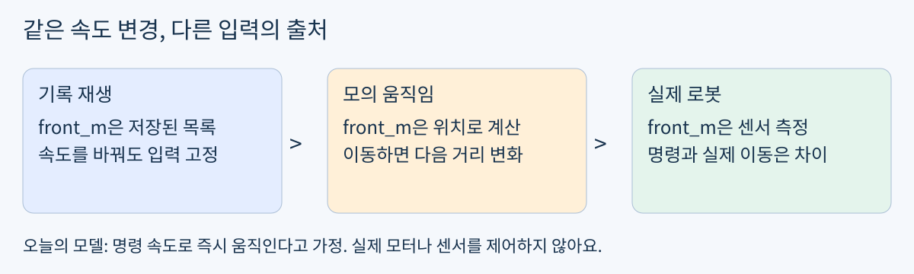
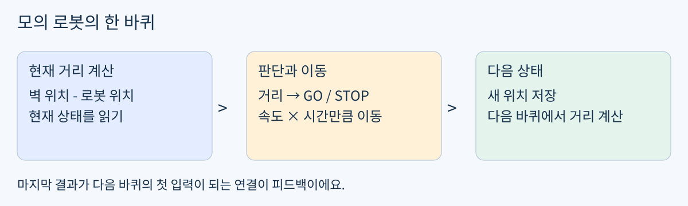

# Day17 | 명령으로 가상 로봇 움직이기

2026-11-05  /  헴의 60분 Physical AI 실습  /  1차원 이동과 피드백

### 오늘의 목표

어제 만든 속도 명령으로 화면 속 로봇의 위치를 바꾸고, 바뀐 위치에서 벽까지 거리를 다시 계산해요. Python 문법을 새로 외우는 시간이 아니라 명령과 움직임을 연결하는 첫 모의실험이에요.

- 이미 확인한 GO/STOP 판단과 속도 명령 함수는 재사용해요. 긴 기초 시험은 생략해요.

- 완료 기준: 위치 갱신 구현, 다음 거리의 출처 설명, 시간 단위와 갱신 순서 오류 찾기.

### 60분 사용법

- 0~5분: 아래 짧은 확인. 5~15분: 이동 그림과 예제.

- 15~35분: 한 번 이동시키기와 반복 연결. 35~50분: 두 속도로 비교.

- 50~60분: 확인 문제와 결과 정리. 막히면 그 부분부터 다음 시간에 이어가요.

### 시작 전 3~5분 확인

미리보기와 같은 조건이에요. 로봇 위치 0 m, 벽 위치 2 m, 속도 0.4 m/s, 이동 시간 500 ms일 때 이동 후 위치와 벽까지 거리를 적어 보세요. 계산식과 단위를 함께 남겨요. 아직 답을 시도하지 않았으므로 해설은 싣지 않았어요.

- 계산을 설명할 수 있으면 실습으로 직행. 막히면 다음 페이지의 다른 숫자 예제로 보충.

준비물: 기존 Python 실행 환경과 빈 노트북. 새 설치, 실물 장비, 유료 GPU 없이 진행해요. 지금 바로 시작할 필요는 없어요.

## 1 | 속도가 위치를 바꾸는 방법

위치는 바닥에 붙인 자의 눈금이에요. 로봇이 오른쪽으로 움직이면 눈금이 커져요. 이 한 줄짜리 세계를 1차원 모델이라고 해요.



예제: 로봇 0.3 m → 0.6 m. 고정된 벽 2.5 m까지 남은 거리는 1.9 m.

### 작은 단계로 연결하기

- 1. 시간: 500 ms / 1000 = 0.5 s. 속도가 m/s이므로 시간도 s로 맞춰요.

- 2. 이동한 거리: 0.6 m/s × 0.5 s = 0.3 m.

- 3. 새 위치: 이전 위치 0.3 m + 이동 거리 0.3 m = 0.6 m.

- 4. 남은 거리: 벽 위치 2.5 m - 새 위치 0.6 m = 1.9 m.

```python
x_m = 0.3
wall_m = 2.5
speed_mps = 0.6
dt_s = 500 / 1000
next_x_m = x_m + speed_mps * dt_s
next_front_m = wall_m - next_x_m
print(next_x_m, next_front_m)
```

변수 뜻: x_m은 로봇의 위치, wall_m은 벽의 위치, dt_s는 이번 한 번 움직일 시간이에요. front_m은 로봇과 벽 사이 거리이지 로봇의 위치가 아니에요.

벽은 가만히 있고, 로봇은 오른쪽으로만 움직여요. 한 번 이동하는 동안 속도는 일정하다고 가정해요.

## 2 | 기록 재생에서 피드백으로



기록 재생과 시뮬레이션은 다음 입력을 얻는 곳이 달라요.

녹화된 영상을 빨리 달리라는 명령으로 바꿀 수는 없어요. 어제의 front_m도 이미 기록된 값이라 명령을 바꿔도 그대로였어요. 오늘은 위치를 직접 갱신해서 다음 거리를 새로 만들어요.



거리 계산 → 판단 → 속도 명령 → 위치 갱신 → 다음 거리 계산의 반복.

현재 결과를 다음 판단에 되돌려 쓰는 연결을 피드백이라고 해요. 오늘은 센서 대신 위치 계산으로 거리를 얻는 시뮬레이션이에요. 학습된 AI 모델은 아직 쓰지 않지만, 로봇 제어와 AI 행동을 시험할 환경의 뼈대를 만드는 단계예요.

### 이 모델이 생략한 현실

명령 속도가 즉시 실제 속도가 된다고 가정해요. 가속, 미끄러짐, 센서 오차, 통신 지연, 로봇 크기는 생략해요. 실제 로봇에서는 측정과 안전장치가 별도로 필요해요.

## 3 | 실습: 한 번 이동하는 함수

빈 day17.ipynb 또는 새 Python 파일에 작성해요. 먼저 예제 코드를 실행하고, 아래 함수의 TODO를 채워요. x_m을 받으면 이동 후 위치를 반환하는 함수예요.

```python
def advance_position(x_m, speed_mps, dt_s):
    # TODO: return the next position in meters
    raise NotImplementedError

print(advance_position(0.3, 0.6, 0.5))
```

위 호출은 앞의 예제와 같은 계산이어야 해요. 여기서만 예제 결과를 비교하고, 확인 문제의 답은 직접 작성해요.

### 이미 만든 함수 재사용

```python
def choose_action(front_m, stop_m):
    return "STOP" if front_m <= stop_m else "GO"

def action_to_speed(action, cruise_mps):
    return 0.0 if action == "STOP" else cruise_mps
```

GO는 판단이고 speed_mps는 숫자 명령이에요. 함수를 호출했다고 로봇 위치가 저절로 바뀌지는 않아요. advance_position의 반환값을 다음 위치로 저장해야 해요.

### 가정과 범위

- 위치와 벽 위치 단위는 m, 속도는 m/s, dt_s는 s예요. 시간 변환은 반복문 밖에서 한 번 해요.

- 속도는 0 이상, 시간은 0보다 크게 두어요. 로봇은 벽 왼쪽에서 시작하고 벽을 향해 움직여요.

## 4 | 실습: 다음 입력을 직접 만들기

아래 뼈대의 TODO 두 곳을 채워요. front_m은 이동 전 거리, next_front_m은 이동 후 거리예요. 매 바퀴의 action은 이동 전 거리로 결정해요.

```python
def run_sim(cruise_mps):
    x_m, wall_m = 0.0, 2.0
    stop_m, dt_s = 0.5, 0.5
    rows = []
    for step in range(16):
        front_m = wall_m - x_m
        action = choose_action(front_m, stop_m)
        speed_mps = action_to_speed(action, cruise_mps)
        # TODO: call advance_position
        next_x_m = ...
        next_front_m = wall_m - next_x_m
        rows.append({
            "t_ms": int(step * dt_s * 1000),
            "front_m": front_m, "action": action,
            "speed_mps": speed_mps,
            "next_x_m": next_x_m,
            "next_front_m": next_front_m})
        # TODO: save next_x_m as the next current x_m
    return rows

for cruise_mps in [0.25, 0.5]:
    print("cruise_mps =", cruise_mps)
    for row in run_sim(cruise_mps):
        print(row)
```

각 행은 t_ms 시점에 판단하고, t_ms + 500 ms까지 이동한 결과를 담아요. next_front_m을 같은 시점의 센서 값으로 착각하지 않도록 구분해요.

이미 두 속도로 호출하는 코드예요. 목록에 속도를 더 추가할 필요 없이, 두 실행 결과를 같은 t_ms끼리 비교해요. 각 실행은 x_m = 0.0부터 독립적으로 시작해요.

## 5 | 확인 문제

### 1. 구현 결과를 관찰하기

고정값은 시작 위치 0 m, 벽 2 m, 정지 기준 0.5 m, 시간 간격 0.5 s, 반복 16회예요. 바꾸는 값은 cruise_mps 두 값 0.25와 0.5뿐이에요.

각 실행에서 처음 STOP이 된 행의 t_ms와 front_m을 적어요. 두 실행의 t_ms = 1000인 행에서 front_m과 next_front_m도 각각 비교해요. 결과가 같거나 다른 이유를 한 문장으로 설명해요.

### 2. 같은 입력인가, 새 입력인가?

오늘 코드에서 다음 front_m을 바꾸는 연결은 어느 두 줄인가요? 해당 줄을 적고, 그중 위치 저장을 빼면 출력이 어떻게 달라질지 예측한 뒤 실제로 비교해요. 확인 후 원래 코드로 복구해요.

### 3. 단위 오류 찾기

dt_s = 500으로 잘못 넣으면 무엇을 1000배 크게 계산하게 되나요? 전체 반복을 돌리지 말고, 한 번의 이동 예측과 올바른 시간값만 적어요.

### 4. 모의실험의 안전 한계

한 번의 이동 거리가 현재 벽까지 거리보다 크면 이 단순 모델은 어떤 잘못된 위치를 만들 수 있을까요? 정지 기준을 검사한다는 사실만으로 실제 충돌 방지가 보장되는지도 설명해요.

문제의 정답과 해설은 제출 후 제공해요. 첫 페이지 미리보기에 이미 답했다면 같은 계산을 다시 제출할 필요는 없어요.

## 6 | 점검과 제출

### 막힐 때 볼 순서

- 거리가 계속 같음: 새 위치를 x_m에 저장하는 줄이 반복문 안에 있는지 확인해요.

- 거리가 갑자기 매우 작거나 음수: ms를 s로 바꿨는지, 이동 폭이 너무 큰지 확인해요.

- GO인데 움직이지 않음: action 글자와 speed_mps 숫자를 따로 출력해요.

- 두 속도 실행이 이어짐: x_m 초기화가 run_sim 안에 있는지 확인해요.

### 오늘 설정의 제한

실습의 최대 한 번 이동 거리는 0.5 m/s × 0.5 s = 0.25 m이고 정지 기준은 0.5 m예요. 이 설정에서는 정지 기준을 조금 지나칠 수 있어도 벽을 넘지 않게 여유를 둔 거예요. 임의의 큰 속도나 큰 시간 간격에는 이 보장이 없어요. 충돌 처리 기능이 있는 시뮬레이터가 아니에요.

### 보낼 결과물

- 완성한 advance_position과 run_sim 코드 또는 노트북.

- 확인 문제 1의 비교 결과와 문제 2~4의 짧은 답. 오류가 있으면 출력이나 오류 문구도 함께.

- 설명 한 줄: 속도 명령이 다음 거리까지 영향을 주려면 어떤 연결이 필요한가?

구현하고 설명할 수 있으면 오늘 완료예요. 계산이 막히면 1페이지 예제 보충, 구현만 막히면 TODO 두 곳부터 이어가요. 답이 없으면 완료로 처리하지 않고 이 실습부터 다시 이어가요.

### 자료 안내

PDF와 README.md는 같은 학습 내용이에요. 그림 원본은 assets 폴더, 빈 실습 노트북은 day17.ipynb예요. Markdown과 assets를 함께 옮겨야 그림이 보여요.

기준 커리큘럼: https://kant.spartaclub.kr/ai-physical  /  개발 기초를 로봇 제어로 연결하는 개인 실습. 공식 부트캠프 주차를 개인 학습 기간으로 환산하지 않아요.
