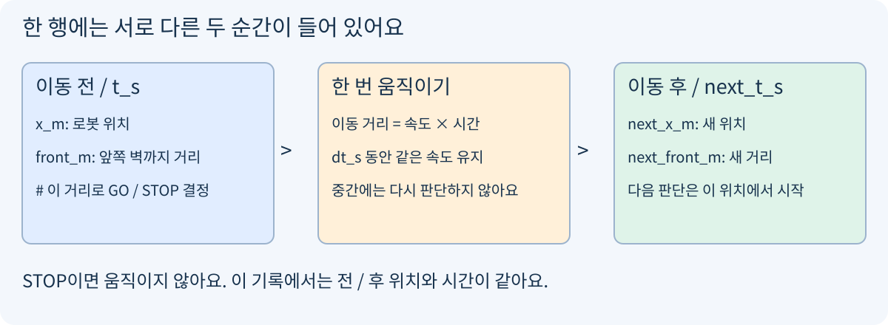
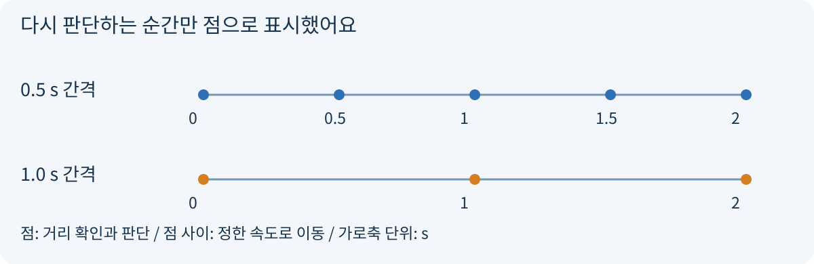
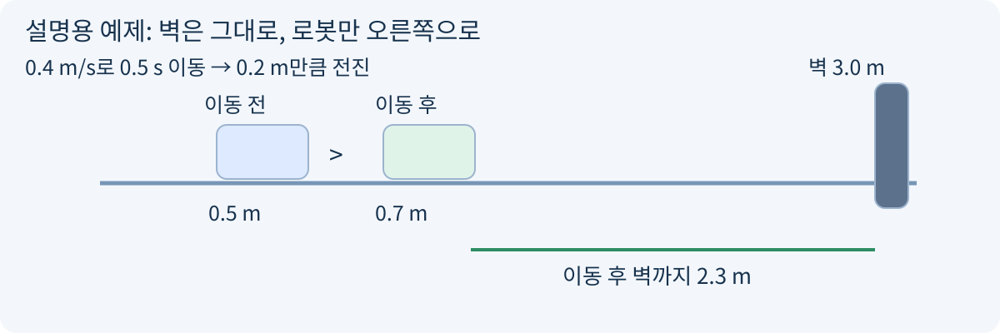
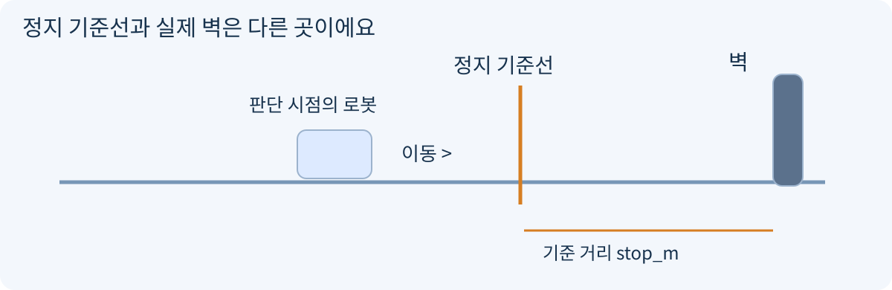

# Day18 | 얼마나 자주 다시 판단할까?

2026-11-06 / 헴의 60분 Physical AI / 한 걸음의 길이와 이동 전 / 후 기록

### 오늘의 목표

완료한 Day17 코드를 다시 시험하지 않아요. 익숙한 움직임 규칙을 그대로 두고, 다시 판단하기까지 기다리는 시간 하나만 바꿔 봐요. 변수마다 한글 뜻과 이동 전 / 후를 붙였어요.

- 한 행에 함께 적힌 이동 전 값과 이동 후 값을 구별해요.

- 제공된 실행기를 실행하고, 선택한 경로의 결과를 말로 설명해요.

- 실습 경로에서는 판단 간격만 바꾸어 정지 기록을 비교해요.

### 60분 계획

- 0~5분: 선택 진단과 경로 선택. 5~15분: 그림과 변수 뜻.

- 15~25분: 다른 숫자로 된 설명 예제. 25~45분: 선택한 경로 실습.

- 45~55분: 확인 문제. 55~60분: 이해도 점검과 저장.

### 짧은 진단은 시작 위치를 고르는 용도예요

선택 진단 D0: 한 행에서 이동 전 벽까지 거리를 읽으려면 front_m과 next_front_m 중 어느 것을 볼까요? 헷갈리면 “기초부터”, 편하면 “실습부터”라고만 적어도 돼요. 생략해도 됩니다.

이전 미리보기 답을 못 보냈어도 괜찮아요. 미응답을 실력이나 학습 여부로 판단하지 않아요. 이미 확인한 Day17은 완료 상태 그대로예요.

### 둘 중 편한 경로 하나만 선택해요

- 기초부터: A 한 번만 실행하고 전 / 후 기록을 천천히 읽어요. Q1 / Q2 / Q5와 U1이면 충분해요.

- 실습부터: A / B를 실행해 판단 간격을 비교해요. Q1 / Q2 / Q3 / Q4와 U1을 적어요.

준비물은 기존 Python 환경과 day18.ipynb예요. 새 설치나 장비는 없어요. 시간이 부족하면 끝낸 곳까지만 저장하고 이어가요.

## 1 | 변수 이름을 두 순간으로 나누기

쉬운 뜻: 한 번 움직이기 직전과 직후의 상태를 한 줄에 담아요. 비유: 여행 사진 두 장을 “출발 전”과 “도착 후”로 붙인 기록장이에요. 이때 각 순간의 위치와 거리 같은 정보를 상태라고 불러요.



파란 상자는 이동 전, 초록 상자는 이동 후예요. 주황 상자는 두 순간 사이의 이동이에요.

### 옆에 두고 보는 한글 사전

- x_m: 이동 전 로봇 위치(m). 출발점을 0으로 잡은 바닥 눈금이에요.

- wall_m: 고정된 앞쪽 벽 위치(m). 로봇이 움직여도 바뀌지 않아요.

- front_m: 이동 전 로봇과 앞쪽 벽 사이 거리(m). wall_m - x_m으로 구해요.

- next_x_m / next_front_m: 이번 이동 후 로봇 위치 / 벽까지 거리(m).

- t_s / next_t_s: 이번 행의 이동 전 시간 / 이동 후 시간(s).

- dt_s: 한 번 이동하며 기다릴 시간(s). 다음 판단까지의 간격이에요.

- stop_m: 이 거리 이하일 때 STOP으로 판단하는 기준(m).

- cruise_mps: GO일 때 쓸 속도(m/s). speed_mps: 이번에 실제 계산에 쓸 속도예요.

- action: GO 또는 STOP이라는 판단 이름. rows: 행들을 모은 기록장이에요.

이름 끝의 *m은 미터, \_s는 초, \_mps는 초당 미터를 뜻해요. next*는 이 행에서 한 번 움직인 뒤를 뜻하며, 다음 행의 이동 전 상태로 이어져요.

## 2 | 자주 살피기와 한 걸음의 길이

쉬운 뜻: 얼마나 기다렸다가 다시 벽까지 거리를 볼지 정해요. 비유: 보드게임에서 짧게 한 칸씩 움직이고 매번 확인하는 것과, 길게 움직인 뒤 확인하는 차이예요. 이 시간을 판단 간격, 코드에서는 dt_s라고 불러요.



같은 2초 안에서도 판단하는 횟수는 달라요. 점 사이에서는 속도를 그대로 유지해요.

### 설명 예제: 오늘 확인 문제와 다른 숫자예요

시작 위치 0.5 m, 벽 위치 3.0 m, 속도 0.4 m/s, 한 번 이동할 시간 0.5 s로 정해요. 이미 GO라고 판단한 상황에서 한 번만 이동해 봐요.



예제의 이동 전 벽까지 거리는 2.5 m이고, 이동 후에는 2.3 m예요. 그림은 비율대로 그린 것이 아니에요.

- 1. 이동 전 거리: 3.0 - 0.5 = 2.5 m.

- 2. 이번 이동 거리: 0.4 m/s × 0.5 s = 0.2 m.

- 3. 이동 후 위치: 0.5 + 0.2 = 0.7 m.

- 4. 이동 후 거리: 3.0 - 0.7 = 2.3 m.

속도 × 시간이 이동 거리예요. 이번에 이동한 거리를 먼저 구한 뒤, 이전 위치에 더해요. 이 예제 결과는 공개하지만 아래 확인 문제의 결과와 해설은 시도한 뒤 확인해요.

## 3 | 제공 코드: 다시 만들지 않고 사용하기

아래 코드는 오늘 사용할 기록 도구예요. Day17에서 이미 완성한 이동 / 갱신 규칙을 담았어요. TODO를 채우는 문제가 아니므로 그대로 복사해 한 셀에서 실행해요. 답과 실행 결과는 아직 비워 두었어요.

```python
def run_sim(dt_s):
    # dt_s: 다시 판단하기 전까지 한 번 이동할 시간(초)
    x_m = 0.0          # 이동 전 로봇 위치(m), 매 실험 0부터 시작
    wall_m = 2.0       # 움직이지 않는 앞쪽 벽 위치(m)
    stop_m = 0.75      # 이 거리 이하이면 STOP으로 판단(m)
    cruise_mps = 0.5   # GO일 때 사용할 속도(m/s)
    rows = []          # 이동 전 / 후를 함께 남길 기록장
    for step in range(20):  # 최대 20번만 판단해요
        t_s = step * dt_s   # 이번 판단을 하는 시간(초)
        front_m = wall_m - x_m  # 이동 전 벽까지 거리(m)
        action = "STOP" if front_m <= stop_m else "GO"
        speed_mps = 0.0 if action == "STOP" else cruise_mps
        next_x_m = x_m + speed_mps * dt_s  # 이동 후 위치(m)
        next_front_m = wall_m - next_x_m  # 이동 후 벽까지 거리(m)
        # STOP 행은 움직이지 않고 기록을 끝내므로 시간도 그대로예요
        next_t_s = t_s if action == "STOP" else t_s + dt_s
        rows.append({
            "t_s": t_s, "x_m": x_m,
            "front_m": front_m, "action": action,
            "speed_mps": speed_mps,
            "next_t_s": next_t_s, "next_x_m": next_x_m,
            "next_front_m": next_front_m,
        })
        # 새 위치를 다음 반복의 출발 위치로 저장해요
        x_m = next_x_m
        if action == "STOP":  # 첫 STOP을 기록했으면 반복을 끝내요
            break
    return rows
```

### 위에서 아래로 딱 네 단계

- 1. 이동 전 거리로 GO / STOP 판단.
- 2. 속도와 시간으로 이동 후 위치 계산.
- 3. 이동 전 / 후를 같은 행에 기록.
- 4. 새 위치를 다음 출발 위치로 저장.

break는 반복을 여기서 끝내라는 뜻이에요. 오늘은 처음 STOP이 관찰된 행까지만 기록해요. 그 행은 정지 확인 순간이므로 시간이 더 흐른 이동 구간을 만들지 않아요.

실제 로봇 제어 코드가 아니에요. 벽을 향한 1차원 이동, 즉시 속도 적용, 오차 없는 위치 계산을 가정하며 가속 / 제동 거리 / 센서 오차는 생략했어요.

## 4 | 실습: 바꿀 것은 dt_s 하나

### 고정값과 바꿀 값

- 고정: 시작 위치 0 m, 벽 2 m, GO 속도 0.5 m/s, STOP 기준 0.75 m.

- 변경: 판단 간격만 A = 0.5 s, B = 1.0 s로 바꿔요. 각 호출은 0 m부터 새로 시작해요.

### A 실행: 두 경로 모두

```python
# 0.5초마다 벽까지 거리를 확인하는 A 실험
rows_a = run_sim(0.5)
for row in rows_a:
    print(row)  # 한 행의 이동 전 / 후 값을 함께 출력해요
```

### 기초 경로는 여기서 기록 읽기로

A의 t_s = 1.0 행을 찾아 이동 전 값에는 파란 표시, 이동 후 값에는 초록 표시를 해요. 복사한 행 아래에 변수의 한글 뜻을 적어도 좋아요. A의 첫 STOP 행도 찾아요. 남은 실습 시간은 Q1 / Q2 / Q5에 사용해요. B는 다음에 해도 돼요.

### B 실행: 실습 경로만

```python
# 1.0초마다 확인하는 B 실험. 속도는 A와 같아요
rows_b = run_sim(1.0)
for row in rows_b:
    print(row)
```

A / B에서 action이 처음 STOP인 행을 각각 찾아요. 표를 직접 만들고 “판단 간격 / 첫 STOP 시간 / 그때 이동 전 벽까지 거리” 세 칸을 채워요. 이미 B를 실행하는 코드가 있으니 함수 안의 값을 바꿀 필요는 없어요.

### 비교할 때의 약속

같은 시각 비교는 두 실행에 모두 있는 t_s = 1.0 행에서 해요. 앞에서 몇 번째 줄인지로 맞추면 다른 시간을 비교할 수 있어요. 이동 후 값은 반드시 next_t_s까지 함께 읽어요.

여기서 “첫 STOP 시간”은 프로그램이 확인해 STOP이라고 판단한 시각이에요. 이동 도중 기준 거리에 도달했을 이론적인 순간과 구별해요.

## 5 | 확인 문제

선택한 경로의 질문만 답해요. 정답표와 비교 결과는 아직 싣지 않았어요. 출력이 예상과 달라도 지우지 말고 관찰한 값과 생각을 함께 남기면 돼요.

### 두 경로 공통

Q1. A 실험(dt_s = 0.5)의 t_s = 1.0인 행을 찾아요. 이동 전 x_m / front_m / t_s와 이동 후 next_x_m / next_front_m / next_t_s를 단위와 함께 적으세요. “이동 전 1.0초”와 “이동 후 시간”을 따로 표시해요.

Q2. A 실험에서 처음 action이 STOP인 행의 t_s, x_m, front_m을 적으세요. 그 행의 next_x_m과 next_t_s도 읽고, 이 행에서 실제로 한 번 더 움직였는지 설명하세요.

### 실습 경로: 두 판단 간격 비교

Q3. 실습 경로만: A와 B(dt_s = 1.0)에서 첫 STOP 행의 t_s와 front_m을 비교하세요. 속도 / 시작 위치 / 벽 / 정지 기준은 같은데 결과가 달라지거나 같아진 이유를 “다시 판단하는 순간”과 연결해 한 문장으로 적으세요.

Q4. 실습 경로만: 두 실행에서 t_s = 1.0인 행을 비교하세요. front_m끼리 비교한 뒤 next_front_m끼리도 비교해요. 각 next_front_m이 가리키는 next_t_s를 함께 적고, 이동 후 값들이 같은 시각의 값인지 설명하세요. 같은 행 번호끼리 비교하지 않아요.

### 기초 경로: 한 실행 안에서 연결하기

Q5. 기초 경로만: A의 첫 번째 행과 바로 다음 행을 보세요. 첫 행의 next_x_m과 다음 행의 x_m을 찾아 연결선을 그리거나 한 문장으로 연결해 주세요. 같은 방법으로 next_front_m과 다음 front_m도 연결해요.

### 답안 틀

- Q1: 이동 전: 시간 ** s / 위치 ** m / 벽까지 ** m. 이동 후: 시간 ** s / 위치 ** m / 벽까지 ** m.

- Q2: 첫 STOP 시간 ** s / 위치 ** m / 벽까지 ** m. 이동 후 위치 / 시간: **. 설명: \_\_.

- 실습 경로: Q3 A **, B **, 이유 **. Q4 각 이동 후 시간 **, 비교할 때 주의점 \_\_.

- 기초 경로: Q5 첫 행의 ** 값이 다음 행의 ** 값으로 이어져요.

day18.ipynb의 Markdown 셀에도 이 질문과 답안 칸이 들어 있어요. 코드 셀과 답안은 비워 두었으니, 제공 코드를 복사하고 본인의 실행 결과와 설명을 남겨 주세요.

## 6 | 이해도 점검과 제출

### 오늘 이해도 점검

이해도 점검 U1: “조금 움직인 뒤 다시 판단한다”를 내 말로 한 문장 적으세요. 자신감은 편함 / 설명을 보며 가능 / 같이 해보고 싶음 중 하나로 표시해요. 막힌 변수나 줄이 있으면 그대로 적어 주세요.

### 선택 보충: 지난번 남겨 둔 두 가지

단위: 1 s는 1000 ms예요. 250 ms는 250 / 1000 = 0.25 s예요. 속도의 단위가 m/s이면 곱하는 시간도 s로 맞춰요. 오늘 코드는 처음부터 s만 써서 추가 변환이 필요 없어요.



기준선은 “이만큼 가까우면 멈추자”는 약속이고, 실제 벽과는 구별돼요.

벽 통과: 이 단순 실행기는 이동 중 충돌을 검사하지 않아요. 큰 시간 간격이나 속도에서는 다음 판단 전에 기준선을 지나거나 벽을 통과한 위치를 계산할 수 있어요. 판단을 자주 한다는 것만으로 실제 로봇의 안전이 보장되지는 않아요.

선택 질문 O1: 한 번 이동하는 거리가 이동 전 벽까지 거리보다 더 크다면, 계산된 next_x_m은 벽의 어느 쪽에 놓일까요? 코드를 실행하지 말고 그림이나 한 문장으로 표시해요. 오늘 제출하지 않아도 됩니다.

### 보낼 결과물

- 기초 경로: A 실행 결과 + Q1 / Q2 / Q5 답 + U1. 이것만으로 오늘 선택한 경로를 마칠 수 있어요.

- 실습 경로: A / B 실행 결과 + Q1 / Q2 / Q3 / Q4 답 + U1.

- 둘 다: day18.ipynb를 저장해요. 오류가 나면 오류 문구와 막힌 셀을 그대로 남겨요. D0와 O1은 제출 필수가 아니에요.

자료 구성: README.md와 PDF는 같은 학습 내용이에요. assets 안의 그림 네 개를 함께 두면 Markdown 그림이 보여요. 노트북은 질문을 담은 빈 풀이 공간이에요. 새 진도보다 선택한 범위에서 이해하고 설명하는 것을 우선해요.
