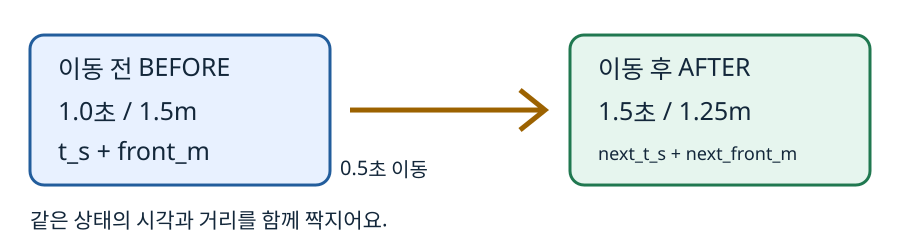
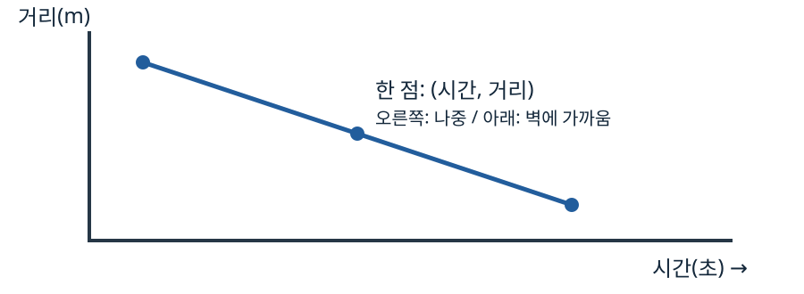

# Day19 | 로봇 기록을 시간 그래프로 읽어요

2026-11-07 · Physical AI · 목표 약 60분 (실제 시간은 다를 수 있어요)

오늘은 이미 완성한 Day18 A/B 시뮬레이션을 다시 만들지 않고 그 기록을 그림으로 바꿔요. 이 기록은 프로그램이 계산한 **시뮬레이션 기록**이며 실제 센서 측정값이 아니에요.

**목표**

1. 같은 시각과 거리를 짝짓기
2. 같은 시각의 두 결과 비교
3. 시간-거리 그래프 읽기
4. 조건을 바꿔 예상과 결과 비교
5. 잘못 붙인 시각 고치기.

정답과 해설은 헴이 시도한 뒤 함께 확인해요.

**선택 타이머**

1. 맨 위 시작 셀 실행
2. 문제 풀기
3. 맨 아래 종료 셀 실행 후 `종료` 입력
4. Ctrl+S로 노트북 저장
5. 이 대화에 ‘다 풀었어’라고 알려주기.

타이머 없이도 풀 수 있어요. 휴식과 노트북을 닫은 시간이 포함된 경과 시간이에요.

종료 셀을 실행한 시각은 저장·채팅 발송 시각과 달라요. 노트북은 채팅 발송을 감지하지 못해요.

**모두 실행**을 누르면 종료 셀도 실행되므로 입력창에서 `종료`를 입력하지 않으면 기록을 끝내지 않아요.

**잠정 순서**

- 선택과 그림 10분
- 기존 기록 정리 15분
- 그래프와 비교 15분
- 조건 변경과 디버깅 15분
- 돌아보기 5분.

오늘은 적용·구현·변형·설명을 함께 연습해요. 8주는 개인 계획을 조정할 목표일 뿐 보장된 수료일이 아니에요.

실제 시간과 막힌 곳을 알려주면 다음 분량을 조절할게요.

## 1 | 어디서 시작할까요? (선택)

어제 미리보기는 아직 답하지 않았으니, 알고 있다고 가정하지 않아요. 아래 확인을 읽고 **그림 먼저** 또는 **바로 실습** 중 하나를 골라요.

둘 다 아래 필수 문제를 풀어요. 그림 먼저는 2절을 천천히 읽고, 바로 실습은 필요할 때 2절로 돌아와도 돼요.

### 확인 문제 1 · 필수

두 로봇이 2.0초에 이동을 시작했어요. A는 0.5초 이동 후 거리가 0.9m이고, B는 1.0초 이동 후 거리가 0.6m예요.

이동 후 거리와 짝인 시각을 각각 구하고 같은 시각인지 적으세요.

**답할 곳:** 아래 빈칸 또는 노트북의 이 문제 아래 Markdown 셀.

- 내 선택: 그림 먼저 / 바로 실습
- A = (***초, 0.9m), B = (***초, 0.6m)
- 두 점이 같은 시각인가요? **_ / 이유: _**

## 2 | 시간표의 짝을 지켜요

**개념 · 쉬운 뜻:** 시간이 흐를 때 벽과 로봇 사이가 얼마나 남았는지 점으로 그려요.

**비유:** 달리기 선수가 출발한 뒤 시간을 재고, 각 시각에 남은 거리를 적는 시간표예요.

**실제 용어:** 가로축은 시간(s, 초), 세로축은 벽까지 거리(m, 미터)인 시간-거리 그래프예요. 오른쪽은 더 나중, 아래쪽은 벽에 더 가까움이에요.



**예제:** 어떤 이동이 1.0초에 시작해 0.5초 걸리고, 벽까지 거리가 1.5m에서 1.25m가 됐어요. 이동 전 점은 (1.0초, 1.5m), 이동 후 점은 (1.5초, 1.25m)예요.

`1.0 + 0.5 = 1.5`이므로 이동 후 거리를 1.0초에 붙이면 안 돼요. 숫자는 예시예요.

**Day18 이름표:** `t_s`는 이동 전 시각(초), `front_m`은 그때 앞쪽 벽까지 거리(m), `next_t_s`는 이동 후 시각(초), `next_front_m`은 이동 후 거리(m)예요.

`action`은 GO/STOP 판단이에요. `dt_s`는 다시 확인하기 전 이동 시간(초)이에요.

A와 B 모두 단위는 초이고 간격만 각각 0.5초와 1.0초예요.

**주의:** STOP 행은 더 이동하지 않고 시각과 거리도 그대로예요. 이전 GO 행의 이동 후 점과 다음 행의 이동 전 점은 같은 상태일 수 있어요.

선을 그릴 때 겹치는 점을 여러 번 넣지 않도록 시작점 하나와 각 GO의 이동 후 점을 써요.

## 3 | 기존 시뮬레이션 기록을 점으로 만들어요

Day18 노트북의 완성된 `run_sim` 함수 셀을 복사해 Day19 노트북의 준비 코드 칸에 붙여 실행해요. 함수 안의 규칙은 고치지 않아요.

그 다음 아래 코드를 실행해 A/B 기록을 다시 얻어요. 문제가 생기면 오류 문장과 함께 알려주세요.

```python
# A와 B가 앞을 다시 확인하는 간격(초)만 달라요.
rows_a = run_sim(0.5)
rows_b = run_sim(1.0)
print('A 첫 행:', rows_a[0])
print('B 첫 행:', rows_b[0])
```

**작은 예제:** 장보기 목록에서 이름과 개수를 한 쌍으로 만들어요. `append`는 목록 끝에 하나를 넣어요.

이건 아래 문제의 답이 아니라 짝짓기 연습이에요.

```python
items = [{'name': 'apple', 'count': 2}, {'name': 'pear', 'count': 3}]
pairs = []  # (이름, 개수)를 담을 빈 목록
for item in items:
    pairs.append((item['name'], item['count']))
print(pairs)
```

### 확인 문제 2 · 필수: 점 목록 직접 만들기

아래 `make_points` 함수의 `...` 네 곳을 채우세요.

**계약:** 입력 `rows`는 Day18의 판단 행 목록, 출력은 `(시각(초), 벽까지 거리(m))` 쌍의 목록이에요. 첫 점은 첫 행의 **이동 전** 시각·거리예요.

그다음 GO 행마다 **이동 후** 시각·거리 한 점을 순서대로 추가해요. STOP은 추가하지 않아요.

예제의 `append`를 써도 좋아요. 코드를 완성해 실행하고 A/B의 첫 점과 마지막 점을 살펴보세요.

**답할 곳:** 아래 코드 셀과 노트북의 빈칸.

```python
def make_points(rows):
    # 첫 판단의 이동 전 시각(초)과 벽까지 거리(m)를 첫 점으로 넣어요.
    points = [(rows[0][...], rows[0][...])]
    for row in rows:  # row는 판단과 이동 전후가 함께 든 한 행
        if row['action'] == 'GO':
            # 이동 후 시각(초)과 그때 거리(m)를 짝지어 추가해요.
            points.append((row[...], row[...]))
    return points

points_a = make_points(rows_a)
points_b = make_points(rows_b)
print('A 점:', points_a)
print('B 점:', points_b)
```

### 확인 문제 3 · 필수

A 기록에서 이동 전 시각이 1.0초인 행을 찾으세요. 그 행의 이동 전과 이동 후 시각·벽까지 거리, 그리고 둘을 각각 점 `(시각, 거리)`으로 적으세요.

**답할 곳:** 노트북 이 문제 아래 빈칸.

- 이동 전: ***초, ***m → (**_, _**)
- 이동 후: ***초, ***m → (**_, _**)
- 왜 `t_s`와 `next_front_m`을 한 쌍으로 쓰면 안 되나요? \_\_\_

### 확인 문제 4 · 필수

`make_points`가 만든 A와 B의 첫 점과 마지막 점을 각각 출력에서 찾아 적으세요.

마지막 점과 각 기록의 첫 STOP 행을 비교해 같은 상태인지 적고, STOP을 다시 추가하지 않은 이유를 설명하세요.

**답할 곳:** 노트북 아래 빈칸.

- A 첫 점 **_ / 마지막 점 _** / 첫 STOP 행 시각·거리 \_\_\_
- B 첫 점 **_ / 마지막 점 _** / 첫 STOP 행 시각·거리 \_\_\_
- 같은 상태인가요? **_ / STOP을 중복 추가하지 않는 이유: _**

## 4 | 그래프와 같은 시각 비교



이 노트북 환경에는 그래프 패키지 matplotlib이 없어요. 설치하지 않고, 이미 사용하는 노트북의 화면 표시 기능과 Python으로 그림을 그려요.

아래 코드는 **제공된 화면 표시 도구**예요. 내부를 직접 구현하지 않아도 돼요.

코드를 실행하면 `draw_graph`라는 그리기 도구가 생기고 A/B 그래프가 보여요. 가로축은 초, 세로축은 미터예요.

점은 **시뮬레이션 기록**이에요. 선은 그 점 사이를 직선으로 이은 그림이며 점이 없는 곳에 별도의 기록이나 실제 센서 측정이 있었다는 뜻이 아니에요.

```python
from IPython.display import SVG, display  # 노트북에 이미 있는 그림 표시 도구
from html import escape  # 글자가 그림 형식을 깨지 않게 보호해요

def draw_graph(series):
    # series: (이름, 점 목록)들의 목록. 점은 (시각 초, 거리 m)이에요.
    xmax = max(t for _, pts in series for t, d in pts) or 1  # 가장 큰 시각(초)
    ymax = max(d for _, pts in series for t, d in pts) or 1  # 가장 큰 거리(m)
    # 화면 안의 위치로 바꿔요: 시간은 오른쪽, 거리는 위쪽이 커요.
    def xy(t, d):
        return 75 + 500*t/xmax, 280 - 240*d/ymax
    parts = ['<svg xmlns="http://www.w3.org/2000/svg" width="700" height="340" viewBox="0 0 700 340">',
             '<rect width="700" height="340" fill="white"/>',
             '<path d="M75 25 V280 H590" fill="none" stroke="#243746" stroke-width="2"/>',
             '<text x="250" y="325">Time (s)</text><text x="8" y="20">Distance (m)</text>']
    for i in range(5):
        x, _ = xy(xmax*i/4, 0); _, y = xy(0, ymax*i/4)
        parts.append(f'<text x="{x-10:.1f}" y="300">{xmax*i/4:g}</text>')
        parts.append(f'<text x="20" y="{y+4:.1f}">{ymax*i/4:g}</text>')
    colors = ['#225d9c', '#a15400', '#207850', '#764ca0']
    for i, (name, pts) in enumerate(series):
        color = colors[i % len(colors)]
        coords = [xy(t, d) for t, d in pts]
        line = ' '.join(f'{x:.2f},{y:.2f}' for x, y in coords)
        dash = ' stroke-dasharray="7 4"' if i % 2 else ''
        parts.append(f'<polyline points="{line}" fill="none" stroke="{color}" stroke-width="3"{dash}/>')
        for x, y in coords:
            parts.append(f'<circle cx="{x:.2f}" cy="{y:.2f}" r="4" fill="{color}"/>')
        parts.append(f'<text x="{100+i*155}" y="18" fill="{color}">{escape(name)}</text>')
    display(SVG(''.join(parts) + '</svg>'))

draw_graph([('A: 0.5 s', points_a), ('B: 1.0 s', points_b)])
```

### 확인 문제 5 · 필수

두 시뮬레이션 기록에 **모두 있는 같은 시각** 1.0초와 2.0초를 골라 A와 B의 거리를 각각 읽어 표에 적으세요. 같은 시각인지 확인하는 이유를 한 문장으로 쓰세요.

한 기록에만 있는 시각은 다른 시뮬레이션에도 기록이 있는 것처럼 비교하지 않아요.

**답할 곳:** 노트북 아래 빈칸.

| 시각  | A 거리   | B 거리   |
| ----- | -------- | -------- |
| 1.0초 | \_\_\_ m | \_\_\_ m |
| 2.0초 | \_\_\_ m | \_\_\_ m |

- 같은 시각에 비교하는 이유: \_\_\_

### 확인 문제 6 · 필수

그래프를 보고 A와 B 각각 첫 STOP 시각과 그때 거리를 기록에서 찾아 적으세요.

어느 점까지 선이 이어지는지 설명하고, 두 STOP 시각의 차이가 **시간 단위가 아니라 무엇의 차이**에서 오는지 쓰세요.

**답할 곳:** 노트북 아래 빈칸.

- A: ***초, ***m / B: ***초, ***m
- 선의 끝과 STOP의 관계: \_\_\_
- 차이가 생긴 이유: \_\_\_

## 5 | 조건을 바꾸고 예상해요

**실습:** Day18의 `run_sim`은 판단 간격 `dt_s`만 인자로 받아요. 함수를 다시 쓰거나 기존 파일을 바꾸지 않고, 이번에는 새 실험 C에서 간격만 0.25초로 바꿔 호출해요.

시작 위치·벽 위치·GO 속도·STOP 기준은 그대로예요.

### 확인 문제 7 · 필수: 두 가지 간격 실험

실행하기 **전**에 C가 A보다 같은 시간 동안 더 자주 확인할지, 첫 STOP 시각도 반드시 달라질지 예상하고 이유를 적으세요.

그런 다음 아래 코드의 빈칸에 간격을 넣고 실행해 시뮬레이션 점과 그래프를 만드세요.

첫 STOP 시각이 다르거나 같을 수 있는 이유를 **STOP 기준에 도달하는 시각과 확인 시각의 관계**로 설명하세요.

**답할 곳:** 노트북 아래 빈칸과 코드 셀.

```python
# C의 확인 간격을 초 단위로 넣어요.
rows_c = run_sim(...)  # 여기에 0.25를 넣으세요
points_c = make_points(rows_c)
print(points_c)
print('C 첫 STOP:', next(row for row in rows_c if row['action'] == 'STOP'))
draw_graph([('A: 0.5 s', points_a), ('C: 0.25 s', points_c)])
```

- 실행 전 예상과 이유 (확인 횟수 / 첫 STOP): \_\_\_
- C 첫 STOP: ***초 / ***m
- 예상과 결과를 비교하면: **_ / 더 자주 확인해도 첫 STOP이 항상 달라지지 않는 이유: _**
- 공통 시각 ***초 / A ***m / C \_\_\_m

**두 번째 실험 D:** 이번에는 기존 함수를 바꾸지 않고 `run_sim(0.75)`를 호출해요.

A와 D가 같은 시각 0초와 1.5초에 남긴 시뮬레이션 거리와, 각자의 첫 STOP을 아래에 적어요.

1.5초 이후 A와 D의 첫 STOP이 서로 다른 시각이면 그 STOP 거리끼리는 **같은 시각 비교가 아니라는 점**도 적어요.

기준에 도달하는 시각이 확인 시각과 꼭 맞지 않을 때 왜 다음 확인까지 기다려야 하는지 생각해요.

```python
# D는 0.75초마다 다시 확인해요. 위치·속도·기준은 A와 같아요.
rows_d = run_sim(0.75)
points_d = make_points(rows_d)
print('D의 시뮬레이션 점:', points_d)
print('D 첫 STOP:', next(row for row in rows_d if row['action'] == 'STOP'))
draw_graph([('A: 0.5 s', points_a), ('D: 0.75 s', points_d)])
```

| 같은 시각 | A 거리   | D 거리   |
| --------- | -------- | -------- |
| 0초       | \_\_\_ m | \_\_\_ m |
| 1.5초     | \_\_\_ m | \_\_\_ m |

- A 첫 STOP ***초 / ***m, D 첫 STOP ***초 / ***m
- 첫 STOP끼리는 같은 시각 비교인가요? \_\_\_
- 기준 도달과 확인 시각이 어긋날 때 결과가 달라지는 이유: \_\_\_

**주의:** 간격을 줄여도 이 단순 모델이 실제 로봇의 안전을 보장하지는 않아요. 벽 충돌과 센서 오차는 이 실험에서 검사하지 않아요.

## 6 | 틀린 짝을 찾아 고쳐요

### 확인 문제 8 · 필수

아래 코드는 이동 **후 거리**에 이동 **전 시각**을 붙였어요. 무엇이 어긋났는지 설명하고 한 줄을 고쳐요.

고친 뒤 A의 첫 GO 행에 대해 잘못된 점과 고친 점을 출력해 두 점의 시각·거리를 비교하세요.

**답할 곳:** 노트북 코드 셀과 빈칸.

```python
row = rows_a[0]  # A의 첫 판단과 이동 전후 기록
wrong_point = (row['t_s'], row['next_front_m'])
fixed_point = (...)  # 같은 이동 후 상태의 시각과 거리로 고치세요
print('틀린 점:', wrong_point, '고친 점:', fixed_point)
```

- 잘못 붙인 이유: \_\_\_
- 틀린 점: **_ / 고친 점: _**
- 어떤 이름표를 어떤 이름표로 바꿨나요? \_\_\_

### 확인 문제 9 · 필수: 직접 만들기

`points_a`와 `points_b`에서 **정확히 같은 시각에 기록된 점**만 찾아 `(시각, A 거리, B 거리)`를 출력하는 코드를 직접 작성하세요.

점의 순서 번호가 같다는 이유만으로 짝짓지 마세요. 1.0초와 2.0초가 결과에 있는지 확인하고, 출력 한 줄을 옮겨 적어 그 뜻을 설명하세요.

소수 시각은 이 실험에서 0.5와 1.0으로 정확하게 표현돼요.

**답할 곳:** 노트북 코드 셀과 아래 빈칸.

- 출력 한 줄: \_\_\_
- 그 줄의 뜻: \_\_\_
- 같은 순서 번호 대신 같은 시각을 찾는 이유: \_\_\_

## 7 | 이해도 점검과 제출

### 확인 문제 10 · 필수: 내 말로 설명

친구에게 “이동 후 거리는 왜 이동 후 시각과 짝지어야 하는지” 두 문장 이내로 설명하세요. 오늘 가장 막혔던 곳도 한 가지 적으세요.

없으면 **없음**이라고 적어도 돼요.

**답할 곳:** 노트북 아래 빈칸.

- 내 설명: \_\_\_
- 막힌 부분: \_\_\_
- 자기 평가 (하나 선택): 혼자 설명할 수 있음 / 교재를 보면 설명할 수 있음 / 같이 다시 보고 싶음

### 선택 문제 · 해도 되고 안 해도 돼요

그래프에 표시된 점 중 A에만 있는 시각 한 개를 찾아 적어보세요. B 시뮬레이션 기록에 같은 시각의 점이 있는지 확인하고, 이 점만으로 B의 기록값을 단정할 수 있는지 설명해요.

**기대 결과:** 시각 하나와 짧은 이유. 완료 조건에는 포함되지 않아요.

**답할 곳:** 노트북 아래 빈칸.

- 내가 고른 시각: **_ / B 시뮬레이션에 해당 시각 기록이 있나요? _** / 이유: \_\_\_

**제출:** 필수 1~10번의 답과 실행한 그래프·코드를 노트북에 저장하고 이 대화에 ‘다 풀었어’라고 알려주세요. 실제 걸린 시간과 막힌 곳도 짧게 알려주면 다음 분량과 속도를 맞출게요.

다 못 끝냈으면 멈춘 곳만 알려줘도 괜찮아요. 선택 문제와 타이머는 필수가 아니에요.

**선택: 새로 측정하기** 노트북의 별도 초기화 셀은 기본적으로 비활성화돼요.

다시 측정하고 싶을 때만 셀의 `enabled = False`를 `True`로 바꾸고 실행한 뒤 `초기화`를 직접 입력해요. 기존 기록은 같은 제외 폴더에 백업돼요.

그다음 시작 셀을 다시 실행해요. 일반 실행과 모두 실행만으로는 초기화되지 않아요.
